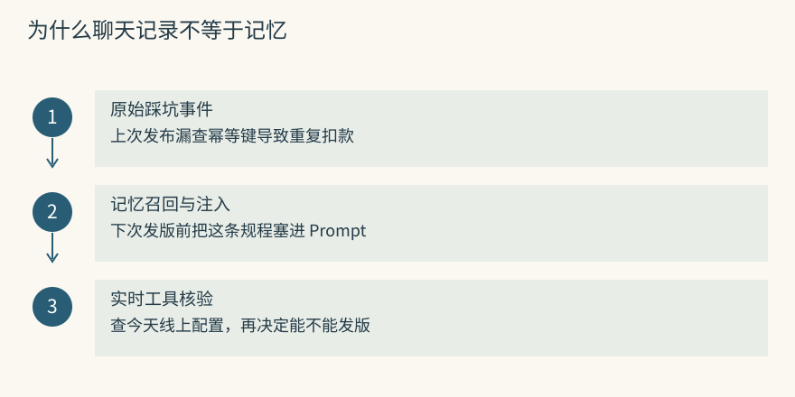
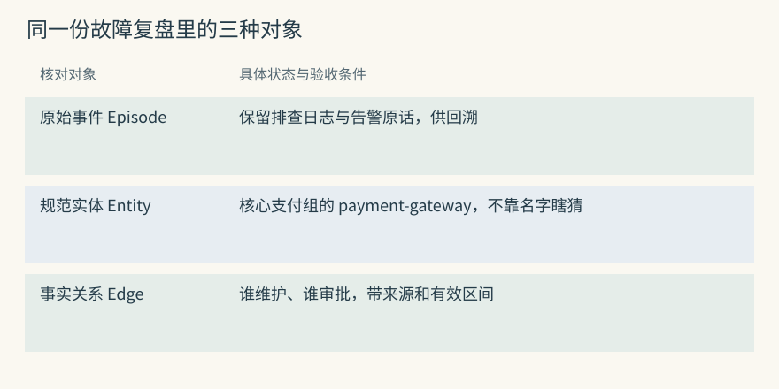
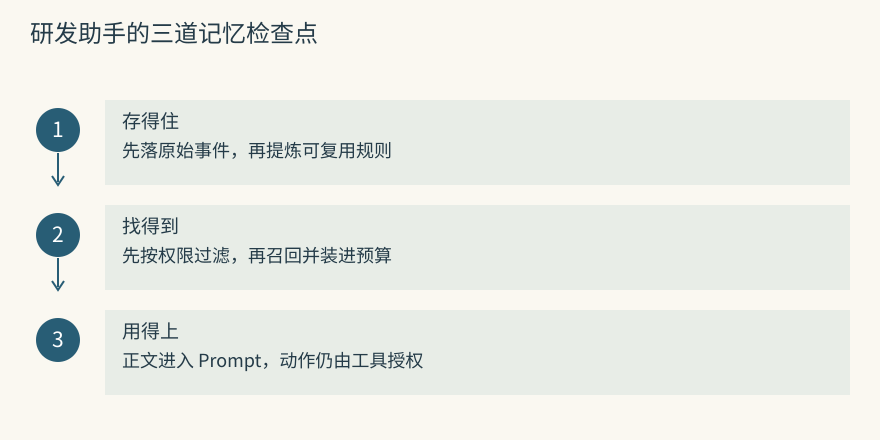

# 前言：记忆不是聊天记录

> **阅读约定与事实边界**：本书全部源码分析与链接锚定于 **2026 年 11 月 21 日** 同步的仓库快照（覆盖 11 个活跃上游项目的最新提交，以及 5 个停更/归档项目的保留快照）。贯穿全书的“工程研发助手”对话、服务名和事故单均为便于推演的技术示例；文中会明确区分开源本地库实际交付的能力、托管云产品的扩展能力，以及需要业务宿主自己补齐的认证、组装与执行边界。

## 2026 年 11 月重编导读：过去两个月记忆生态发生了什么

如果你之前翻过 2026 年 9 月的旧版草稿，这轮重编不仅把原本生硬的虚构剧本全部换成了开发者每天都会碰到的研发工程场景，还同步吸收了 2026 年 9 月底至 11 月 21 日这短短两个月里，Agent Memory 开源生态最值得关注的五项真实变化：

1. **Mem0：托管侧补出结构化画像与“后台做梦巩固”，开源与商业边界更清晰**
   - Python SDK 在 `v2.2.x` 补齐了按 JSON Schema 异步维护的 **User Profiles**（`get_profile()` / `generate_profile()`）和防重复提交的 `Idempotency-Key`；托管 Pro/Enterprise 侧推出了后台异步巩固引擎 **Dream**，专门用来合并重复事实、提炼高层模式并把过时信息标成 `superseded`。
   - 与此同时，核查 `2026-11-18` 的开源主仓（`fff8a6472512`）可见：本地同步 OSS 核心依然是 **ADD-only 批量追加 + 语义池内加分**。同期官方也针对作用域隔离漏洞（如 `CVE-2026-116575`）发了安全补丁（要求升级 Python SDK ≥ `2.0.18`、TS SDK ≥ `3.1.6`）。换句话说，用开源版时，长期治理与权限边界仍得自己抓牢。
2. **Graphiti / Zep：进入 `v0.31.x`，引入一等公民 `SagaNode` 并修复删源摘要重建**
   - `v0.31.2+`（本书同步至 `2026-11-20` 提交 `9b8a46300920`）新增了 **`SagaNode`** 与叙事汇总能力，把连续多段 episode 卷成主线；参考 MCP 和 REST 服务默认收紧为仅监听 `localhost`；更重要的是，我们在最新源码里核实到 **`remove_episode()` 已经升级**——不再粗暴只看 `episodes[0]`，而是保留被其他 episode 共同支持的边，并对存活实体自动重算 `summary`。
3. **Letta：旧 Python 服务端彻底退役，`Letta Code` 成为唯一主战场**
   - 旧仓 `letta-ai/letta` 已归档，主线全面收敛到基于 Git-backed Markdown 的 **`letta-code`（MemFS）**。10—11 月间沿 `v0.33 → v0.34.x`（同步至 `2026-11-21` 提交 `76428c1b0ee7`）密集补齐了多子 Agent 并发的 **worktree 隔离**、会话级 `client_skills` 冻结、压缩摘要遥测与工具溢出脱敏。
4. **Cognee 与 MemOS：一个加固企业安全，一个从供应链事故中警醒**
   - **Cognee** 在 `v1.6.8+`（同步至 `2026-11-20` 提交 `1961133d0c68`）默认拦截外部 HTTP URL、裸数据库连接串与服务器本地路径（防 SSRF 和凭据泄露），并新增异步 embedding worker 与混合查询分解。
   - **MemOS** 在 2026 年 9 月底经历过一起严重的 PyPI / npm 供应链投毒事件（恶意 `MemoryOS v2.0.34` 及插件包），随后团队开展全面审计并在 **`v2.0.36`**（同步至 `2026-11-09` 提交 `3a16e5fe3048`）修复了 PostgreSQL 图对齐与限流等问题。引入任何记忆依赖前，核验洁净版本与包哈希已成为必做项。
5. **工程周边与模块化加速**：`mcp-memory-service` 发布 **`v13.0.0`**（补齐 Cloudflare 每 store 凭据隔离、防跨库哈希覆盖与 `as_of` 历史过滤）；`hippo-memory` 演进到 **`v3.12.0`**（彻底模块化重构 `src/entry/` 与 `src/domain/`，并补出带 `asOf` 的多跳图召回）；`hermes-jev-skills` 发布 **`0.25.3`**（扩展到 13 项轻量判别技能与网页注入筛查）。而 `A-MEM`、`Memobase`、`MemoryOS` 三个项目截至 11 月仍处于停滞状态，适合学思想，不适合直接当生产依赖。

---

## 从一个总忘事的研发助手开始

先看一个每天都在团队里上演的真实痛点。

上周二，开发者林远让研发助手帮忙准备 `payment-gateway`（支付网关）的发布清单。助手顺手生成了命令，结果上线后踩了个大坑：新版本改了重试超时，却忘了同步核对幂等键（`idempotency_key`）的有效窗口，导致一批超时请求重复扣款。复盘会上，团队定下一条铁律：

> “以后只要发 `payment-gateway`，上线前必须先查一遍 `idempotency_key` 配置有没有覆盖最大重试窗口。”

结果这周二，林远新开了一个对话窗口：“帮我发一下 `payment-gateway` 的 v2.14。”

如果你的助手只是把上周的聊天记录存进了数据库日志里，而今天发给大模型的 Prompt 里只有林远刚才那句话，会发生什么？**大模型依然会直接给出发布命令，把上周的血泪教训原封不动再踩一遍。**

大语言模型本质上是一个无状态函数：你这一次塞进上下文窗口什么文字，它就只看得见什么文字。后台落盘了多少 G 的历史日志，跟“模型这一轮做决策时有没有读到那条教训”，完全是两码事。

一个真正管用的记忆系统，至少要把三件事串成闭环：
1. **留得住**：把值得复用的规程、偏好和教训提炼出来，和原始上下文一起存稳；
2. **找得准**：下次遇到 `payment-gateway` 发版时，在权限允许的范围内把那条幂等键检查规则精准捞出来，塞进当前 Prompt；
3. **分得清边界**：如果林远今天顺嘴补了一句“今天演示环境只跑 `dry-run`，不要真发版”，系统得知道这只是**今天这一次任务的例外**，千万别把它存成“以后永远禁止发布 `payment-gateway`”。

源码与边界：Mem0 与 Graphiti 怎么走通第一步（选读）

### 在 Mem0 里：事故教训变成可搜索的短事实

应用先在自己的业务库里留住原始事故复盘 `release-14`（同时筛掉密钥、Token 等敏感字段），再把整理好的消息交给 `add()`。Mem0 会调用抽取模型提炼短事实——理想情况下要保住“发版前”“覆盖重试窗口”这两个关键限定词，而不是缩水成一句空泛的“注意支付网关配置”。

等下周发版时，应用再调 `search()` 把这条短事实搜出来，把里面的 `memory` 正文（而不只是记录 ID！）拼进发给回答模型的 Prompt 里。注意：抽事实的模型和回答问题的模型即使配置成同一个型号，也是两次独立调用；而且搜到规则后，真正去线上查配置的工具还得由宿主程序去调。

### 在 Graphiti 里：教训和归属变成有来源的关系边

如果问题变成“发 `payment-gateway` 找谁终审？”，单条短事实可能分散在两份文档里：一份写着 `payment-gateway` 归基础交易组维护，另一份写着基础交易组的生产发布由老李终审。

Graphiti 把每份输入存成 `EpisodicNode`（原始材料），从中抽取出实体节点（服务、团队、人员）并统一归并成规范 UUID，再连出带有效时间的关系边（`EntityEdge`）。这样回答“找谁审批”时，应用就能顺着服务找到团队、再找到审批人，并顺着 `episodes` 字段回查原始文档核对细节。

## 读这本书之前，你需要知道什么

你不需要懂深度学习推导，也不需要提前买一堆大模型 API 额度或 GPU：
- **Agent** 在本书里很朴素：就是一个围绕大模型转的程序循环——接任务、拼上下文、调工具、看返回、决定下一步。
- **上下文窗口与 Token**：模型一次能吞下的所有系统提示、历史消息、记忆片段和工具结果都在这一个窗口里。就算模型号称支持 100 万 Token，每轮把过去半年的聊天记录和构建日志全量重发，账单、延迟和注意力干扰也会立刻失控。
- **动手门槛极低**：第 4 章的最小实现 [mini_memory.py](../../examples/mini_memory.py) 只用 300 行 Python 标准库 + SQLite，零外部依赖，本地终端直接能跑通持久写入、用户隔离、版本替代和 Token 预算。

读任何开源记忆项目时，最容易踩的第一个坑就是**搞混不同对象的身份**。比如在 Mem0 里，记录 ID 只是定位句柄，真正能让模型看懂的是 `memory` 正文；在 Graphiti 里，原始材料（Episode）、规范实体（Entity）和关系边（Edge）是三种完全不同的东西——拿材料 ID 去查实体，或者把节点摘要直接当成审批证据，都会在生产环境埋雷。

源码与边界：认清不同框架里的核心对象（选读）

### Mem0 的核心对象：消息、payload 与短事实

Mem0 的向量库里存着每条事实的 embedding 和 payload：`data` 字段放事实正文，同时还有 `hash`、`text_lemmatized` 和业务自己塞进去的 `metadata`（比如事故单号 `release-14`）。搜索返回给你的 `memory` 是文本正文，宿主必须把正文和必要的出处一起写进 Prompt，别只把 ID 和分数丢给模型。

### Graphiti 的核心对象：Episode、Entity 与 Edge

一份复盘文档落盘成 `EpisodicNode`，里面的 `payment-gateway` 和基础交易组解析成带规范 UUID 的 `EntityNode`，“归属”和“审批”连成带时间区间的 `EntityEdge`。UUID 才是对象真身，名字只是给人看的标签——不同业务线完全可能同时存在叫 `billing-api` 的服务，光看名字合并必出事故。

## 先在纸上把两条核心路线走一遍

在急着装任何框架之前，先拿三段真实研发资料在脑子里过一遍流程：
- **复盘记录**：`payment-gateway` 上次发版漏查 `idempotency_key` 导致重复扣款，以后发版前必查。
- **团队归属**：`payment-gateway` 归基础交易组维护。
- **审批通知**：基础交易组生产发布从 11 月 1 日起改由老李终审（之前是老张），但通知 11 月 4 日才录入。

你会立刻发现两条路线的发力点完全不同：
- **事实路线（以 Mem0 为代表）**：擅长把分散对话拆成独立短事实卡片。重点要防两件事——一是抽取时别把“发版前”“覆盖重试窗口”等条件压丢了；二是检索时别被底层的候选池边界把精确错误码 `PAY-409` 漏在门外。
- **关系与时间路线（以 Graphiti 为代表）**：擅长把跨文档的对象连成链，并给每条关系挂上“现实何时生效”和“系统何时知道”两根时间轴。重点要防两件事——一是同名服务别合错 UUID；二是查 11 月 2 日的历史状态时，要分清是在问“那天现实中该找谁”，还是“那天助手为什么找了老张”。

贯穿全书，我们会沿着 **“发现真实痛点 → 拆透底层原理 → 扒开真实源码核对边界 → 动手验证”** 的节奏推进。Mem0 和 Graphiti 会作为两条主参照系贯穿绝大多数章节，你可以在每章的折叠区里随时核对它们的真实函数入口（如 [Mem0 主模块](../../sources/repos/mem0/mem0/memory/main.py) 与 [Graphiti 主模块](../../sources/repos/graphiti/graphiti_core/graphiti.py)），不用被营销文案牵着鼻子走。

全书资料索引与三条阅读路线（选读）

## 本书拆解的 16 个项目与 11 篇论文

全书覆盖 16 个开源仓库（11 个已同步至 2026 年 11 月最新提交，5 个停滞/归档仓保留用于机制与迁移对照）和 11 篇核心论文：

| 项目 | 重点观察的机制 | 主要对应章节 |
|---|---|---|
| MemGPT / 历史 Letta | 有限窗口里的主动换入与虚拟上下文思想 | [原生记忆](08-agent-native.md) |
| Letta Code | Git-backed MemFS、worktree 隔离与编译生效 | [原生记忆](08-agent-native.md) |
| Mem0 | ADD-only 批量事实写入、语义池内加分、托管 Profile/Dream | [事实与画像](10-fact-profile.md) |
| Memobase | Buffer/Flush 批处理与直接读取用户画像 | [事实与画像](10-fact-profile.md) |
| Graphiti | Episode、实体消歧、双时间边、SagaNode 与删源重建 | [图谱路线](11-graph.md) |
| Cognee | 多模态 Schema 管线、检索路由与 v1.6.8 SSRF 防护 | [图谱路线](11-graph.md) |
| HippoRAG | OpenIE 短语图 + PPR 多跳段落传播 | [图谱路线](11-graph.md) |
| MemoryOS | 短/中/长期三层页搬运与热度提升 | [生命周期与 OS](12-memory-os.md) |
| MemOS | Plaintext / KV / LoRA 多形态容器与调度队列 | [生命周期与 OS](12-memory-os.md) |
| Hippo Memory | 半衰期衰减、outcome 反馈、sleep 巩固与图召回 | [生命周期与 OS](12-memory-os.md) |
| A-MEM | 笔记描述与邻接关系的动态演化 | [生命周期与 OS](12-memory-os.md) |
| Basic Memory | 人类可编辑 Markdown 作为权威真相源 | [工程接入](13-integration.md) |
| MCP Memory Service | 跨客户端 MCP 存取、混合并集检索与 v13.0 存储隔离 | [工程接入](13-integration.md) |
| Agent Beacon | 跨 20+ 宿主的标准化工具动作 Trace 采集 | [工程接入](13-integration.md) |
| TencentDB Agent Memory | 团队多租户 ACL、Loadout、L0~L3 分层与 Proxy 接入 | [工程接入](13-integration.md) |
| Hermes Jev Skills | 检索后的轻量化相关性/防注入/充分性判别闸门 | [Jev 判别门控](16-jev.md) |

## 三条推荐读法

- **急着选型或做方案评审**：按 `前言 → 01 → 05（重点看候选并集 vs 池内加分）→ 06（双时间轴）→ 09 → 10/11/13 按需看 → 15 → 17` 速通。
- **打算自己动手写轻量记忆层**：顺序读 `01 ~ 08`，第 4 章亲手跑完 `mini_memory.py`，再结合 `14` 和 `15` 补齐回归测试与多租户安全防线。
- **线上排障或翻源码研究**：直接用右上角搜索页搜关键词（如 `ADD-only`、`rank_const`、`invalid_at`、`MemFS`），或从 [源码与论文索引](appendix-sources.md) 顺着函数名直接定位。

## 动手检查

研发助手把上周的复盘原话存进了数据库，这周发版时却只把用户的新请求发给了模型；修复后，它把复盘搜出来了，却只把记录 ID `mem_8912` 塞进了 Prompt。这两次分别缺了哪一步？

答案提示：第一次缺了“检索并注入当前上下文”这一步，光落盘不参与调用等于没记住；第二次虽然搜到了，却没把可读的正文和来源交给模型。再往前想一步：就算模型真的读到了“发版前核对幂等键”的正文，也不代表今天线上配置就一定没问题——还得由宿主调用实时配置查询工具去核验。

<figure class="concept-diagram" tabindex="0"><figcaption>图：判断记忆系统有没有生效，必须把存盘、召回注入和业务核验三道关分开检查。</figcaption></figure>

项目对照速查（选读）

## 本章对照结论

| 研发助手的真实痛点 | 优先核对的开源路线 | 重点验收什么 | 必须由宿主自己补齐的责任 |
|---|---|---|---|
| 每轮稳定记住个人偏好（中文、先给 diff） | Memobase、Mem0、Letta Code、MemoryOS | 偏好是否无需碰运气就能稳定进 Prompt | 本轮对话的临时例外优先覆盖长期默认 |
| 跨文档查服务归属与发布终审人 | Graphiti、HippoRAG、Cognee、Basic Memory | 中间团队节点是否同一实体、原文能否回查 | 核对审批用途与生效日期，不把旧边当授权 |
| 长期积累几十次事故复盘，防止记忆发臭 | Hippo Memory、MCP、A-MEM、MemoryOS | 巩固到底改了内容、权重还是组织层级 | 保护低频高危规程，保留反例与回滚入口 |
| 多团队共用一套研发助手与知识库 | TencentDB、MCP Memory Service、Basic、MemOS | 租户身份、资产版本与撤权边界 | 服务端统一认证与最终 Prompt 组装 |
| 把排障轨迹沉淀成可复用发布检查流程 | Agent Beacon、Letta Code、Hermes Jev | 采集、判别、审核与执行是否职责分离 | 所有写操作和生产发布由确定性工具授权 |

