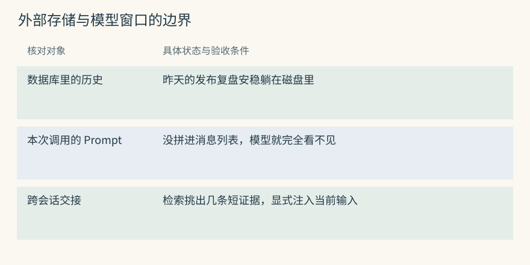
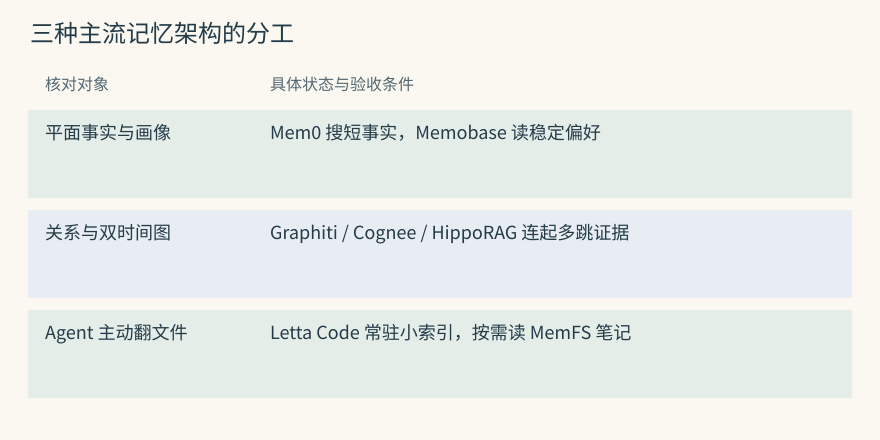
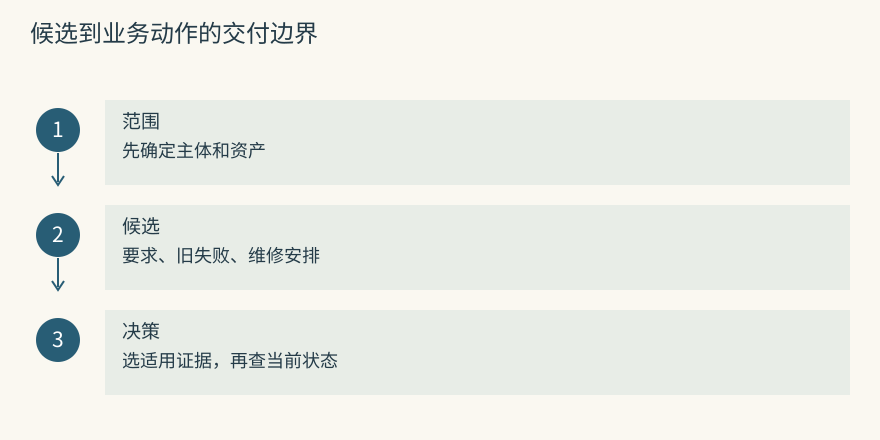
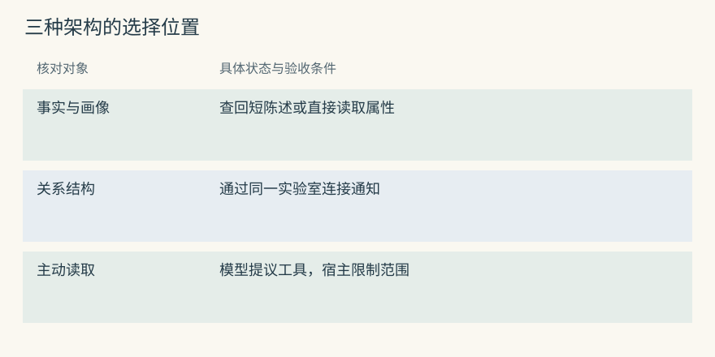
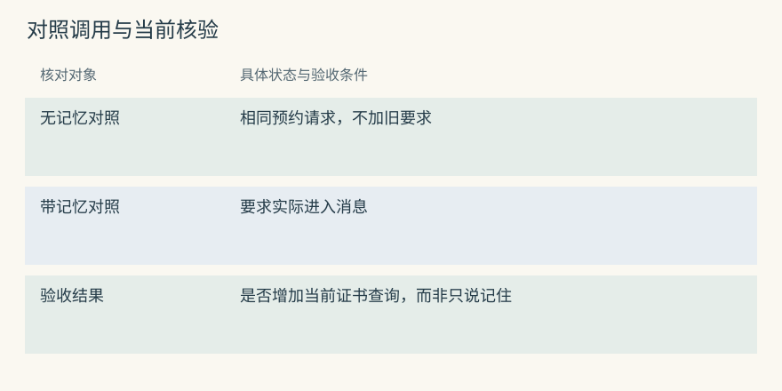

# 统一心智模型

## 模型为什么没有自动记住上次对话

陈禾昨天问过 S7 的预约条件，管理员提醒证书必须覆盖实验当天。今天应用发给模型的输入只有“把 S7 约到下周三”。如果昨天的提醒没有出现在这次输入里，回答模型就无法将它作为本次经历的证据。日志服务器是否保留了昨日会话，与这一次模型读到了什么，是两件可以独立检查的事。

把提醒再加入输入，无须重新训练模型，就可能改变任务计划。模型原本准备查询空闲时段，现在还会提出查询证书的步骤。记忆系统提供的就是这种跨调用的信息交接：保存可复用状态，再根据任务选择少量内容交付。外部存储能容纳大量资料，当前窗口仍只包含这一次实际发送的文本。

对 Mem0 而言，记录存在不代表搜索已发生；搜索返回不代表宿主已经注入。对 Graphiti 而言，S7 的管理关系即便在图里可见，也得被读取和转换为证据才能参与回答。两套系统都不会仅因初始化成功，就让回答模型主动拥有整座数据库。

<details class="source-example">
<summary>源码与边界（选读）</summary>



### Mem0：外部状态通过 search 回到输入

`Memory` 的配置连接提取模型、embedding 服务、事实后端和历史数据库。`add()` 改变这些外部组件保存的状态，不改变预约助手所用基础模型的参数。即便关闭服务再启动，能够读回短事实，也只证明持久存储有效。

假设 `search()` 带回记录 C8，正文为“提交 S7 预约前核对实验日的校准有效期”。宿主需要提取正文，附上适用范围和来源，再构造下一次调用。`history()` 用于检查某条事实的变化，它不会自动把整份历史追加给回答模型。排障时应直接查看最终消息里是否有 C8 的正文，而不是只看数据库中的条目。

### Graphiti：图也在模型窗口之外

图后端 driver 负责读写，LLM client 负责请求抽取等模型工作，embedder 提供检索向量。三种依赖各自改变数据流的一段，不能把它们理解为一组已接管预约业务的智能体。

`add_episode()` 保存原材料并派生实体与边；基础 `search()` 返回事实边。宿主可从边的 `fact` 读取“S7 由北校区光学实验室管理”，再按 `episodes` 核对来源。回答模型能使用的是交付的这些证据，而不是图中其余未被查询的节点。图很大与输入很长没有直接对应关系。

</details>

<a id="让一条发布教训走完整个过程"></a>

## 一次预约退回怎样成为可复用的要求

第一次申请被退回时，应用收到以下教学材料：

```text
事件编号：booking-14
申请：陈禾预约 S7，实验日为 11 月 6 日
服务结果：证书到期日 10 月 31 日，申请未提交
管理员说明：以后提交前，检查证书是否覆盖实验日
```

捕获阶段应保存服务结果和管理员原话，并标明各自来自哪里。Agent Beacon 这类采集工具可以统一动作事件，但“服务拒绝申请”还不能直接变成“仪器发生故障”。编码阶段才从材料提出可复用要求，且保留检查时机和日期条件。

组织阶段将要求归到 S7 预约流程，而把这一次的退回保留为事件。存储阶段既要能找回短事实，也要有稳定入口回看材料。若某条信息只适用于陈禾的个人安排，就不能因仪器相同而进入全校共享规程。作用域是数据访问和业务解释的一部分，不能只靠正文里写一个姓名。

Mem0 可形成候选“预约 S7 前检查证书覆盖实验日”，应用保存其事件来源。Graphiti 可以留住退回通知，再分别表达本次申请结果与长期检查要求。两者都应把“管理员报告”与“服务观测”区别开，后来纠正时才能定位受影响的结论。

<details class="source-example">
<summary>源码与边界（选读）</summary>



### Mem0：一段事件会分成消息记录与事实 payload

新消息若只有“下次也查一下”，需要上下文才能知道查什么。当前实现给提取器提供同范围最近十条消息和最多十条相关旧事实。它们帮助解释指代，却只是有限的观察范围，不能保证所有相关历史都已读到。

`_add_to_vector_store()` 中，提取结果的 `text` 会成为 payload 中的 `data`，随后还会生成 hash 和词形化文本等字段。消息保存与事实写入不是同一个对象。要追溯 `booking-14` 的实际返回码，应用应维护源事件映射；只有一条短事实时，无法从“检查证书”重建那次接口的完整请求和结果。

### Graphiti：实体身份决定边接到哪里

原通知被表示为 `EpisodicNode`。抽取器先发现 S7、实验室和申请等对象，实体解析再决定它们对应的已有 UUID。`extract_nodes()` 与 `resolve_extracted_nodes()` 之间的身份核对，决定了后面的关系连到谁。

假设抽取临时节点 X，解析结果是北校区资产 I7。边的端点会随映射改成 I7。若实际通知来自南校区，语句即便正确，图仍会把证书问题归给另一台仪器。核验顺序宜从材料中的校区和资产号开始，再检查端点，最后读关系正文；只看自然语言是否通顺，会漏掉这种错误。

</details>

<a id="第二次发布-先找-再读-再做"></a>

## 再次预约时如何交付历史证据

陈禾再次发起预约。应用从认证会话拿到学生身份，从仪器目录确认资产 I7，再限定可读资料。搜索得到的结果叫候选：它们可能相关，但还不都适合送入当前输入。假设其中有预约要求、上次失败和一份无关的维修安排，宿主要选择支持本次提交的内容。

一份可用的输入交接可以写为：

```text
资料：仪器室预约要求，来源 booking-14
要求：提交 S7 申请前，核验证书覆盖实验日期。
历史：上次申请因证书在实验前到期而退回。
当前：陈禾拟约 11 月 6 日，今天的证书状态尚未读取。
```

这里让模型知道哪部分讲过去，哪部分要求现在检查，哪部分仍未知。随后证书工具若返回 12 月 20 日到期，就满足本次日期条件；若只到 10 月 31 日，则应请求校准或改期。记录没有替代工具查询，也没有代表仪器室接受申请。

Mem0 返回正确事实后，宿主才能要求助手先查证书。Graphiti 查到复核人关系后，助手只能知道去找谁，不能将一条历史职责关系当成本次批准。一次预约的成功，应落在实际请求和结果上验证。

<details class="source-example">
<summary>源码与边界（选读）</summary>



### Mem0：过滤、评分、格式化之后还差一次组装

用 `filters={"user_id": "chenhe"}` 示意按用户限制搜索，但真实值应由认证结果产生。模型可以提出查询内容，不能替自己挑选另一个用户的身份。过滤限定集合，相关评分排列集合里的记录，两者目的不同。

搜索结果经过 `MemoryItem` 等格式化后，宿主取 `memory` 正文和需要的 metadata。若接口返回 C8，最终调用却只出现“找到一条相关记录”，模型仍不知道证书条件。应用应同时保存候选 ID 与最终注入 ID，以便区分搜索完成和交付完成。授权预约工具又是后续独立环节。

### Graphiti：返回的是事实边，原文需要另查

边的 `episodes` 保存材料编号，而不是已展开的全部通知。核对限定条件时，应用要按编号读取材料，检查通知是否只适用于教学演示仪器。基础 `EDGE_HYBRID_SEARCH_RRF` 配方针对边做混合搜索和名次融合，不是自动阅读所有来源。

需要节点、episode 或社区摘要时，可以使用高级 `search_()` 的相应配置。返回节点摘要不等于查到了预约规则，返回事实边也不等于读过原文。先明确预期证据单位，再决定读取路线，能避免用不相干的完整对象填满输入。

</details>

## 三种架构，就是三种放资料的方法

事实库把复用信息写成独立陈述，适合“这台仪器预约前注意什么”。Mem0 搜索短事实；Memobase 则会提前整理稳定用户属性，像语言和通知方式，可以直接按用户读取。两者都保存文字，选择发生的位置却不同。

图结构多保存一项关系：资料之间通过哪个对象相连。通知甲讲 S7 的归属，通知乙讲实验室的复核职责，查询若只围绕 S7 字面展开，容易漏掉乙。Graphiti、Cognee、HippoRAG 各自用关系支持读取，但建图语义、扩展方式和时间处理并不相同。

Agent 自管理上下文把部分选择留给模型。常驻核心只提示“S7 预约规程见仪器索引”，详细日志等需要时再打开。Letta Code 的文件视图代表这类方案。它可以减少常驻输入，也引入发现失败：模型可能不知道该开哪份笔记，或者读到摘要就提前回答。

实际接法可以组合：稳定沟通偏好直接读，证书要求按任务检索，复核职责按关系读取，当前证书状态则向业务系统查询。组合后需要一个明确的最终组装位置，防止多套插件重复注入或互相覆盖。

<details class="source-example">
<summary>源码与边界（选读）</summary>



### Mem0：实体索引没有把事实库变成时间关系图

实体索引可以为 S7 维护 `linked_memory_ids`，列出涉及它的短事实。查询提到 S7 时，这些链接可提供加分信号。该列表表达“这些记录谈过同一对象”，没有表达谁管理谁，也没有保存一条批准链的方向。

若某条卡片只说明管理实验室，仍需由应用再查实验室的复核要求。一个对象连了很多事实，并不表示基础搜索已经完成多跳。评测可以特意把复核人放在没有 S7 字样的另一份材料里，检查实际读取是否到达，而不是凭实体功能名称推断。

### Graphiti：图结构与摘要承担不同工作

实验室节点的 `summary` 可能概括设备管理和预约复核，适合作为入口。精确回答复核人时，应检查对应边的 `fact`、端点、时间和 episode。摘要若没有注明交接日期，很容易把旧人名当作当前值。

常驻核心、主动工具调用和事实图属于不同层。Graphiti 组织图状态，不负责保证每轮注入一段核心，也不负责模型何时继续查询。接入方需要决定入口节点、扩展深度和证据不足时的处理方式。把整段宿主流程归给“图会推理”，会掩盖缺失的控制逻辑。

</details>

## 记忆怎样改变一次决策

观察计划比询问“助手有没有记住”更容易得到证据。准备相同的预约请求，一份输入只有仪器和日期，另一份再加入证书检查要求。教学预期是后者增加证书查询，并按查询结果决定是否提交。这里只定义对照方法，没有声称已经测得模型行为差异。

旧事件只能提示风险。上次证书过期，不代表现在仍过期；上次申请退回，也不支持永久拒绝 S7。应把历史作为触发核验的依据，将本次工具返回作为当前状态。若证书已经续期却仍拒绝预约，说明过去和现在在决策中被混淆了。

保留事件与要求的不同角色能帮助定位问题。事件保留一次发生的事，要求说明重复任务的检查点，当前观测说明这一次是否满足条件。将三者压成“S7 校准有问题”，会让模型难以分辨该查证书、报修还是直接拒绝。

还可以加一个行为反例：用户只想查看预约页面，明确不提交。即便历史要求强调正式预约检查证书，也不应迫使演示流程实际发起申请。记忆带来的计划变化应局限于相关任务，并受当前明确意图约束。

<details class="source-example">
<summary>源码与边界（选读）</summary>



### Mem0：观察计划变化需要记录实际注入

对照时记录三份材料：搜索返回了什么，输入实际发了什么，工具真正做了什么。若 C8 已被返回却没有进入输入，错误在组装路径；若已经交付但没查询证书，继续检查模型选择和工具流程。

分数只能解释记录为什么可能被选中，无法代替行为记录。将无记忆与有记忆两份测试都固定为同一证书状态、相同授权和相同工具定义，才能把计划变化与输入差异关联起来。若一个测试使用更新后的资料而另一个没有，结果就混入了状态变化。

### Graphiti：时间事实也只提供检查依据

搜索可能同时命中“10 月申请被退回”和“预约前核对证书”，两条都相关，角色却不同。应用可以在输入中分别标成历史事件和预约要求，并给出日期、来源。复核人关系也要按实验日期或申请日期选择合适视图，具体规则由业务确定。

即便图中某关系在当前日期有效，预约是否可执行仍取决于本次证书、时段和权限。一个有效的职责事实不代表那个人已经批准。测试时同时核对事实选择和业务动作，能避免答对姓名却绕过批准的假成功。

</details>

## 动手检查

接口返回了 C8，助手仍重复提交过期证书的申请。请区分以下情况：输入没有正文；输入有正文但没查证书；查到了过期日却仍提交。

答案提示：依次对应交付缺失、计划或工具选择失败、业务执行约束失败。三者都可能在界面上呈现“又忘了”，但更换检索器只能影响其中一部分。用同一请求 ID 连接候选、输入和工具日志，才能沿链检查。

<details class="implementation-notes">
<summary>实现笔记与源码对照（选读）</summary>

## 记忆是受限上下文的控制系统

输入空间、时间和误用风险都有限。对预约助手，价值可以表现为少退回一次申请、少追问一轮资料；成本包括整理旧消息的模型调用、当前检索延迟和证据占用的 token。不能只最大化召回条数，因为无关证据会挤掉当前日期与工具结果。

```text
目标：预约完成收益，扣除读取费用、等待和错误动作损失
限制：当前身份可见、证据仍适用、来源可核对、总窗口可容纳
可调动作：何时提取、读哪类记录、展开多少来源、何时请求核实
```

| 控制位置 | 预约室中的输入与输出 | 可观察错误 |
|---|---|---|
| Capture | 服务退回、管理员消息进入事件表 | 漏事件、混淆观察与猜测 |
| Encode | 原话形成有条件的检查要求 | 日期和动词被改写 |
| Organize | 归入仪器、用户、流程与来源 | 同名资产混合 |
| Store | 保存正文、索引与版本 | 部分对象写入失败 |
| Retrieve | 受限候选成为有限证据 | 漏召回、排序或打包丢失 |
| Evolve | 根据纠正改变当前视图与价值 | 误强化或误删保护项 |

## RAG 与 Memory 的边界

仪器手册中的波长范围通常是外部知识，预约助手的经验是一次任务产生、可能改变下次操作的信息。两者可共用全文或向量索引，却有不同更新规则。新版本手册替换参数时，要按文档版本管理；陈禾改变通知偏好时，要按主体和生效范围处理。

一次退回产生的检查要求还带有观察边界：服务报告证书到期，管理员建议预约前检查。若原因后来被纠正，应能找到对应事件和派生要求。把所有内容一律切块后按余弦取前几条，不能自动回答“这条规则属于谁”“当时有效吗”“用户要求删除后还有哪些副本”。

## 三种主导架构

### 1. 平面事实库

每个短事实附主体、来源和检索字段。它适合先把预约检查、通知偏好等小而明确的内容读起来。Mem0 将选择留到查询阶段；Memobase 提前整理画像。简单结构便于观察，但当前值选择、来源链和跨材料关系往往需要外层补充。一次搜索只返回旧证书事件时，读取者仍可能误把它当当前要求。

### 2. 图或上下文图

图提前记录 S7 与实验室、人员及材料之间的联系。Graphiti 重点维护事实边、来源和时间；Cognee 根据 schema 处理异构内容；HippoRAG 将查询信号沿图传播到支持段落。建图增加了模型提取和身份解析成本。数据很少、问题都是直接查单条规程时，这些成本未必带来净收益。

### 3. Agent 自管理状态

模型通过工具选择历史，或者修订未来常驻的核心内容。MemGPT 提供有限窗口与外部存储的控制思路，Letta Code 将可编辑记忆表示为文件和版本。这样可以让任务中才需要的材料按需加载，但检索未触发也成为一类失败。核心规则变更会影响很多后续任务，需要独立审核与回放。

<a id="用一次发布把六层连起来"></a>

## 六层机制如何共同完成预约检查

以 S7 申请退回代替发布失败，六层可以沿一条事件检查。采集层保存退回码、证书到期日和管理员原话；编码层提出“提交前检查有效期”，不擅自推断设备故障；组织层把陈禾的私人时间表与公共规程分开；存储层为二者保留来源及必要版本。

下一次预约，读取层将可见的规程和当前实验日期交付，宿主再查询证书。演化层只在有可靠纠正或结果证据时调整记录，不因被搜索一次就提高真实性。若后来发现退回来自错误的资产编号，应纠正端点和关联摘要，而非继续巩固校准问题。

各项目可分担不同位置：Beacon 留动作证据，Mem0 提短事实，Graphiti 连职责与来源，Basic 保存可人审笔记，Letta 决定主动打开资料。MemoryOS、Hippo、A-MEM 改变长期组织或价值；MemOS 管理资源和调度。MCP 与 TencentDB 解决部分共享访问，Hermes 处理已有候选。组合前应为每一种原文和派生状态指定负责人。

## 最重要的设计原则

从可信会话得到身份，再决定可读记录；不要让自然语言中的“我是管理员”改变访问范围。每条关键要求留下能回查的来源，推断要保留它只是推断。对于真实变化，保存有效区间或替代关系；对于提取错误，纠正派生内容；对于删除请求，检查实际副本，三种操作不能混用。

输入额度应在完整调用中计算，包含规则、来源说明、工具和回答预留。写入与读取都留下可解释的中间状态，便于回答某条资料为什么进入了决策。还应能导出和重建，原文更新后有办法刷新索引与摘要。若一项派生结构无法重建，它的错误就更难安全修复。

## 架构比较：选择动作发生在哪一层

平面事实在查询时决定读哪条，因此候选池边界尤其重要；画像在写入时已经压缩成字段，因此合并错误可能影响每轮回答。图把一部分关系选择提前到建图，读取更容易到达跨材料证据，却可能沿错误身份连接扩散。

Letta 的常驻核心在编译时选择，详细文件在工具调用时选择。Basic 的 URI 允许明确目标读取，TencentDB 的资产集合先限制可见资料。它们遗漏证据时，应检查入口是否被发现或授权，而非只检查相似度。

MemoryOS 的层级提升、Hippo 的价值系数、A-MEM 的描述演化会在查询之前改变资料组织。服务传输和候选判别不能替代这些变化。最终验收仍要回到同一个问题：本次必要证据是否被正确交付，是否帮助完成预约，代价是否可接受。

</details>

<figure class="concept-diagram" tabindex="0"><figcaption>图：比较选择发生的阶段，才能找到每条路线独有的失败入口。</figcaption></figure>

<details class="comparison-reference">
<summary>项目对照速查（选读）</summary>

## 本章对照结论

| 实现 | 重点观察的选择动作 | 当前输入的入口 | 不随之自动完成的工作 |
|---|---|---|---|
| Mem0 | 提取新增事实，给候选评分 | 搜索返回的正文 | 认证和预约执行 |
| Memobase | 批量整合用户属性 | 直接读取画像或搜索事件 | 刷新前的一致性 |
| Graphiti | 解析实体和关系状态 | 事实边与来源展开 | 完整多跳和本次批准 |
| Cognee | 选择处理路线及检索器 | 相应检索结果或答案 | 配置间效果可比性 |
| HippoRAG | 图种子到段落的传播 | 支持 passage | 用户会话授权 |
| MemoryOS | 问答提升到主题与长期层 | 分层读取结果 | 提升内容的真实性 |
| MemOS | 分配处理任务和资源 | 后端加载或文本检索 | 模型资源兼容 |
| Hippo | 相关性结合寿命和反馈 | 有限候选集合 | 反馈可靠归因 |
| A-MEM | 修改笔记属性和连接 | 近邻及邻接笔记 | 原文与描述一致性 |
| Letta Code | 核心编译与主动读取 | 根文件、详情、历史工具 | 新规则安全评审 |
| Basic Memory | 解析明确文件结构 | URI 或关系上下文 | 并发编辑和文件保留 |
| MCP Memory Service | 服务检索与集中治理 | MCP 或 REST 结果 | 宿主最终输入组装 |
| Agent Beacon | 统一动作观察 | 下游读取事件 | 长期事实提炼 |
| TencentDB | 选择可见资产与层级 | Proxy 或工具结果 | 端到端撤销验证 |
| Hermes Jev Skills | 判断已有候选 | 被选 ID 回映射正文 | 持久事实库 |
| MemGPT / 历史 Letta | 模型发起外部读写 | 工具返回填入窗口 | 当前文件协议兼容 |

</details>
