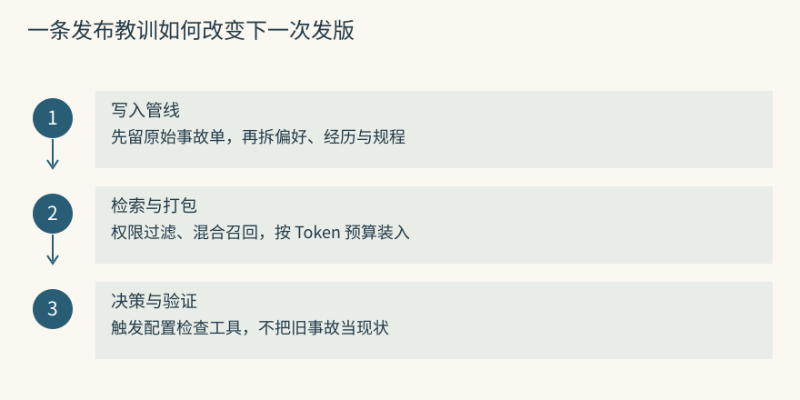

# 统一心智模型

## 模型为什么不会自动记住昨天的对话

昨天林远在终端里踩过一次坑，和助手聊了半小时，最后敲定“发 `payment-gateway` 前必须核对 `idempotency_key`”。今天林远新开会话说：“准备发 `payment-gateway` v2.14。”

如果应用程序发给大模型的 `messages` 数组里只有这一句话，模型就完全不知道昨天的事。哪怕你的 PostgreSQL 里完整躺着昨天的聊天日志，只要宿主程序没把相关内容挑出来塞进本次请求的上下文，大模型眼里它就不存在。

把那条教训拼进今天的 Prompt，**不需要微调模型权重**，模型的行为立刻就会变：原本它只会直接生成发布脚本，现在它会先提议调用配置检查工具。这就是 Agent Memory 最底层的本质——**一套架在无状态模型外面的“持久状态 + 按需筛选 + 注入上下文”控制系统**。

这个底层事实对所有框架一视同仁：
- 对 **Mem0** 来说，`add()` 写进向量库不代表下次会自动 `search()`；`search()` 返回了候选列表，也不代表宿主已经把正文拼进了 Prompt。
- 对 **Graphiti** 来说，图数据库里连好了“服务 → 团队 → 审批人”的边，只要这一轮没查、没转成文本塞给模型，图再大也帮不上忙。

<details class="source-example">
<summary>源码与边界：外部状态怎样回到本次调用（选读）</summary>


### Mem0：通过 search 把外部卡片带回 Prompt

Mem0 的 `Memory` 实例背后挂着抽取 LLM、embedding 模型、向量库和 SQLite 历史表。`add()` 改变的是这些外部存储，重启进程还能读到，证明的是磁盘持久化，不是模型变聪明了。

等 `search()` 返回候选卡片后，宿主得自己把 `memory` 正文连同出处拼进下一轮消息。`history()` 用来查某条卡片的修改轨迹，绝不会自动塞给回答模型。线上遇到“助手又忘了”，第一步永远是看**最终发给模型的完整 Prompt 日志**里到底有没有那段文字，而不是只看数据库里有没有这行记录。

### Graphiti：图库也在模型窗口之外

Graphiti 把图数据库 driver、抽取 LLM 和 embedder 组装在一起。`add_episode()` 负责建节点连边，基础 `search()` 返回的是事实边（`EntityEdge`）。宿主拿到边的 `fact` 和 `episodes` 引用后，自己决定要不要展开原文、怎么拼进上下文。图里有十万个节点，模型这一轮能用的也只有你真正塞进去的那几百个 Token。

</details>

## 一条发布教训走完整个生命周期

来看看一次真实的发版事故，是怎么一步步变成可复用记忆的：

```text
事故单：release-14
任务：林远发布 payment-gateway v2.13
工具观测：上线 5 分钟后触发 PAY-409 重复扣款，重试窗口 60s 大于幂等键 TTL 30s
复盘结论：以后发布 payment-gateway 前，必须核对 idempotency_key TTL >= 重试窗口
```

把这条教训管好，需要经过六个环节，每个环节都有各自容易翻车的坑：

1. **捕获（Capture）**：先原样留住工具日志、报错码和人工复盘结论，并标清谁说的。像 Agent Beacon 这类采集器能忠实记录工具报错，但千万别把“接口返回 500”直接脑补成“数据库挂了”。
2. **编码（Encode）**：从长复盘里提炼出短而准的规则，**保住限定词**（哪个服务、发版前还是发版后、TTL 与重试窗口的关系）。
3. **组织（Organize）**：把“发版前查幂等键”归进 `payment-gateway` 的团队共享规程，把“林远习惯先看 diff”归进林远的个人偏好，把 `release-14` 本身留作可回溯的历史事件——作用域千万别混在一起。
4. **存储（Store）**：正文、检索索引、版本和来源映射各就各位，出问题能追回原事故单。
5. **检索与组装（Retrieve & Pack）**：下次发版时，先按服务端认证的身份和项目权限圈定可读范围，再召回、排序、按剩余 Token 预算塞进 Prompt。
6. **演化（Evolve）**：以后架构升级取消了旧参数，或者发现某条复盘猜错了根因，要有办法关闭旧规则、修正派生摘要，而不是让错误记忆越用越顽固。

<details class="source-example">
<summary>源码与边界：一条事故在 Mem0 和 Graphiti 里长什么样（选读）</summary>

### Mem0：原始消息与短事实分家存放

当林远只说一句“下次发版也记得查一下”时，抽取模型需要结合上下文才能补全主语。Mem0 同步写入默认会拉取同范围最近 10 条消息和最多 10 条相关旧事实给抽取 Prompt 参考——这能解决近期指代，但并不是扫描全库历史。

在 `_add_to_vector_store()` 里，抽取出的 `text` 会作为 `data` 存进向量库 payload，连带生成 `hash` 和词形化字段；而消息记录落在另一个历史库里。如果你想从一条短事实反查 `release-14` 的完整报错堆栈，必须由应用自己在 `metadata` 里挂上事故单 ID。

### Graphiti：先定实体真身，再连关系边

Graphiti 先把复盘文档构造成 `EpisodicNode`，再走 `extract_nodes()` 和 `resolve_extracted_nodes()`，把文本里的“支付网关”归并到已有的规范节点 UUID 上。这一步直接决定了后面所有的边连向谁：如果把核心支付组和大客户组的同名服务合错了节点，就算关系的自然语言写得再流畅，整条检查链也会串台。

</details>

## 第二次发版：先找、再读、再查当前状态

一周后林远发起新发版。宿主程序先从可信登录态拿到身份（`linyuan`）和当前仓库（`payment-gateway`），去记忆层拉回候选，挑出和发版强相关的内容，拼成一段边界清晰的上下文交接给模型：

```text
[历史规程 | 来源 release-14]
发布 payment-gateway 前，必须核对 idempotency_key TTL 是否覆盖最大重试窗口。

[历史事件 | 上周二]
v2.13 曾因 TTL(30s) < 重试窗口(60s) 引发 PAY-409 重复扣款。

[当前状态 | 待工具核验]
本次准备发布 v2.14，当前线上配置尚未读取。
```

这段话最关键的设计在于**把“历史经验”和“当前现状”划开**：
- 记忆只负责提醒模型“发版前该去查哪项配置”；
- 今天线上到底配的是 30s 还是 120s，必须靠宿主调用实时配置读取工具来确认。如果工具查回来今天已经改成 120s，就正常放行；如果还是 30s，就在发版前拦住。

千万不要让助手因为“上次出过事故”，就不管今天有没有修好一律拒绝发版；更不要因为林远今天只是在测试环境跑个 `dry-run` 演示，就拿正式发版规程卡死他。

## 三种主流架构，本质是把“选择”放在不同地方

市面上十几个记忆项目看着眼花缭乱，扒掉概念外壳，核心架构其实就三条路：

1. **平面事实库 / 画像库**（Mem0、Memobase）
   - 把经验存成一条条独立短事实（Mem0），或者提前归并成结构化用户属性字段（Memobase）。
   - 优点是上手快、好排查；短板是跨文档多跳关联和复杂历史版本得靠外层自己补。
2. **知识图谱 / 上下文图**（Graphiti、Cognee、HippoRAG）
   - 提前在写入或索引阶段把实体和关系连起来，靠图结构把两份字面不挨着的文档串成证据链（比如“服务 → 团队 → 终审人”），Graphiti 更是直接把双时间轴挂到了边上。
   - 优点是擅长多跳追踪和状态演进；短板是建图贵、消歧怕合错、图库运维成本高。
3. **Agent 原生自管理上下文**（MemGPT 思想、Letta Code 的 MemFS）
   - 不靠黑盒向量检索每轮硬塞，而是让一小份精简索引常驻 System Prompt，详细笔记和历史对话全存在文件系统（或外部库）里，由模型自己判断缺什么、自己调工具翻文件，甚至自己改写未来的记忆文件。
   - 优点是透明、人类可读、可用 Git 审计回滚；短板是引入了新的失败模式——**模型可能根本忘了去翻笔记**。

真实工程里，这三条路完全可以混搭：个人偏好直接读稳定字段，发布规程按任务检索，审批链查关系图，当前配置查实时业务接口——只要最后收敛到**唯一一个上下文组装器**统一控预算、去重就行。

<details class="source-example">
<summary>源码与边界：三种架构最容易被误解的边界（选读）</summary>


### Mem0 的实体索引 ≠ 关系图谱

Mem0 会给实体维护 `linked_memory_ids` 列表，方便在搜到 `payment-gateway` 时给相关卡片加分。但它只表达“这几张卡片提过同一个词”，**没有关系方向，也没有谓词语义**，更不会自动完成“服务 → 团队 → 审批人”的多跳查询。

### Graphiti 的节点摘要 ≠ 完整事实证据

Graphiti 的实体节点自带 `summary`，适合用来做粗略导航；但要精准回答“11 月 2 日谁审批发布”，必须去查具体 `EntityEdge` 的 `fact`、端点和有效区间，必要时再沿 `episodes` 读原文。不要把一段没有日期的摘要直接当成审批凭证。

</details>

## 怎么证明记忆真的改变了决策

判断记忆系统有没有用，别问大模型“你记住了吗”——它嘴上永远会客气地回答“我记住了”。

唯一靠谱的办法是**对照实验**：给模型发一模一样的发布请求、绑定一模一样的线上配置工具返回：
- **对照组（无记忆）**：不注入历史规程，看模型是不是直接生成发布命令；
- **实验组（带记忆）**：把 `release-14` 规程注入 Prompt，看模型是不是真的先发起了配置检查工具调用，并且在查到 `TTL < 重试窗口` 时主动停下来提醒。

如果实验组里模型没检查配置，别急着骂模型笨或换向量库，按顺序查三份日志：
1. 记忆库搜到 `release-14` 了吗？（没搜到 → 查写入/检索）
2. 宿主真的把正文拼进最终 Prompt 了吗？（没拼进去 → 查组装/预算）
3. Prompt 里明明有正文，模型为什么没调工具？（查提示词优先级、工具定义或模型能力）

<details class="implementation-notes">
<summary>实现笔记：记忆控制系统与 RAG 的分界（选读）</summary>

## 为什么传统静态 RAG 搞不定 Agent 记忆

RAG 和 Memory 可以共用向量库和 BM25，但它们面对的世界完全不同：
- **RAG 面对静态知识库**（API 手册、架构 Wiki）：文档更新低频，不随每个用户、每次对话实时翻转，也很少出现“今天演示别提交，以后照常提交”这种时效混杂。
- **Memory 面对动态运行态**：数据按用户/团队强隔离；同一主题的事实会随时间失效、被替代、被纠错；还要支持按隐私合规要求连带清理所有派生副本。

把所有聊天记录一股脑切块扔进向量库按余弦取 Top-5，永远回答不了“这条规则归谁管”“当时生没生效”“用户删号后摘要里还有没有残留”。

## 记忆系统的收益与代价公式

把记忆当成一个受限上下文的控制系统来看，目标很清楚：

```text
净收益 = 少踩的坑 + 少追问的轮次 - (写入抽取开销 + 检索延迟 + Token 账单 + 误召回造成的误操作)
硬约束 = 身份权限隔离 + 事实在目标时间有效 + 来源可回查 + 总长度不超窗口预算
```

| 链路环节 | 研发助手里的具体动作 | 最常见的真实故障 |
|---|---|---|
| Capture | 事故单、CI 日志、群通知先落盘 | 没先存原件，抽取超时导致输入永久丢失 |
| Encode | 从复盘里拆出偏好、经历与规程 | 把“怀疑”抽成“确认”，或把“仅本次”压成“永久” |
| Organize | 区分个人偏好、项目规程与临时任务 | 同名服务串台、私人草稿混进团队共享库 |
| Store | 写正文、向量、全文、图边与历史 | 多后端部分成功，主库有数据索引里没有 |
| Retrieve | 权限过滤 → 多路召回 → 排序 → 预算打包 | 池外漏召回、长文本被预算悄悄挤掉 |
| Evolve | 合并重复、替代旧版、衰减降权、物理删除 | 误召回自我强化、低频高危规程被误淘汰 |

</details>

## 动手检查

日志显示检索接口成功返回了 `release-14` 的幂等键检查规则，但研发助手还是直接把有缺陷的版本发到了测试环境。请区分以下三种现场各自错在哪一层：
1. 最终发给大模型的 Prompt 里根本没出现这条规则的正文；
2. Prompt 里有正文，但模型完全没调配置检查工具；
3. 模型调了工具、也看到了 `TTL=30s < 60s`，但还是继续执行了发版工具。

答案提示：三种情况表面看都是“助手又忘了”，但根因完全不同——第 1 种是宿主组装/预算打包缺失；第 2 种是提示词引导或模型工具规划失败；第 3 种是高危操作缺少确定性工具层硬拦截（不能把生产安全完全赌在模型听话上）。盲目换 embedding 模型只能浪费时间，必须用同一个 `request_id` 把候选列表、最终 Prompt 和工具执行日志串起来排查。

<figure class="concept-diagram" tabindex="0"><figcaption>图：记住、搜到、装进 Prompt、触发工具核验，每一步都能独立抓包定位。</figcaption></figure>

<details class="comparison-reference">
<summary>项目对照速查（选读）</summary>

## 本章对照结论

| 实现 | 核心“选择”发生在哪一步 | 进入本次 Prompt 的入口 | 绝不会替你自动完成的事 |
|---|---|---|---|
| Mem0 | 写入抽短事实 + 查询时语义池评分 | `search()` 返回的 `memory` 文本 | 身份认证、最终拼装与业务工具执行 |
| Memobase | 后台 `flush` 合并用户画像字段 | 按用户直读 Profile / 另查事件 | `flush` 完成前的实时一致性 |
| Graphiti | 写入实体消歧 + 双时间边裁决 | 事实边 `fact` 与按需展开的 `episodes` | 自动完整多跳与实时业务审批 |
| Cognee | 按 Schema 建图 + `recall` 路由选择检索器 | 块、图证据或直接生成的答案 | 不同配置间可比性与业务权限网关 |
| HippoRAG | 事实/段落种子经 PPR 在图上传播 | 关联度最高的支持段落（passage） | 多租户会话认证与实时变更治理 |
| MemoryOS | 短期溢出转主题页 + 热度触发长期分析 | 分层取回的页面与长期知识 | 验证高热度内容是否真实有效 |
| MemOS | Scheduler 派发 + MemCube 多形态容器 | 文本检索或兼容的 KV/LoRA 加载 | 不同底层模型间的资源兼容 |
| Hippo Memory | 混合检索 × 强度/半衰期/outcome 系数 | 预算裁剪后的本地记忆条目 | 自动证明任务成功归因于某条记忆 |
| A-MEM | 写入时演化邻居笔记的描述与链接 | 向量近邻 + 邻接笔记 | 防止派生描述偏离原始证据 |
| Letta Code | 编译根部核心 + 模型主动调工具翻 MemFS | 根文件常驻 + 按需读子目录/历史 | 自动评审自编辑规则是否安全 |
| Basic Memory | 解析人写 Markdown + URI 限深展开 | `memory://` 目标文件与关联邻域 | 多人并发编辑冲突与 Git 隐私擦除 |
| MCP Memory Service | 跨端协议接入 + 全文/向量并集检索 | MCP / REST 返回的候选条目 | 宿主侧最终上下文组装与预算 |
| Agent Beacon | 跨宿主采集并归一工具活动 Trace | 下游读取 `runtime.jsonl` 时间线 | 自动提炼长期规程与冲突裁决 |
| TencentDB | ACL × Loadout 资产筛选 + Proxy 注入 | 高层摘要注入 + 低层工具按需拉取 | 业务系统的最终写入授权 |
| Hermes Jev Skills | 检索后轻量判别相关性、防注入与充分性 | 返回安全 ID 列表，由宿主回读原文 | 持久化存储长期记忆 |
| MemGPT / 历史 Letta | 模型主动调用 recall/archival 读写工具 | 工具返回值填入当前窗口 | 兼容当前 Letta Code 文件协议 |

</details>
