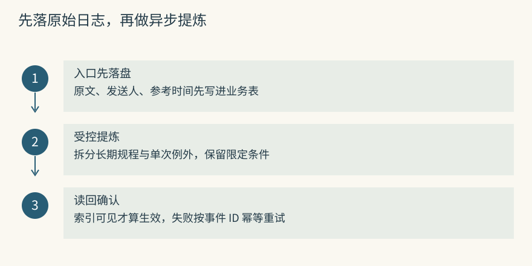
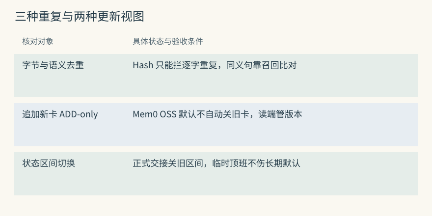
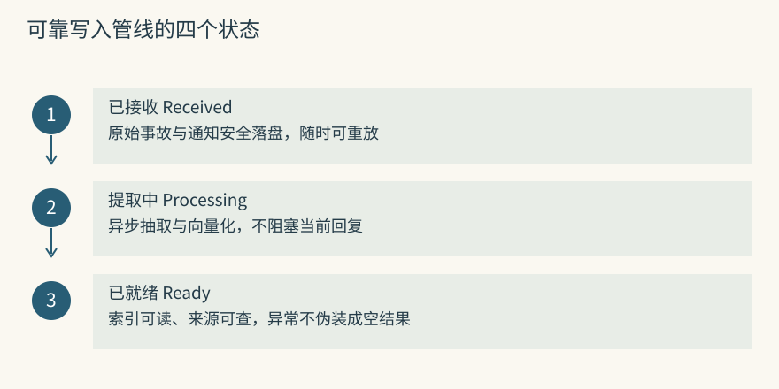

# 写入管线：什么值得记

## 先别急着总结，先把原话安全落盘

很多团队做记忆系统踩的第一个大坑，就是一收到消息或事故复盘，直接扔给大模型抽摘要，原话顺手就丢了。

举个真实场景：支付组发了一封交接通知：“**从下个月 1 号起，`payment-gateway` 的发布终审交给老李；不过本周五的紧急 hotfix 还是找老张拍板。**”

如果你在入口不留原话，直接压成一句话：
- 压成“找老李”，周五的 hotfix 就送错人；
- 压成“找老张”，下个月的交接就丢了；
- 更糟的是，如果此时抽取模型 API 突然 504 超时，连原通知一起蒸发，你连重试的原料都没了！

另外，注意里面的相对时间——“下个月 1 号”“本周五”。如果你今天（10 月 26 日）没记下**参考日期和时区**，三天后后台队列重试时，“本周五”就可能飘到下一周去了。

所以写入管线的第一条军规就是：**业务宿主先落原始事件（含原文、可信来源、参考时间、稳定事件 ID），确认落盘后再去触发记忆提取。**

<details class="source-example">
<summary>源码与边界：为什么不能指望 SDK 替你先写日志（选读）</summary>



### Mem0：消息落库在流程尾巴上

翻开 [Mem0 主流程](../../sources/repos/mem0/mem0/memory/main.py) 你会发现，正常的 `add()` 是在提取流程的收尾阶段才调用 `self.db.save_messages()` 保存消息的。一旦中间 LLM 提取超时抛出 `LLMError`，代码根本走不到这一行——如果宿主没提前存底，原始输入就直接丢了。

### Graphiti：内存里建好对象 ≠ 已经写进图库

Graphiti 的 `add_episode()` 在早期就会在内存里构造好 `EpisodicNode` 并分配 UUID，但真正落进图数据库要等到抽取、实体消歧、边解析全部跑完后的 `_process_episode_data()`。看到日志打印了 episode UUID，不代表图里已经可读；半路报错后，还得靠宿主记录的原始事件 ID 去对账重放。

</details>

## 提取阶段：把长期规则和单次例外拆干净

拿到上面那封 10 月 26 日发出的交接通知，合格的提取器应该拆出两条边界清楚的候选，而不是糊成一句“老张和老李都管发布”：

```text
长期规则候选：2026-11-01 起，payment-gateway 常规发布终审人为老李（来源 notice-31）。
单次任务候选：2026-10-30（本周五）的 hotfix 仍由老张拍板，不改变长期交接规则。
```

审核提取结果时，别光看 JSON 格式合不合法、人名拼没拼对，重点盯三处最容易被模型悄悄抹掉的东西：
1. **限定词**：常规发布 vs 紧急 hotfix、正式环境 vs 演示环境；
2. **明确日期**：相对时间有没有锚定到具体日历日期；
3. **语气强度**：把“怀疑/建议”保留成假设，别自动升格成“确定故障/强制铁律”。

## 去重：字面重复和意思重复是两码事

一条交接通知经常在邮件、飞书群、工单里被转发四遍。去重时要把三种情况拆开处理：
- **同一事件重复投递**：靠业务自己的 `event_id` 做幂等拦截，别重跑一遍；
- **一字不差的重复文本**：靠文本归一化后的 Hash（如 MD5/SHA256）秒拦；
- **换了说法的同义句**：比如“老李接手支付网关发版审批”和“11 月起 payment-gateway 发布找老李终审”，Hash 完全不同，必须先召回已有相似记录，再由模型或规则判断是同义重复、来源补充还是状态交接。

还要提防一个常见误区：**同一份通知被转发十次，依然只是 1 次独立观察，绝不是 10 次独立验证。** 合并同义事实时可以把来源链接挂在一起，但别盲目把“出现次数”当成“可信度”。

<details class="source-example">
<summary>源码与边界：去重与变更在源码里到底怎么跑（选读）</summary>



### Mem0：局部 Hash 去重 + 同步默认 ADD-only

在 2026-11 最新快照的 Mem0 本地同步路径中，有两处极容易和老教程对不上的真实实现：
1. **Hash 去重不是全库唯一**：代码计算候选文本的 MD5，只在 `seen_hashes`（本批次）和 `existing_hashes`（本次召回参考的旧记录）这个小圈子里查重。如果某条一模一样的旧事实排太靠后没被召回进参考池，它依然会被再写一条。
2. **同步默认路径是 ADD-only**：虽然老文档和旧注释里常画着模型自动输出 `ADD / UPDATE / DELETE` 的流程图，但当前本地同步推断走的是 `generate_additive_extraction_prompt()`，**默认只做分阶段批量追加**！旧的“老张负责审批”卡片不会自动消失——如果你要维护唯一的“当前审批人”，必须在业务层显式调用 `update()` 或维护外部版本字段。

### Graphiti：精确去重 + 关系解析分开返回

Graphiti 的 `resolve_extracted_edges()` 会先按“源 UUID + 目标 UUID + 规范化 fact”滤掉本批完全重复的边，再拉出端点间的已有边和相关候选让模型裁决，分别返回 `resolved_edges`、`invalidated_edges` 和 `new_edges`。验收时千万别只看有没有新边生成，更要检查**旧边该关的关没关、不该关的（比如临时 hotfix 不该关长期默认）有没有被误伤**。

### TencentDB：写入去重范围 ≠ 读取范围

顺带提一句，[TencentDB 的 L1 去重实现](../../sources/repos/tencent-agent-memory/MemoryCore/src/core/record/l1-dedup.ts) 先用原生混合检索（或全文 + 客户端向量 + RRF）召回旧候选，再批量让模型做去重裁决，但它的去重隔离范围可以限定在单次 session 内，与跨会话读取范围并不一样；而且没召回出候选时会直接 store，也不能把“调用成功”等同于“全库语义去重完成”。

</details>

## 热路径 vs 冷路径：别让用户干等提取，也别让旧缓存覆盖新指令

把原文写进数据库只需要几毫秒，但调大模型抽事实、算向量、做实体消歧可能要几秒钟。
- **热路径（当前回复前）**：原文落盘，而且**用户刚发来的明确纠正必须立刻留在当前对话上下文里**，马上生效；
- **冷路径（后台异步整理）**：实体解析、去重合并、画像刷新、长期巩固交给持久任务队列慢慢跑。

很多系统的翻车点就在这个“最终一致性窗口”：林远刚说“以后改用中文回复”，后台异步任务还没跑完，下一秒系统又从旧画像里读出“默认英文”覆盖了当前对话！记住：**异步整理没完成时，本轮和近期原话的优先级永远高于旧的派生记忆。**

还要区分语言层面的 `async/await` 和真正的持久队列：像 Mem0 的 `AsyncMemory` 只是异步非阻塞接口，进程一挂任务就没了，它并没有替你建好 Redis/RabbitMQ 级别的持久化重试队列。

## 什么值得长期记，什么只配留在原始日志

不是每句话都值得塞进长期记忆。判断一条信息值不值得提炼，问自己一个大白话问题：**“如果下周我忘了这句话，会不会选错人、漏查配置、搞挂线上，还是仅仅少了一段闲聊背景？”**

- **值得记**：明确约束、反复踩过的坑、经过确认的架构边界、长期个人偏好；
- **先留在原始日志，别急着提炼**：单次网络抖动、还没验证的排障猜测、大段堆栈日志。原始日志同样可审计、可按需搜，别把它们全塞进高优先级召回池把真正重要的规程挤掉。

对于工具日志和代码文件：像 Mem0 提供 `infer=False` 跳过模型提取直接落库，适合已经过业务审核和脱敏的短结论；Graphiti 接受文本/JSON 作为 `episode_body`，但直接把几百行堆栈扔进去会抽出一堆垃圾节点，一定要先清洗、用 Schema 限死关注对象。

## 写到一半挂了，怎么安全重试而不造重复垃圾

真实生产环境里，部分失败太常见了：一条通知拆出两条规则，第一条写进向量库成功，第二条算 embedding 时网络断了。

如果你直接把整条通知重新丢进 `add()`，很可能把第一条规则再生成一遍，挂上新 ID——以后系统看日志还以为这条规则被独立确认了两次！

靠谱的恢复做法很朴素：
1. **给每条原始输入发一个稳定的 `event_id`**，外层建一张状态账簿，记录“已接收 / 处理中 / 部分失败 / 已就绪”以及已经成功落盘的派生 ID；
2. **重试前先对账**：只补做失败的那一项，或者按新版本号整体重建并替换旧派生记录；
3. **盯紧底层框架的真实行为**：Mem0 批量插入或算向量失败时会逐条回退，接口返回的对象列表未必和每个底层存储完全一致，需要按 ID 读回确认；Graphiti 的 `add_episode(uuid=...)` 在源码里是去加载**已经存在**的 episode，并不是传个业务 ID 就能自动实现幂等创建。

<details class="implementation-notes">
<summary>实现笔记：写入状态的清晰边界与各项目实情（选读）</summary>

## 可靠写入的四段账簿

```text
1. 入口落盘：清洗后原文 + 可信来源 + 参考时间/时区 + 稳定 event_id → 状态 RECEIVED
2. 本轮直通：当前明确约束直接进本轮 Prompt，不等后台队列
3. 后台派生：抽取候选 → 核对限定词 → 查重/版本裁决 → 写索引与映射 → 状态 PROCESSING
4. 读回验收：按派生 ID 读回确认可读，更新事件映射 → 状态 READY（失败则 RETRYABLE）
```

## 矛盾来了别急着覆盖，先分清四类情况

| 情况 | 研发助手里的例子 | 正确动作 |
|---|---|---|
| 正式状态演进 | 11 月 1 日老李正式接替老张审批 | 结束旧有效区间，开启新有效区间，保留历史 |
| 单次任务例外 | 本周五紧急 hotfix 仍找老张 | 新建带任务 ID 的短期约束，不碰长期默认 |
| 抽取或人工录入错误 | 把“临时顶班”错写成“永久接任” | 回到原始事件重抽并修正派生记录与摘要 |
| 来源互相打架 | 群消息说换老李，工单系统还写老张 | 并存双源证据并提示核实，别按后写入瞎覆盖 |

## 常见项目的写入机制速览

- **Mem0**：同步普通路径用近 10 条消息 + 相关旧事实做单次 ADD-only 批量提取；`infer=False` 直存审核文本。
- **Memobase**：先写进用户 buffer，等阈值、空闲或显式 `flush` 才批处理合并画像和事件。
- **Graphiti**：从 episode 出发，走节点抽取 → 规范 UUID 消歧 → 边抽取与时间冲突裁决 → 节点属性/摘要更新。
- **Cognee**：按内容类型（文档/代码/会话/技能）路由到不同加载、分块、Schema 抽取与多存储管线（v1.6.8 入口新增 SSRF 与服务器路径拦截）。
- **Basic Memory / Letta Code**：不靠每轮自动抽事实，前者解析人类编辑的 Markdown，后者由 Agent 编辑 MemFS 并 Git commit 后在下次编译生效。
- **Agent Beacon / Hermes Jev**：Beacon 只负责把工具动作归一采集为事件流，Hermes 只做检索后的判别门控，两者都不充当长期事实写入库。

</details>

## 动手检查

按时间顺序收到三条通知：
1. “`payment-gateway` 发布默认由老张终审。”
2. “本周五紧急 hotfix 找老李临时顶班。”
3. “11 月 1 日起 `payment-gateway` 发布终审正式交给老李。”

请写出每条通知分别应该改动长期默认、任务状态和历史区间的哪一部分。再假设第 3 条在写入索引时中途崩溃，重试前你必须先核对哪几个对象？

答案提示：第 2 条只是单次任务例外，绝不能关闭老张的长期职责；第 3 条才是正式交接，且要区分通知收到日期和 11 月 1 日生效日期。中途崩溃后，重试前必须先按原 `event_id` 查原始事件、已生成的派生 ID、旧关系是否已被关闭以及节点摘要是否已更新，切忌盲目把原文本再灌一遍。

<figure class="concept-diagram" tabindex="0"><figcaption>图：把原文落盘、异步提取、索引可读分开记账，出故障时才知道从哪一步安全续做。</figcaption></figure>

<details class="comparison-reference">
<summary>项目对照速查（选读）</summary>

## 本章对照结论

| 项目 | 写入管线里最值得追的环节 | 上线前不能省的验收点 |
|---|---|---|
| Mem0 | ADD-only 批量提取、`infer=False`、局部 Hash | 事实、SQLite 历史与实体链接是否写齐 |
| Memobase | buffer 累积到 flush 合并画像 | 纠正写入后多久才对下一次读取可见 |
| Graphiti | Episode → 实体消歧 → 边冲突裁决 | 规范 UUID、生效日期与旧边失效状态 |
| Cognee | 多类型管线路由、安全路径检查 | 跨关系/图/向量库中途失败怎么恢复 |
| HippoRAG | 文档 OpenIE 三元组与来源图索引 | 关键跨段连接是否被正确抽出 |
| MemoryOS | 短期容量溢出转页 + 热度触发长期分析 | 单次例外有没有在摘要提升时被压丢 |
| MemOS | Reader 处理与 Scheduler 异步队列 | 队列积压监控与失败重试状态 |
| Hippo Memory | 本地捕获与 `sleep` 集中巩固 | 合并后能否追溯回原始轨迹 |
| A-MEM | 新笔记描述生成与邻居属性修改 | 邻居改完后向量索引是否同步刷新 |
| Letta Code | MemFS 编辑、Git commit 与下次编译 | 本轮立即可见 vs 下轮编译生效的边界 |
| Basic Memory | Markdown 解析与链接同步 | 文件改名、死链与并发写入冲突 |
| MCP Memory Service | 客户端提交 + FTS5/向量存储与巩固 | 直接 store 不等于内容已筛选有价值 |
| Agent Beacon | 跨宿主工具活动归一为 `runtime.jsonl` | 采集覆盖、重复去重与敏感参数脱敏 |
| TencentDB | L0 留底 + L1 同会话去重 + L2/L3 归纳 | 去重范围与读取范围的隔离区别 |
| Hermes Jev Skills | 轻量决策与精确匹配 memo 缓存 | 不承担长期事实写入职责 |

</details>
