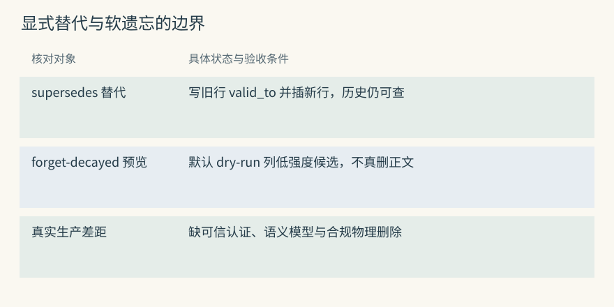
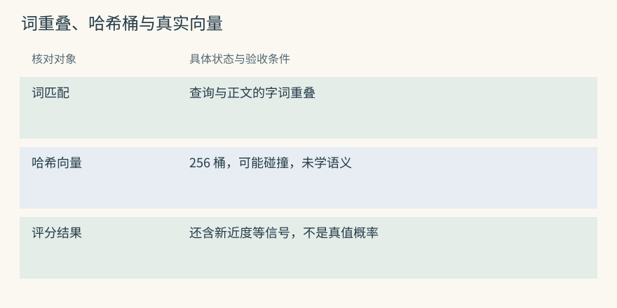
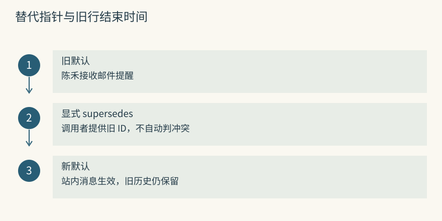
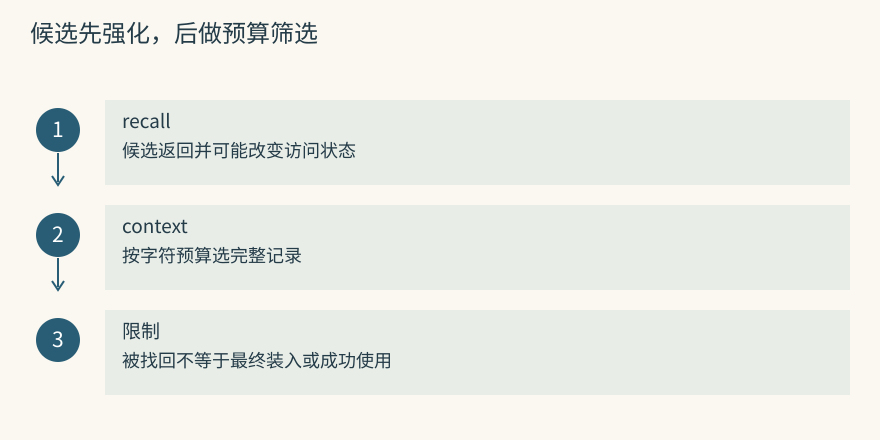
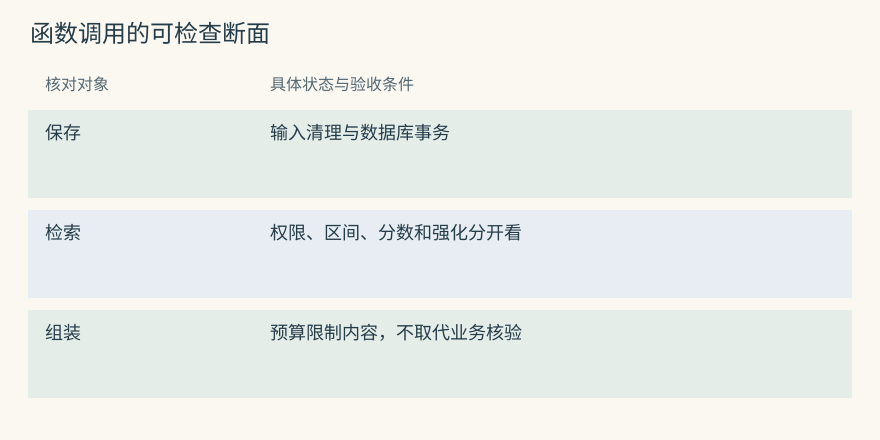
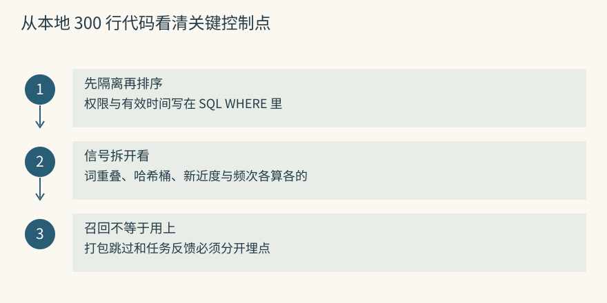

# 从零实现持久记忆

## 先做一个不调用模型的记忆实验

这次先不做自动摘要。把一条经过人工确认的预约要求写进数据库，退出进程，再开另一个进程读取。这样可以单独验证持久化、用户筛选和正文交付，不把模型服务的不确定性混进实验。

命令从仓库根目录执行。数据库放在新建的临时目录，不会覆盖已有练习文件。以下输出描述是预期验收条件，随机 ID 和浮点评分以运行结果为准。

```bash
practice=$(mktemp -d)
python3 examples/mini_memory.py --db "$practice/booking.sqlite" remember \
  "S7 预约提交前核对证书覆盖实验日期" \
  --user chenhe --kind procedural --source notice-31
python3 examples/mini_memory.py --db "$practice/booking.sqlite" recall \
  "S7 预约 证书" --user chenhe
python3 examples/mini_memory.py --db "$practice/booking.sqlite" recall \
  "S7 预约 证书" --user yucheng
```

写入命令打印记录 ID，陈禾的搜索应包含刚才的正文和 `notice-31`。余澄的搜索在这个全新数据库应为空，因为没有为他写入记录。三次命令分别启动进程，第二次还能找到正文，才证明不是只从第一个 Python 对象的变量里读回。

这里的 `--user` 是教学过滤字段，不是认证。读者能在终端自由填它，所以它无法保护真实用户数据。生产宿主要从已验证身份得到范围，并禁止模型或客户端任意冒用。这个实验也没有提交预约，只读写记忆文件。

Mem0 可用提取路径从管理员消息形成事实，也可直接保存审核正文；Graphiti 通常从材料抽取对象和关系。跑通这个标准库例子，不能据此认定这两套依赖已经连接或验证。

<details class="source-example">
<summary>源码与边界（选读）</summary>


本章将“提取是否准确”暂时固定为人工负责，只测写入、读取和有限组装。这样出现空结果时，能先查数据库和过滤，而无须猜模型是不是没理解通知。

### Mem0：零模型实验可以映射到直接保存路径

相近的契约是 `add(..., infer=False)`：跳过事实提取，但仍需 embedding 和已配置存储。若用一条文字直接保存，仍不能称作纯标准库或完全零模型依赖。

下面只示意已配置对象的调用形态，不是在本章创建可直接运行的服务脚本：`m.add("S7 预约前核验证书日期", user_id="chenhe", infer=False)`，随后 `m.search("S7 预约证书", filters={"user_id": "chenhe"})`。实际使用前应按选定 provider 配置并验证返回结构。

### Graphiti：从 episode 开始会引入抽取依赖

`add_episode()` 需要材料正文、来源说明、参考时间和分组等参数，并依赖图后端与抽取模型。参考时间应带时区，避免“明天到期”被不同机器解释成不同日期。

`add_triplet()` 可以从显式节点和边出发，但仍涉及解析、向量等工作。它不是把本章 SQLite 命令改一个函数名就能运行的替代。检验图持久化需要读取材料、端点和来源关系，而不只是查询一张文字表。

</details>

## SQLite 里面到底保存了什么

配套 [`mini_memory.py`](../../examples/mini_memory.py) 的 `MemoryStore.__init__()` 建立表和索引，`remember()` 生成记录 ID、写入字段并提交。SQLite 将数据库保存在指定文件，`commit()` 使完成的修改能够被后续连接读取。程序还使用 WAL 日志模式，实际备份时不能忽略仍在使用中的辅助文件。

在同一终端中检查刚才的数据：

```bash
python3 - "$practice/booking.sqlite" <<'PY'
import sqlite3
import sys

with sqlite3.connect(sys.argv[1]) as conn:
    rows = conn.execute(
        "SELECT user_id, kind, text, source FROM memories ORDER BY created_at"
    ).fetchall()
    for row in rows:
        print(row)
PY
```

预期是一行陈禾的过程记录。SQL 不调用回答模型，因此可以独立确认数据是否真正留存。若这里没有正文，应先检查路径、写入是否完成和事务，而不是调整检索权重。若这里有正文但 `recall` 没返回，再去看用户和有效时间条件。

Mem0 的状态分散在事实后端、历史数据库和可能的实体存储；Graphiti 的材料、实体、事实边相互引用。本地文件存在或图界面出现 S7 节点，都不能证明整条写入已完成。

<details class="source-example">
<summary>源码与边界（选读）</summary>



可以为每类对象写一个新连接读回检查：事实正文能否按 ID 读取，来源 ID 是否能解到原事件，端点是否在同一可见范围。只验证一次接口返回，会漏掉某后端失败而另一个成功的情况。

### Mem0：历史 SQLite 与事实后端不是同一职责

`SqliteManager` 保存消息和变更历史，事实内容及向量通过配置的 `vector_store` 管理。历史文件里有一项 ADD，不代表事实搜索后端现在可用，也不保证所有辅助链接已保存。

备份方案应列出事实、历史、实体及配置，恢复后重新按 ID 读取并运行受限搜索。只复制看到的 SQLite 文件，可能恢复了审计记录却没有可搜索的事实，或相反。

### Graphiti：一次写入形成多个有关联的对象

一次材料写入涉及 episode、实体、事实边及材料到实体的关联。Driver 负责持久化，但不同对象有不同读取入口。材料原文的读取与事实边搜索不等价。

验证时可以在新连接中查 episode UUID、规范节点 UUID 和边来源列表，确认它们互相指向正确对象。若只看到仪器节点，还无法证明通知正文和复核关系都在；这类缺失会在后续来源展开或多跳读取时才暴露。

</details>

## 相关性怎样算出来

`recall()` 先按用户与有效区间取行，再逐条计算分数。词匹配统计查询与正文的重叠；哈希向量将词映射到 256 个桶并归一化，比较方向；新近度、重要性、置信度和访问强化也参与加权。这个实验让各项信号可见，不追求通用语义理解。

中文处理把含汉字的片段拆成单字和相邻双字，英文大致按词处理。哈希桶可能碰撞，同义词也未必共用桶。因此“证书有效期”和“校准覆盖日期”未必得到理想匹配。字段名叫 `semantic` 只是示例命名，应读成哈希词袋近似，不能解释为模型已经理解物理校准。

可以再存一条无关内容“S7 展示海报采用绿色”，用“预约证书”查询，比较它与检查要求的 `lexical` 和 `semantic`。若无关记录也进入前几名，先看共同字词和额外价值项，而不是把分数当真假判断。这个程序即使没有明显相关记录，也可能返回超过阈值的背景项。

<details class="source-example">
<summary>源码与边界（选读）</summary>



玩具算法适合观察计算位置。真实项目使用 embedding 和索引，仍要明确候选比较的是短事实、节点摘要还是来源段落，不同单位不能用一个相似度字段混为一谈。

### Mem0：真实 embedding 后还有多信号评分

`_search_vector_store()` 为查询生成向量，后端返回语义候选；关键词规范化分数和实体加分随后进入 `score_and_rank()`。本章固定权重不是 Mem0 的实现公式，也不能拿两者的 `semantic=0.8` 直接对比。

替换向量模型时，记录模型和维度版本，确认正文与查询使用兼容空间。后端距离是否已转换为预期分数，也需要核对，否则阈值可能把好候选错误排掉。

### Graphiti：搜索对象决定向量比较什么

事实边搜索比较 query 与关系正文，节点搜索比较节点的索引内容；来源搜索又是另一类对象。配置选择 RRF、MMR 或其他排序时，输入和输出单位会继续影响解释。

起步可以只检验事实边及其来源，确认“谁负责预约”确实命中职责事实，再增加组合搜索。返回一个 S7 节点摘要不等于返回复核人关系，也不代表材料中的日期已经核对。

</details>

## 用新记录替代旧默认

最小程序不判断两句话是否冲突，调用者明确给出旧记录 ID。下面把默认提醒渠道从邮件改为站内消息，仪器要求保持不变：

```bash
previous=$(python3 examples/mini_memory.py --db "$practice/booking.sqlite" remember \
  "陈禾的预约提醒默认发邮件" --user chenhe --kind profile)
python3 examples/mini_memory.py --db "$practice/booking.sqlite" remember \
  "陈禾的预约提醒默认发站内消息" --user chenhe --kind profile \
  --supersedes "$previous"
python3 examples/mini_memory.py --db "$practice/booking.sqlite" recall \
  "预约提醒渠道" --user chenhe
```

程序将同用户旧记录的 `valid_to` 写成本次时间，再插入新记录。当前查询不应再把旧邮件默认视为有效，但正文仍保留在表里。SQL 的变化是确定性的，语义判断来自我们手工选择 `previous`，并非数据库理解了渠道交接。

Python API 的 `recall(as_of=...)` 支持指定有效时点，CLI 没有 `--as-of` 选项。此例的替代时刻与写入时刻绑定，还没有表达今天补录上周交接的完整业务时间。不要将这一列字段直接称为完整双时间系统。

<details class="source-example">
<summary>源码与边界（选读）</summary>



核验替代至少检查新正文、旧 `valid_to` 和当前查询三项。旧行没有物理删除，历史读取仍有机会看到它。若业务要求彻底删除邮件偏好，单次替代不满足要求。

### Mem0：不要调用不存在的 supersedes 语义

本章 `supersedes` 属于教学 API，普通 Mem0 `add()` 没有相同的自动替代参数。把旧 ID 写入 metadata 可以保留说明，但不会自动使旧记录退出当前搜索。

接入方可显式更新一份当前偏好，或维护外部版本表和日期条件。选哪条记录更新之前仍应检查主体和含义，防止“这次不发邮件”误改默认。历史回答也不能仅按 `updated_at` 推算现实生效日。

### Graphiti：替代发生在语义与时间解析中

新材料若明确“11 月 1 日起提醒渠道改为站内消息”，图可提取新关系，并对相关旧关系维护结束日。它自动化了部分识别，也可能把单次安排误判为永久变化。

实验应直接核对新旧边日期，再分别查询交接前后。只观察新关系出现，会漏掉旧关系未结束或无关关系被关闭的问题。这样的测试与本章手工旧 ID 替代各有验收重点。

</details>

## 让搜索结果成为有限输入

仍在同一终端运行，先看搜索 JSON，再看组装后的文字：

```bash
python3 examples/mini_memory.py --db "$practice/booking.sqlite" context \
  "S7 预约提交" --user chenhe --budget 36
python3 examples/mini_memory.py --db "$practice/booking.sqlite" context \
  "S7 预约提交" --user chenhe --budget 1
```

`context()` 先调用 `recall(limit=20)`，再逐条判断格式化后的行能否装入剩余额度，太长就跳过并继续看后面的短项。`budget` 实际换算为四倍字符数，标题和换行还没完全计入，不能用来保证真实模型不超 token 窗口。预算为 1 时，通常只剩“无相关记忆”的固定输出。

还有一处有意保留的简化：`recall()` 默认会强化返回项，即使它稍后被打包跳过。因而访问计数增加，只证明进入返回集合，不证明模型看过或任务成功。生产接法应把候选选择、实际装入、实际使用和结果反馈分开记。

Mem0 的返回条数、Graphiti 的边数量也都不是最终输入长度。应用展开来源后，字数可能远多于短事实。需要把正文、日期、来源和安全说明一起按目标 tokenizer 计算，再预留当前工具和回答空间。

<details class="source-example">
<summary>源码与边界（选读）</summary>



可以让两条相关记录一长一短，观察长项被跳过后短项仍被采用。再看两条的访问计数，便能看到本程序强化与打包的位置不一致。这个结果用于解释简化，不应据此设计可靠成功学习。

### Mem0：limit 限制结果，不保证最终 token

`search(top_k=...)` 控制数量，候选正文可能是短句，也可能是长段。应用加上 metadata 和来源后，应对完整注入文本计数。重排改变次序，不会自动给出满足总预算的提示。

可以为必要规程先留空间，再考虑可选背景。若没有足够额度，返回证据不足或分步读取，比截掉条件后继续提交预约更可靠。

### Graphiti：num_results 与 SearchConfig.limit 都是中间限额

基础搜索的 `num_results` 限制事实边，组合搜索还可能带节点和材料。几条 fact 很短，episode 原文却可以很长，不能把来源展开视为零成本。

宿主应对扩展深度、原文片段和最终输入分别限额。问复核链时，应保留链上必要关系作为一组证据，而非只给最高分的仪器归属边，留下无法回答的半条链。

</details>

## 沿着一次函数调用读懂这个程序

从 `remember()` 开始，记录正文、用户和来源如何进入一行 SQL。它对重要性与置信度截在 0 到 1 区间，却不验证数字的事实依据；对正文做 strip，却没有自动提取或隐私清洗。确定性写入能稳定复现，但调用者仍得保证输入适合保存。

看 `recall()` 时，先停在 SQL 结果。身份和有效区间在评分之前生效。余澄应在此时得到零行，而不是把陈禾的数据全算完分再在界面上隐藏。虽然这个例子没有真实认证，内部过滤顺序仍值得单独观察。

随后看特征计算和阈值。词重叠与哈希向量都依赖字面词项，不是互相独立的两套理解能力；新近度和价值项又可能让词面不相关记录得到非零分。可以改写同一要求，比较分项变化，了解这个近似在什么表达上失败。

最后看 `context()`。它打印一段可供模型阅读的文字，并没有调用模型或预约接口。输出包含证书要求，只证明宿主可以取得这段证据。是否真的先查证书，需要另一个端到端实验，记录模型与工具动作。

`remember(..., supersedes=...)` 同样把判断和执行分开。我们手工指出旧 ID，数据库执行区间结束。以后加入自动冲突判断时，可以固定同一组 SQL 验收，另外测试判别器有没有选对旧项，避免语义错误与持久化错误互相掩盖。

<details class="source-example">
<summary>源码与边界（选读）</summary>



每个断面都写下实际值：原话、候选、保存正文、返回正文、最终输入。某处由“检查日期”变成“重新校准”，便能确定错误发生在压缩还是组装，而不用反复替换向量库。

### Mem0：沿 add、payload、search、MemoryItem 读

从 `add()` 的范围校验进入 `_add_to_vector_store()`，再看 `_search_vector_store()` 的池和结果格式化。消息、提取 `text`、payload `data` 与返回 `memory` 是同一信息在不同阶段的形状，应逐项比较条件是否仍在。

实体链接属于辅助索引。它给 S7 相关记录加分，不能替代卡片正文核验。若最终输入丢了“覆盖实验日期”，应定位是哪次转换删掉，而不是只检查实体有没有被识别。

### Graphiti：沿 episode、UUID 映射、edge、SearchResults 读

写入时追一个临时 S7 UUID 到规范资产 UUID，再查边端点、日期和来源。读取时固定搜索配置，核对返回的是边、节点还是 episode。这样能把图中存在、搜索到达、最终采用分成独立状态。

若复核人答错，先查中间实验室是不是同一个对象，再看职责范围和日期。名字看起来都正确的图，也可能通过错误端点构成不属于这台仪器的批准链。

</details>

## 动手检查

在不改数据库的情况下，把 `context` 的预算分别设为 1、36、120，记录输入里保留了哪些正文。然后运行本章给出的单元测试命令。若某条没出现，按“表中是否存在、recall 是否返回、context 是否装入”逐层定位。

答案提示：三个阶段的空结果原因不同。为了避免调试搜索本身强化记录，Python API 可使用 `reinforce=False`。遗忘命令默认预览，真正应用只写失效日期，并不清除正文。

<details class="implementation-notes">
<summary>实现笔记与源码对照（选读）</summary>

这里继续使用同一份 [标准库程序](../../examples/mini_memory.py)。下面每组命令都展示一个控制点，不要求修改配套源码或启动任何远程服务。

## 1. 建库

在仓库根目录另建一个临时实验库。后续命令沿用 `exercise`：

```bash
exercise=$(mktemp -d)
python3 examples/mini_memory.py --db "$exercise/rules.sqlite" remember \
  "S7 夜间预约需要单独核验培训资格" --user optics \
  --kind procedural --importance 0.85 --confidence 0.9 --source policy-night-2
```

`source` 是可回查编号的示意，程序不会自动创建 `policy-night-2` 文件。用户、类型、有效区间和价值字段随正文入库，索引帮助先按用户和当前状态缩小范围。重要性和置信度在这里只是手工输入，不是实测概率。

## 2. 召回

```bash
python3 examples/mini_memory.py --db "$exercise/rules.sqlite" recall \
  "S7 夜间 培训资格" --user optics --limit 3
```

评分的六部分如下。保留常量是为了读懂现有程序，而不是建议实际系统沿用权重：

```text
词重叠 0.42，哈希向量余弦 0.28
创建时间新近度 0.10，重要性 0.10
置信度 0.07，访问强化 0.03
总分为六项加权和，结果保留四位小数
```

`recency` 使用距创建时间的指数项，访问强化使用有上限的对数项。短期调试连续搜索可能改变后一次分数，做对照时应关闭强化或恢复初始库，不能把变化全部归给词匹配。

## 3. 处理变化

```bash
prior=$(python3 examples/mini_memory.py --db "$exercise/rules.sqlite" remember \
  "S7 夜间申请提前两天登记" --user optics)
python3 examples/mini_memory.py --db "$exercise/rules.sqlite" remember \
  "S7 夜间申请提前三天登记" --user optics --supersedes "$prior"
```

旧记录在本次时间结束，新记录从本次时间开始，过去的正文不被抹掉。测试可在 Python 中固定非零 `now` 并用 `as_of` 查询，验证边界是否左闭右开。它没有处理系统当时知道什么，也不能直接把未来业务生效日传给 CLI。

## 4. 控制上下文预算

```bash
python3 examples/mini_memory.py --db "$exercise/rules.sqlite" context \
  "S7 夜间申请" --user optics --budget 55
```

候选最多 20 条，程序不会在这批全被跳过后继续回库补搜。字符额度对中英文和 JSON 的近似不同，生产应使用目标模型 tokenizer，包含标题、来源和格式开销。若一条必要条件装不下，应保留完整条件分步读取，而非只留下方便但不完整的摘要。

## 5. 遗忘必须先 dry-run

```bash
python3 examples/mini_memory.py --db "$exercise/rules.sqlite" forget-decayed --user optics
python3 examples/mini_memory.py --db "$exercise/rules.sqlite" forget-decayed --user optics --apply
```

第一条只返回候选 ID，第二条才写 `valid_to`。结果可能为空，因为刚写入的高价值记录通常没低于阈值。验证效果时应查应用前后的 SQL 状态，而不假设任何记录必然被选中。该操作是退出当前视图，不是隐私物理删除。

## 6. 运行测试

```bash
(cd examples && python3 -m unittest -v)
```

仓库已有测试用于检查用户隔离、替代、预算和遗忘预览。应以当前运行输出为准，不能因为文字说“四项覆盖”就跳过执行。若失败，先记录具体断言与数据库状态；不要为了让命令变绿而改掉实验想解释的行为。

## 这个实现刻意没做什么

程序不含自动模型提取、真实 embedding、图扩展和跨编码器重排，也没有生产认证、完整 ACL、加密或派生链删除。它没有一个能自动认出“提前两天”和“提前三天”冲突的判别器。每个省略都对应一个清楚的边界，不能通过改字段名补齐。

下一步可以收集本地查询、预期相关记录、实际装入 ID 和任务结果，再选择要替换哪一层。若正文已经错误，换索引没有帮助；若必要证据在打包阶段丢失，提高向量精度也不能解决；若模型读到了却越权提交，则应检查工具流程。

## 逐步把示例映射到真实项目

SQL 先过滤再评分的顺序可映射到后端受限召回，但实际索引的权限实现要单独验证。Mem0、MCP、Graphiti、Hippo 等各用不同候选机制，替换哈希向量时也要保存模型与维度版本。不能只把一个函数换成远程 embed 就认定迁移完成。

手工替代对应一项确定性业务指令。Graphiti 会从材料判断关系和日期，Mem0 普通追加只增加事实，Hippo 或文件系统另有纠正协议。它们并没有自动继承本章 `supersedes` 的语义。应统一比较现实生效日、录入日和当前/历史返回，而不是只看是否有同名字段。

预算打包晚于本程序的召回强化。候选中的长项即使没进入输入，也已经增加访问次数；这只能演示状态变化，不能当成功信号。真实系统可先记录 selected，再记录 packed 和 used，结果证据充分后才调整寿命。忘记的记录仍在文件里，备份、历史查询与用户删除各有独立处理要求。

</details>

<figure class="concept-diagram" tabindex="0"><figcaption>图：从文件里的行查到模型可读文字，每一步都能独立验收。</figcaption></figure>

<details class="comparison-reference">
<summary>项目对照速查（选读）</summary>

## 本章对照结论

| 最小程序展示的点 | 真实项目中的相近位置 | 迁移时新增的验收 |
|---|---|---|
| 文件持久化和用户 SQL 过滤 | Hippo、MCP、Basic、TencentDB standalone | 认证、并发、恢复与辅助索引 |
| 词项和哈希向量分项 | Mem0、Graphiti、MCP 等检索路径 | 中文、模型版本、候选边界 |
| 调用者明确指定旧 ID | 图关系解析、外层事实版本或文件修订 | 单次例外不误改默认 |
| 字符近似的逐项打包 | 各项目宿主的输入组装 | 完整 tokenizer 与证据组 |
| 搜索命中就增加计数 | Hippo 强化、MemoryOS 热度 | 被找到与真正有用分开 |
| 低强度项写失效日期 | Hippo、MCP 生命周期处理 | 保护项、恢复和物理删除 |
| 人工写好候选正文 | 对照 Mem0、Graphiti 等自动提取 | 条件保真、模型故障重试 |
| 不含采集与判别服务 | Beacon、Hermes 等配套入口 | 先证明缺失职责再组合 |

</details>
