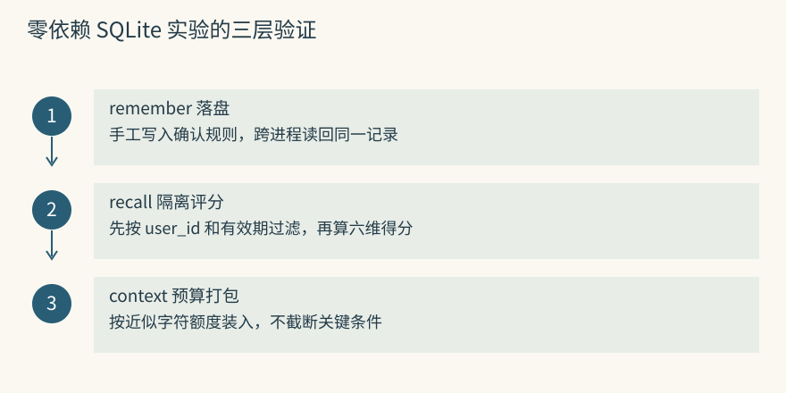

# 从零实现持久记忆

## 先做一个不接大模型的最小记忆实验

前面聊了三章概念，这一章我们直接动手跑代码——而且**彻底剥离大模型 API**，只用 Python 标准库 + SQLite。

为什么要先去掉大模型？因为一上来就接 LLM 抽取、远程 Embedding 和云向量库，一旦“搜不到”，你根本分不清是模型抽歪了、向量没对齐、网络超时了，还是自己的过滤逻辑写错了。把人工确认过的规程直接写进本地 SQLite，能让你把**持久化、用户隔离、版本替代、Token 预算、软遗忘**这五个核心控制点看得清清楚楚。

从仓库根目录打开终端，把练习库建在临时目录里跑一遍（代码见 [mini_memory.py](../../examples/mini_memory.py)）：

```bash
practice=$(mktemp -d)
python3 examples/mini_memory.py --db "$practice/dev.sqlite" remember \
  "payment-gateway 发布前必须核对 idempotency_key 覆盖重试窗口" \
  --user linyuan --kind procedural --source release-14
python3 examples/mini_memory.py --db "$practice/dev.sqlite" recall \
  "payment-gateway 幂等键" --user linyuan
python3 examples/mini_memory.py --db "$practice/dev.sqlite" recall \
  "payment-gateway 幂等键" --user chenming
```

跑完立刻能验证两件事：
1. **跨进程持久化**：第一条命令写完就退出进程，返回 12 位随机 ID；第二条命令起了全新 Python 进程，依然稳稳读回正文和 `source: "release-14"`；
2. **用户范围隔离**：第三条命令换同事 `chenming` 来查，直接返回空列表 `[]`——哪怕查询词一模一样，也碰不到 `linyuan` 的数据。

> 提醒一句：命令行里的 `--user` 只是教学演示的过滤参数，谁都能在终端随便填。放到生产环境里，`user_id` 必须由服务端鉴权会话得出，绝不能让客户端或模型自己填！

<details class="source-example">
<summary>源码与边界：最小实现和 Mem0 / Graphiti 差在哪（选读）</summary>



### 对照 Mem0：最接近的是 `infer=False` 直存路径

Mem0 的 `add(..., infer=False)` 同样跳过 LLM 事实抽取，直接把审核好的文本存进去，但它依然依赖配置好的 embedding 模型和向量后端，并不是零依赖。另外，Mem0 的状态分散在向量库和 SQLite 历史表里，备份或排障时不能只盯着一个文件看。

### 对照 Graphiti：从 Episode 到图对象链路更长

Graphiti 的 `add_episode()` 即使只喂一条规程，也会调 LLM 抽实体、做消歧、算向量、写图数据库，把信息拆成 Episode、EntityNode、EntityEdge 三个互联对象。验证落盘时不能只看表里有没有一行文字，还得核对端点 UUID 和 `episodes` 引用连对了没有。

</details>

## 打开 SQLite，看看磁盘里到底存了什么

`MemoryStore.__init__()` 开启了 WAL 模式，并建了一张带复合索引 `(user_id, valid_to, created_at)` 的 `memories` 表。直接用几行 Python 查库，不经过任何检索打分：

```bash
python3 - "$practice/dev.sqlite" <<'PY'
import sqlite3, sys
with sqlite3.connect(sys.argv[1]) as conn:
    for row in conn.execute("SELECT user_id, kind, text, source FROM memories ORDER BY created_at"):
        print(row)
PY
```

养成这个习惯非常管用：以后排障时，**先直接查底层存储确认数据在不在、范围对不对，再去怀疑检索公式**。库里都没写进去，调一万遍权重也没用。

## 相关性分数到底是怎么算出来的

打开 [mini_memory.py](../../examples/mini_memory.py) 的 `recall()`，看它的两步控制流：
1. **先硬过滤**：SQL `WHERE user_id = ? AND valid_from <= ? AND (valid_to IS NULL OR ? < valid_to)` 先把无权查看和不在有效期的记录直接挡在门外；
2. **再算六维加权分**：
   - 词重叠 `lexical`（权重 `0.42`）：英文按词切，中文拆成单字 + 相邻双字；
   - 256 桶哈希词袋余弦 `semantic`（权重 `0.28`）：用 `blake2b` 把词映射到 256 个桶算余弦；
   - 新近度 `recency`（权重 `0.10`）：30 天指数衰减；
   - 重要度 `importance`（`0.10`）、置信度 `confidence`（`0.07`）、访问频次 `frequency`（`0.03`，带上限对数）。

注意这里特意暴露了一个“诚实的局限”：虽然输出 JSON 里字段名叫 `semantic`，但它底层是 **256 桶哈希词袋**，根本没有接入真正的语义向量模型——不同词可能撞进同一个桶，同义词（比如“幂等键”和“防重复扣款标识”）如果不共字，分数就会掉下来。而且只要 `importance` 或 `recency` 足够高，字面毫不相关的记录也可能混出超过 `0.05` 阈值的分数。自己写完一遍，你就能一眼识破很多“玩具记忆库”的底牌。

## 用显式替代（supersedes）更新长期偏好，同时保住历史

现在林远的偏好变了：以前改配置前要求先给 diff，现在改成直接提 PR 附变更说明。最小程序不会自作聪明猜冲突，而是由调用者显式传入旧记录 ID：

```bash
old_pref=$(python3 examples/mini_memory.py --db "$practice/dev.sqlite" remember \
  "林远要求改配置前先在终端展示 diff" --user linyuan --kind profile)
python3 examples/mini_memory.py --db "$practice/dev.sqlite" remember \
  "林远要求改配置直接提 PR 并附变更说明" --user linyuan --kind profile \
  --supersedes "$old_pref"
python3 examples/mini_memory.py --db "$practice/dev.sqlite" recall \
  "改配置" --user linyuan
```

进数据库看看发生了什么：在同一个 SQLite 事务里，旧记录的 `valid_to` 被设为当前时间戳，新记录的 `valid_from` 也设为同一时刻且 `supersedes` 指向旧 ID。
- 现在查 `recall`，只会命中新偏好；
- 旧记录正文**依然留在库里**，用 Python API 调 `recall(..., as_of=旧时刻)` 依然能还原历史；
- 因为区间是左闭右开 `[valid_from, valid_to)`，交接那一瞬间精确只落在新记录上，不会出现两条同时有效或一瞬间空白。

不过要注意边界：这个极简实现把“生效时刻”和“写入时刻”绑在了一起，还处理不了“11 月 4 日补录 11 月 1 日的交接”（双时间轴我们留到第 6 章拆透）。

<details class="source-example">
<summary>源码与边界：替代与预算在真实项目里的对应位置（选读）</summary>


### Mem0：普通 `add()` 没有 `supersedes` 参数

别把这里的手工 `supersedes` 误以为 Mem0 也自带。Mem0 同步 OSS 写入默认是追加，你在 `metadata` 里写个 `supersedes` 字符串，底层并不会自动关闭旧记录——真要替代，得自己维护版本视图或显式调 `update()`。

### Graphiti：替代发生在语义与时间解析里

Graphiti 靠模型判断新旧边矛盾后自动填旧边的 `invalid_at`，省掉了手工传旧 ID 的麻烦，但代价是模型可能误判（比如把“本周演示只跑 dry-run”误判成替代长期发布规程），所以必须配套正反例测试。

</details>

## 把搜索结果装进有限上下文预算

检索返回的 JSON 不能一股脑全扔给大模型，必须按预算打包：

```bash
python3 examples/mini_memory.py --db "$practice/dev.sqlite" context \
  "payment-gateway 发布" --user linyuan --budget 40
python3 examples/mini_memory.py --db "$practice/dev.sqlite" context \
  "payment-gateway 发布" --user linyuan --budget 1
```

看 [mini_memory.py](../../examples/mini_memory.py) 里的 `context()` 实现，有三个细节非常值得拍下来留念：
1. **整条取舍，不腰斩句子**：先调 `recall(limit=20)` 拿候选，按顺序能塞下整条就装，太长塞不下就跳过看下一条短的，防止一刀把“不要真发版”里的“不要”切掉；
2. **近似预算不是精准 Tokenizer**：代码里粗略按 `budget * 4` 个字符算，而且没把标题行和换行算进去；生产环境必须拿目标模型的真实 tokenizer 对“完整拼接后的文本（含标签和出处）”算总长；
3. **特意留下的“强化错位”示范**：`context()` 调 `recall()` 时默认会给返回的所有候选加 `access_count + 1`——哪怕排第一的那条长记录因为超预算根本没装进 Prompt，它的访问计数也涨了！这正好提醒你：**生产里必须把“搜到了（selected）”“装进去了（packed）”“模型真用了（used）”和“任务成功了（outcome）”彻底拆开记。**

## 软遗忘：先 `dry-run` 预览，而且绝不是物理删除

最后跑一下衰减遗忘命令：

```bash
python3 examples/mini_memory.py --db "$practice/dev.sqlite" forget-decayed --user linyuan
python3 examples/mini_memory.py --db "$practice/dev.sqlite" forget-decayed --user linyuan --apply
```

默认不带 `--apply` 时只返回低强度候选 ID 列表，数据库纹丝不动；加上 `--apply` 后也只是给旧行填上 `valid_to`，让它退出当前默认检索，**正文仍然好好躺在 SQLite 里**。所以软遗忘只管降噪，用户如果提出隐私删号请求，必须做真正的物理清除。

<details class="implementation-notes">
<summary>实现笔记：跑通自带测试与刻意省略的生产边界（选读）</summary>

## 跑一遍仓库自带的单元测试

仓库的 `examples/test_mini_memory.py` 已经覆盖了用户隔离、事务回滚、左闭右开边界、六维公式、预算裁剪、软遗忘预览和 CLI 异常处理，直接跑：

```bash
python3 -m unittest discover -s examples -v
```

## 这 300 行代码刻意没做什么

保持简单才能看清骨架。上线前，下面每一项省略都需要你按需替换或补齐：
- **没有真实语义向量与分词**：高并发或大库下全量扫用户记录会变慢，应换 FTS5 / 向量索引与兼容的 Embedding 模型；
- **没有自动抽取与冲突判别**：目前靠调用方提供干净文本和 `supersedes` ID；
- **没有可信鉴权与加密**：`user_id` 必须来自服务端认证，而不是 CLI 或模型入参；
- **没有合规物理删除与多副本清理**：WAL 文件、备份、日志里的隐私正文都需要独立治理。

但正因为它足够干净，它非常适合当你的 **Baseline（基线）**：以后每想引入一个复杂框架，先问问它在这套 300 行基线解决不了的哪道具体失败题上，到底带来了多少净收益。

</details>

## 动手检查

不修改数据库，分别把 `context` 的 `--budget` 设为 `1`、`40`、`150`，观察输出变化；如果某条记录没出现在最终文本里，你会按什么顺序排查？调试时连续调 `recall` 为什么会让分数偷偷变高，怎么关掉它？

答案提示：按“SQLite 表里存没存（查表）→ `recall` 过没过用户/时间过滤和 `0.05` 门槛 → `context` 是不是因为单条太长被跳过”三层定位。连续调 `recall` 分数变高是因为默认 `reinforce=True` 增加了 `access_count`；做调试或消融实验时，在 Python API 里传 `reinforce=False` 即可冻结状态。

<figure class="concept-diagram" tabindex="0"><figcaption>图：300 行标准库代码把隔离、打分、替代、打包和软遗忘全摆在了明面上。</figcaption></figure>

<details class="comparison-reference">
<summary>项目对照速查（选读）</summary>

## 本章对照结论

| `mini_memory.py` 的控制点 | 真实开源项目里的对应机制 | 迈向生产时必须补齐的验收 |
|---|---|---|
| SQLite 落盘 + `WHERE user_id` 过滤 | Hippo、MCP、Basic、TencentDB standalone | 服务端鉴权、并发锁、备份恢复与多索引一致 |
| 词重叠 + 256 桶哈希词袋 | Mem0、Graphiti、MCP 的全文/向量检索 | 中文分词、模型版本绑定与候选池边界 |
| 调用方手工传 `supersedes` | Graphiti 关系解析 / 外层版本表 / Git 修订 | 单次例外不能误关长期规程，补齐双时间 |
| 近似字符预算整条打包 | 宿主统一组装器 | 真实模型 tokenizer 计数与成组证据保护 |
| 召回即加 `access_count` | Hippo 强化、MemoryOS 热度 | 拆开 selected / packed / used / outcome |
| `forget-decayed` 默认预览 + 写 `valid_to` | Hippo、MCP 生命周期治理 | 低频高危保护项、恢复窗口与隐私物理删除 |
| 人工提供干净正文 | Mem0 / Graphiti 自动 LLM 提取 | 条件保真检查、敏感脱敏与模型超时重试 |

</details>
