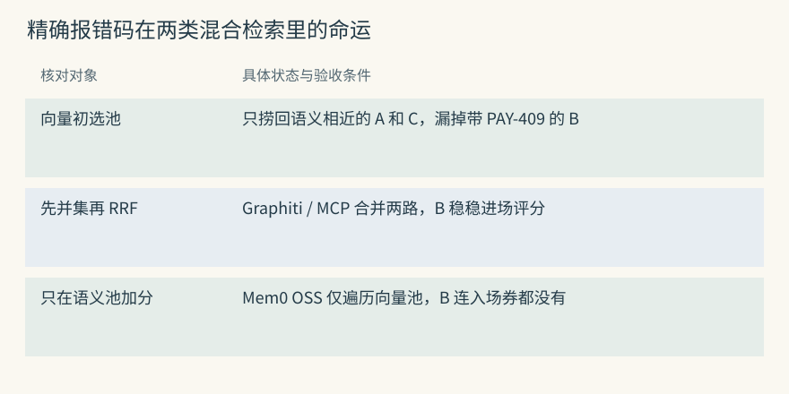
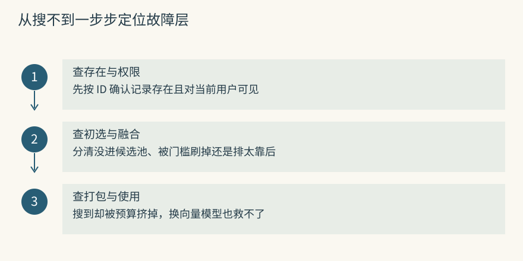

# 检索、重排与上下文预算

## 先拿三条真实记录，看看搜索到底会漏什么

假设林远有权限读取团队里的三条记录：

```text
A：payment-gateway 发版前必须运行 check_idempotency，核对幂等键 TTL 覆盖重试窗口。
B：报错 PAY-409 通常由上游超时重试窗口大于防重放缓存过期时间引起，先核对缓存配置。
C：payment-gateway 的 Grafana 监控大盘链接在团队首页第二行。
```

今天林远问：“发 `payment-gateway` 遇到 `PAY-409` 要先查什么？”
- **A** 带服务名和检查函数名，直接贴题；
- **B** 压根没写 `payment-gateway` 这几个字，但精准命中了错误码 `PAY-409`，而且换了说法解释了同一个坑；
- **C** 虽然命中了 `payment-gateway`，但对发版排查毫无帮助。

检索干的绝不只是算一个余弦相似度，而是四道串联的关口：**权限硬过滤 → 候选召回 → 融合重排 → 预算打包**。而且永远记住第一原则——**权限过滤一定在相关性打分之前**。就算同事陈明的私人草稿里恰好一字不差写着 `PAY-409` 的解法，也不能进入林远的候选池。

## 关键词检索 vs 向量检索：谁补谁的短板

- **全文 / BM25 检索**：专治精确标识符——错误码 `PAY-409`、函数名 `check_idempotency`、接口路径 `/v2/charge`、版本号 `v2.14`。BM25 会综合词频、逆文档频率和文档长度打分，但碰上“幂等键”和“防重放缓存”这种不同措辞就束手无策；中文分词和连字符切分（`PAY-409` 被切成两个词还是保留整体）也会直接左右命中率。
- **向量（Embedding）检索**：把文字投射成向量比方向，擅长把“幂等键覆盖重试窗口”和“防重放缓存覆盖超时重试”拉到一起。但它天生有两个短板：一是对无语义特征的精确报错码和工单编号不敏感；二是**只看主题接近，不管真假和否定**——“幂等键已配置”和“幂等键未配置”在向量空间里几乎贴在一起！

另外，向量检索有个经常被踩的生产坑：**查询向量和入库向量必须来自兼容的同一模型空间**。某些 embedding provider 还会区分 `"search"` 和 `"add"` 两种编码前缀；哪怕换了同维度的新模型，直接拿新向量查旧索引也会静默失效。

## 最隐蔽的架构分水岭：先取并集，还是只在向量池内加分？

同样在 README 里大字写着“支持 Hybrid Search（混合检索）”，底层控制流却藏着一个足以酿成线上事故的巨大差异：**全文检索单独捞出来的记录，到底有没有资格进最终名单？**

继续看刚才的例子：你查 `PAY-409`，向量检索没太理解这个编号，只捞回 `{A, C}`；全文检索精准捞回了 `{B, A}`。

- **路线一：先取并集，再统一融合排序（Graphiti、MCP Memory Service）**
  两路结果先合并成 `{A, B, C}`，再去算综合名次。**B 稳稳拿到入场券**，完全有机会冲到第一名。
- **路线二：只在向量初选池内加分（Mem0 开源当前同步快照）**
  先扩大拉出一个向量初选池 `{A, C}`，然后遍历这个池子，把 BM25 分数和实体关联分数当成“加分项”叠上去。**B 从头到尾没进向量池，哪怕你把关键词权重调到天上去，B 也永远进不了最终结果！**

<figure class="concept-diagram" tabindex="0" data-review-figure="memory-candidate-set">
<svg xmlns="http://www.w3.org/2000/svg" viewBox="0 0 960 396" role="img" aria-labelledby="memory-candidate-set-title memory-candidate-set-desc" style="display:block;width:100%;min-width:620px;height:auto">
<title id="memory-candidate-set-title">候选池边界决定谁有资格评分，调权重救不回池外记录</title>
<desc id="memory-candidate-set-desc">固定两路输入：向量初选 {A,C}，全文精准命中带 PAY-409 的 {B,A}。先取并集再排序得到 {A,B,C}，B 可参与评分；只在向量池内加分仍只有 {A,C}，B 永远被挡在门外。</desc>
<rect width="960" height="396" fill="var(--paper,#faf8f1)"/>
<g font-family="'IBM Plex Sans','Noto Sans CJK SC',system-ui,sans-serif"><text x="40" y="48" font-size="28" fill="var(--ink,#243b48)" text-anchor="start">候选池边界决定谁有资格评分，调权重救不回池外记录</text><rect x="40" y="88" width="272" height="56" rx="6" fill="var(--paper-2,var(--paper-deep,#ffffff))" stroke="var(--line,var(--rule,#bfc8c3))"/><text x="56" y="123" font-size="20" fill="var(--ink,#243b48)" text-anchor="start">固定两路输入</text><text x="344" y="123" font-size="20" fill="var(--ink,#243b48)" text-anchor="start">向量初选 {A, C}；全文命中 {B(PAY-409), A}</text><rect x="40" y="168" width="272" height="56" rx="6" fill="var(--paper-2,var(--paper-deep,#ffffff))" stroke="var(--line,var(--rule,#bfc8c3))"/><text x="56" y="203" font-size="20" fill="var(--ink,#243b48)" text-anchor="start">先取并集再排序</text><text x="344" y="203" font-size="20" fill="var(--ink,#243b48)" text-anchor="start">合并为 {A, B, C}，B 拿到入场券参与评分</text><rect x="40" y="248" width="272" height="56" rx="6" fill="var(--paper-2,var(--paper-deep,#e5ede9))" stroke="var(--forest,var(--accent,#29564c))"/><text x="56" y="283" font-size="20" fill="var(--ink,#243b48)" text-anchor="start">只在语义池内加分</text><text x="344" y="283" font-size="20" fill="var(--ink,#243b48)" text-anchor="start">仍只有 {A, C}，B 连门都没进，调权重也没用</text><path d="M40 332H920" stroke="var(--line,var(--rule,#bfc8c3))"/><text x="40" y="368" font-size="18" fill="var(--muted,#536772)" text-anchor="start">这是两种完全不同的控制流：控制流先决定候选集合，融合公式只决定集合内名次。</text></g>
</svg>
<figcaption>图：同样叫混合检索，先并集再融合（Graphiti / MCP）与语义池内加分（Mem0 OSS）对精确报错码的召回边界截然不同。</figcaption>
</figure>

<details class="source-example">
<summary>源码核验：Mem0、Graphiti 与 MCP 怎么算混合分数（选读）</summary>



### Mem0（2026-11 快照实测）：先过语义硬门槛，再按活跃信号除分母

我们直接核对了 2026-11-18 最新快照里的 [scoring.py](../../sources/repos/mem0/mem0/utils/scoring.py)，`score_and_rank()` 的真实控制流依然非常明确：
1. **循环对象是 `semantic_results`**：`bm25_scores` 和 `entity_boosts` 只是按 `mem_id` 查表的字典，不会往候选池里插新 ID；
2. **先过语义硬门槛**：`if semantic_score < threshold: continue`——如果阈值设 `0.2`，某条记录语义分只有 `0.19`，哪怕 BM25 和实体分拉满，照样直接被跳过；
3. **BM25 Sigmoid 归一化**：`get_bm25_params()` 按词数选参数（`<= 3` 个词时 `midpoint=5.0, steepness=0.7`，原始分 5 映射为 0.5）；
4. **动态分母合成**：`max_possible` 按本次查询**整体**有没有非空信号决定——仅语义是 `1.0`，加 BM25 是 `2.0`，再加实体（权重 `0.5`）是 `2.5`。所以如果本次查询整体有 BM25 和实体信号，记录 A（`0.72 + 0.60 + 0.18`）得 `1.50 / 2.5 = 0.60`；而语义同为 `0.72` 但没命中关键词和实体的记录，得 `0.72 / 2.5 = 0.288`。注意这**不是 RRF**！

### Graphiti（2026-11 快照实测）：先并集再 RRF，且默认 `rank_const=1`

翻开 2026-11-20 最新快照的 [search_utils.py](../../sources/repos/graphiti/graphiti_core/search/search_utils.py)，`edge_search()` 会把全文、向量和可选 BFS 的结果按边 UUID 汇总取并集，再交给 `rrf()`：

```python
def rrf(results: list[list[str]], rank_const=1, min_score: float = 0):
    for result in results:
        for i, uuid in enumerate(result):
            scores[uuid] += 1 / (i + rank_const)
```

看清楚那个默认参数：**`rank_const=1`**！教科书里的 RRF 常用 `k=60`（名次靠前差别平缓），但 Graphiti 默认用的是 `1/r`（第 1 名 `1.0`，第 2 名 `0.5`，第 3 名 `0.333`）！
- 举个算例：A 在全文排第 2、向量排第 3；B 只在全文排第 1。
- 按教科书 `k=20`：A 得 `1/22 + 1/23 ≈ 0.0889`，B 得 `1/21 ≈ 0.0476` → **A 排前面**；
- 按 Graphiti 默认 `rank_const=1`：A 得 `1/2 + 1/3 ≈ 0.8333`，B 得 `1/1 = 1.0` → **B 排前面**！
头部名次陡峭度天差地别，且最终得分完全可能超过 `1.0`，绝不能当成概率去理解。

### MCP Memory Service（v13.0.0 实测）：独立并集 + `as_of` 历史过滤

查看 2026-11-20 最新 [hybrid.py](../../sources/repos/mcp-memory-service/src/mcp_memory_service/storage/mixins/hybrid.py)，`retrieve_hybrid()` 并行跑 FTS5 BM25 和向量查询，按 `content_hash` 取并集，对只在全文路命中的记录专门回库补取正文；v13.0 还补上了 `as_of` 历史时间点支持（历史查询时不过早排除后来才被替代的记录）以及 FTS5 trigram 对短词查询的回退处理。

</details>

## 重排（Rerank）和上下文打包：搜到第一名，也可能进不了 Prompt

拿到融合后的 Top-N 列表，后面还有两道关：

1. **重排（Cross-Encoder / Jev 判别器）**：把“用户问题 + 单条候选文本”拼一起做精排，能很轻松地把 C（Grafana 大盘链接）踢下去。但记住：**重排器只能给传进来的候选排座次，救不回没进池的 B**；而且像 Graphiti 的边 Cross-Encoder 会先用 RRF 截断到 `2 * limit` 再重排，Mem0 的重排异常时会静默降级回原顺序，日志里一定要把“是否触发重排降级”记下来。
2. **上下文打包与真实 Token 预算**：别看着模型窗口写着 128K 就随便塞！算一笔真实的账：

<figure class="concept-diagram" tabindex="0"><figcaption>图：留给记忆的预算要从总窗口里扣掉系统提示、当前对话、工具往返和回答预留后才能算数。</figcaption></figure>

假如这次调用分配的总窗口是 12,000 Token：系统指令和工具 Schema 占 3,000，当前对话和已有日志占 2,500，给模型输出留 2,000，给后续工具调用往返留 2,500——**真正留给记忆的只剩 2,000 Token**！

打包时坚持三条工程经验：
- **稳定偏好别进相似度竞赛**：林远的“中文回复、先给 diff”单独走直读通道，免得搜 `PAY-409` 时因为字面不相关被挤出 Top-K；
- **成组证据要整体保留**：查“发布终审人”至少要同时保留“服务归属基础交易组”和“基础交易组终审人是老李”两条证据，只装一半等于白装；
- **连出处、日期和包装标签一起算 Tokenizer**：两条短事实只有 80 Token，但展开原始事故单后可能暴涨到 1,800 Token，预算检查一定要放在最终拼装完之后。

## 搜不到东西？用“六格排查表”三分钟定责

线上遇到“明明记过了却没用上”，别靠猜，给预期记录拉一行六格布尔表，**第一个变成“否”的列就是根因**：

1. **存在吗？** 直接按 ID 查库——不在就查写入管线；
2. **可见吗？** 检查用户权限、项目范围、有效期——无权看到其实是安全防线起效了；
3. **进初选池了吗？** 查全文、向量各路原始 ID——没进池就查分词、Embedding 版本或池内加分边界；
4. **过门槛了吗？** 查 `threshold` / `min_score`——语义门槛太高会把精确编号挡掉；
5. **留进 Top-K 了吗？** 查融合常量与重排结果——排第 7 而你只取前 5；
6. **装进最终 Prompt 了吗？** 查打包日志——排第 1 但文本太长被预算跳过了！

<details class="implementation-notes">
<summary>实现笔记：主流项目检索控制流横向拆解（选读）</summary>

不同框架的“检索”底层干的事差别极大，调优前先对号入座：
- **Mem0**：语义 over-fetch 池 `max(limit * 4, 60)` → 语义门槛过滤 → 叠加 BM25 Sigmoid 与实体 boost → 可选 `RerankerFactory` 重排。`explain=True` 只能解释过门槛项的分项，看不出池外漏了谁。
- **Graphiti**：[search_config.py](../../sources/repos/graphiti/graphiti_core/search/search_config.py) 支持对 Edge / Node / Episode / Community 分别配 cosine、BM25、BFS，以及 RRF、Cross-Encoder、MMR、中心距离、`episode_mentions` 五类重排。注意基础 `search()` 默认只搜边且不自动多跳 BFS。
- **Hippo Memory（v3.12.0）**：[hybrid.ts](../../sources/repos/hippo-memory/src/domain/search/hybrid.ts) 支持 `blend` 和 `rrf` 两种融合，融合后还会叠加 strength、recency、outcome 等生命周期系数；而多跳图扩展 [recall.ts](../../sources/repos/hippo-memory/src/domain/graph/recall.ts) 可以从词法种子沿关系图拉回池外记录，并支持 `asOf` 双时间过滤。
- **HippoRAG / Basic / A-MEM**：HippoRAG 用三元组和段落种子跑 PPR 传播；Basic Memory 已知 `memory://` URI 时直接精准读取再限深展开关系；A-MEM 先取近邻再补 `links` 邻居，但最后 `[:k]` 截断容易把邻居挤掉。
- **什么时候才值得上“图检索”？** 如果你的问题 90% 都是“发 `payment-gateway` 前查什么”，受限的“全文 + 向量并集”早就够用且好维护；只有当你攒出一批纯检索确实搞不定的两跳关联题（比如文档 A 和文档 B 毫无重合词，必须通过中间团队节点串联），再算清楚建图和消歧成本去上图。

</details>

## 动手检查

假设你排查“查询 `PAY-409` 时助手漏掉规程”的现场日志，发现：
- 记录 B（含 `PAY-409`）在全文路排第 1，但不在向量初选池；
- 记录 A 进了两路且排第 1，但附带的原始复盘太长被预算打包跳过；
- 最终 Prompt 里只装进了无关的记录 C（Grafana 链接）。

如果有人提议“把 `top_k` 从 5 调大到 20 就好了”，为什么这治标不治本？你应该分别改哪两个控制点？

答案提示：单纯把 `top_k` 拉大到 20，只会把更多像 C 一样的无关监控链接塞进窗口，**B 依然因为池外边界进不来，A 依然可能因为单条超预算被跳过**。正确改法是两处分别动手：一是对精确报错码引入独立的全文候选并集（或扩大语义池 + 独立关键词补查）救回 B；二是把 A 拆成短规程 + 按需展开来源，或优化打包策略保住必要检查条件，同时检查排序为什么没把 C 压下去。

<figure class="concept-diagram" tabindex="0"><figcaption>图：按六格排查表找到首次漏失阶段，再对症下药，别把一切检索问题都归罪于向量模型。</figcaption></figure>

<details class="comparison-reference">
<summary>项目对照速查（选读）</summary>

## 本章对照结论

| 项目 | 候选是怎么生成的 | 排查漏召回时最独有的坑 |
|---|---|---|
| Mem0 | 语义初选池 + 池内 BM25 / 实体加分 | 精确编号掉在语义池外、被语义 `threshold` 提前刷掉 |
| Memobase | 稳定画像直接读 + 事件单独检索 | 画像与事件两条路分开评测，别混成一个指标 |
| Graphiti | 按对象（边/点/原文）配置多路并集 + RRF/CE | 默认 `rank_const=1` 头部极陡；基础 `search()` 不自动多跳 |
| Cognee | 按路由选块/图/Session Retriever | 有的路径直接生成答案而非返回原始证据 |
| HippoRAG | 事实与段落种子经 PPR 在图上传播 | 高连接泛化节点带噪、最终 reader 预算截断 |
| MemoryOS | 先筛中期主题摘要，再筛主题内 Page | 主题摘要漏词会直接挡住底下整批 Page |
| MemOS | 文本后端检索，或加载兼容 KV/LoRA | 不同物理形态模块不能套同一套文本召回指标 |
| Hippo Memory | BM25 + 向量融合 × 强度衰减 + 可选图召回 | 池内加权排序与池外图扩展（`graphExpandRecall`）要分开消融 |
| A-MEM | 向量近邻后追加 `links` 邻居 | 末端 `[:k]` 截断可能把刚补进来的邻居全切掉 |
| Letta Code | 根核心常驻 + 模型主动调工具查 MemFS/recall | 模型根本没意识到要调工具去翻笔记 |
| Basic Memory | 关键词搜索或已知 `memory://` URI 限深展开 | 深度控制与最终 Token 预算要分开算 |
| MCP Memory Service | FTS5 BM25 与向量并行取并集（支持 `as_of`） | 各路过滤条件与 hash 补取必须保持权限一致 |
| TencentDB | ACL 授权资产内的混合检索 + Loadout 过滤 | 权限缓存与不同层级（L0~L3）的注入策略 |
| Hermes Jev Skills | 对已有候选做相关性、防注入与充分性判别 | 900 字符截断盲区与故障时的 `unjudged` 状态 |

</details>
