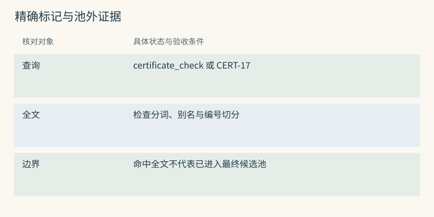
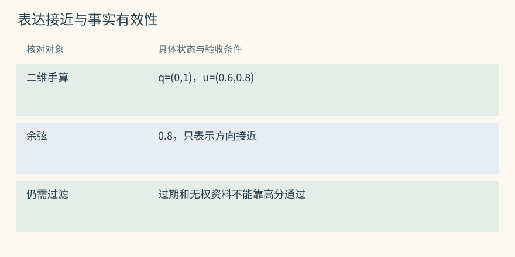
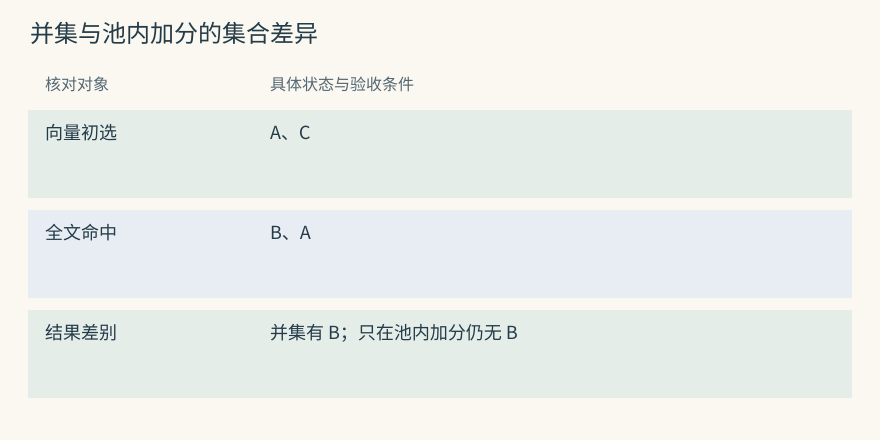
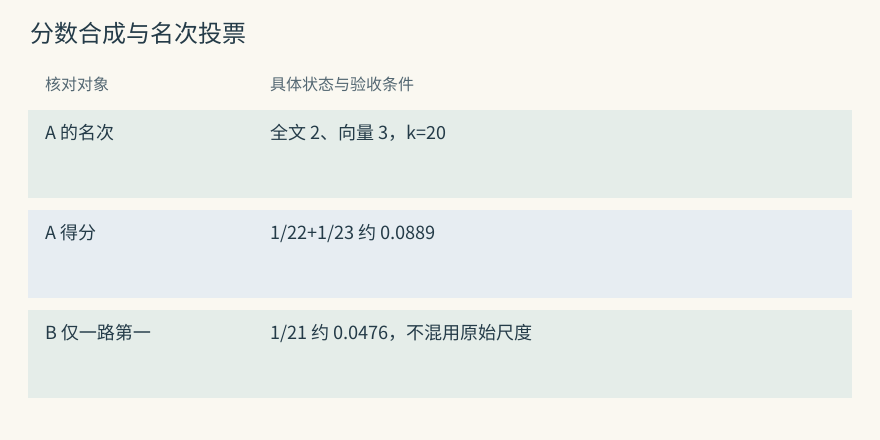
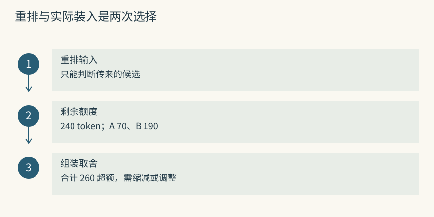
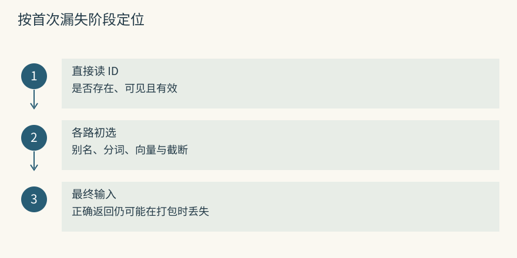
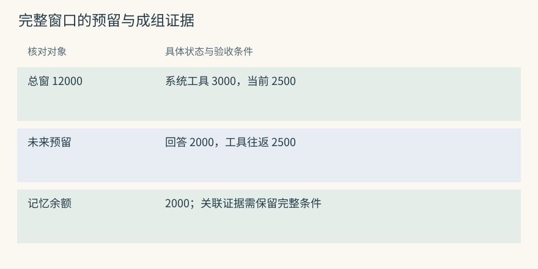
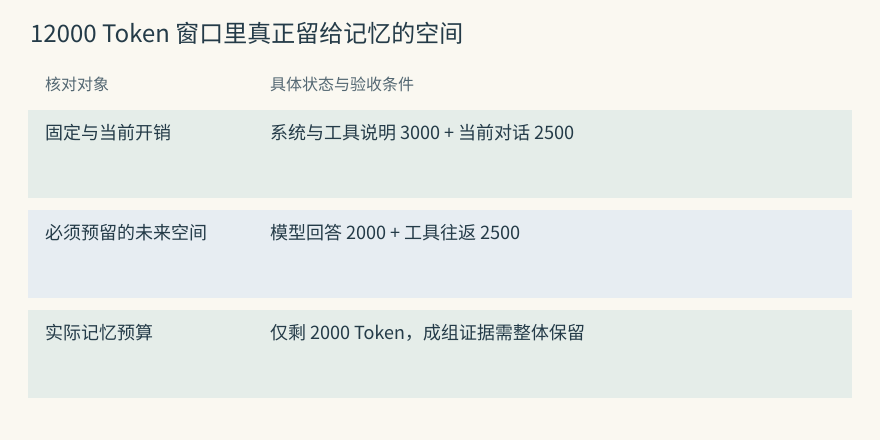

# 检索、重排与上下文预算

## 先用三条记录观察搜索会漏什么

仪器室允许陈禾读取的资料里有三条教学记录：

```text
A：S7 提交预约前执行 certificate_check，确认证书覆盖实验日。
B：光谱实验的校准有效期应包含计划采样日期，否则先申请校准。
C：S7 的参观讲解板放在走廊东侧。
```

问题是“下周用 S7 做实验，预约时要核对什么”。A 含资产名和检查动作，容易识别；B 换了表达，没有 S7 字样，但可能提供同一类要求；C 命中了 S7，却不能支持预约答案。检索需要分别处理对象匹配、意图匹配和证据用途。

范围在相关性之前确定。余澄的私人实验安排即使与查询完全一致，也不能进入陈禾的候选。学校公共规程与个人预约卡可以采用不同授权规则，可信登录信息决定可见集合，不能让问题正文里的“替余澄查一下”直接改变身份。

Mem0 搜索的是事实记录，Graphiti 基础搜索的是事实边。若题目要求复核链，除了“S7 属于光学实验室”，还需要“光学实验室的预约由顾宁复核”。找到第一条只说明到达了中间对象，不能据此作答。

<details class="source-example">
<summary>源码与边界（选读）</summary>


调参前应确认被索引的文字。假设错误标记 `CERT-17` 只在原始报告里，短事实只写“证书不合格”，那么只搜索短事实就可能永远漏掉该标记。候选单位决定了系统究竟能看见什么。

### Mem0：A 能否入池由语义召回先决定

当前内部语义候选数量为 `max(limit * 4, 60)`。扩大池可以让弱语义记录参加后续多信号评分，但不是完整召回保证。A 若没有进语义集合，关键词或实体加分不能把它直接补成输出。

过滤先交给后端，到期项还会在构造候选时排除。因此后端候选数与最终有效条数不同，某些过期记录仍可能占据早期名额。排查时应保存各阶段 ID，而不是只比较最终条数。

### Graphiti：事实边和原文不是同一个候选单位

基础搜索可返回从 A 或 B 派生的事实边，完整报告通常要沿 episode 来源另读。分组通过 `group_ids` 限定，时间条件通过 `SearchFilters` 等入口表达。找到 S7 参观位置边 C 不代表搜索失败，可能只是后续相关性判断还没排除它。

如果答案需要具体证书编号，先看编号是否被保存在 fact，再决定是否查材料。不要把扩大边结果数量当成读取原报告的替代。

</details>

## 关键词检索：认出具体词语

精确名称对搜索很重要。查询 `certificate_check`、`CERT-17` 或某证书编号时，共同字串通常比概念相近更有辨识力。全文排序会考虑词是否罕见、出现次数和文档长度；BM25 是常见方法，但并不是简单计算共同词数量。

如果记录把检查写成“证书核验”，查询却只给英文函数名，能否命中取决于索引分词和别名处理。中文连写、下划线、型号和连字符都值得用真实样例测试。记录正文没有某个错误码，全文索引也无法凭空恢复它。

独立全文路还有一项价值：它能将向量没找到的强字面证据带入候选。MCP 的 SQLite hybrid 就会组织全文与向量结果；TencentDB 无远程 embedding 的配置仍可用词搜索。当前 Mem0 路径则主要利用关键词调整已有语义池，二者可到达集合不同。

<details class="source-example">
<summary>源码与边界（选读）</summary>



教学查询 `CERT-17` 可能精确命中一份报告，却与“校准失败”的通用向量不够接近。应检查全文能否独立带入该结果，而非仅确认系统存在一个关键词分数字段。

### Mem0：关键词分数经规范化参与池内排序

写入生成 `text_lemmatized`，查询经过 `lemmatize_for_bm25()`。支持的后端可以执行 `keyword_search()`，原始分数通过 `get_bm25_params()` 和 `normalize_bm25()` 变为可组合信号。

某后端不支持或返回空时，这条信号可能缺失，语义路仍可继续。模型与后端升级后，要重新测试中文和代码标识，不能因接口名没变就认定词匹配质量相同。池外记录依旧没有最后评分机会。

### Graphiti：全文可以独立带回事实候选

在相应配置下，`edge_search()` 调用 `edge_fulltext_search(..., 2 * limit)`，保留单独候选列表，再与向量及可选 BFS 结果汇集。只靠全文找到的事实也能参加融合。

索引行为依 driver 而异。一个后端把 `CERT-17` 分成两个词，另一个保留完整标识，结果可能不同。应该用已知 fact 做输入输出验收，不要只凭“支持 BM25”推导所有中文和标识符都能同样命中。

</details>

## 向量检索：把表达转换成可比较的数字

向量检索把查询和正文转换为可比较的数字序列。合适的 embedding 模型可能让“证书覆盖实验日”和“校准有效期包含采样日期”靠近，帮助找回 B。它利用训练中学到的语言联系，但不保证每种学科术语、型号和条件都能被正确表示。

余弦比较方向。用二维教学向量，查询 `q=(0,1)`，记录 `u=(0.6,0.8)`，两者长度都是 1，余弦为 0.8；另一条 `v=(1,0)` 得 0。这只说明计算方法，真实向量坐标通常没有“校准”“预约”这样的可直接命名意义。

向量可能把“校准过期”和“校准完成”都判断为主题相近。它适合形成候选，不承担事实裁决。主体、日期、否定和任务用途仍要在过滤或后续核验中处理。高相似度不能作为证书有效的概率。

<details class="source-example">
<summary>源码与边界（选读）</summary>



可以准备同义、否定和无关三组句子，分别观察是否进入候选与最终是否被正确使用。召回否定句本身不一定有错，错误可能发生在读取者把它当成肯定事实时。

### Mem0：query 与正文向量必须来自兼容空间

查询用 `embedding_model.embed(query, "search")`，正文写入使用相应 add 模式。有些 provider 对两种任务采用不同前缀或编码方式，换模型不能忽略这一约定。

存量正文与新查询如果来自不兼容空间，即使维度相同也可能失去可比意义。迁移要重建需要的向量，记录模型版本并验证相同样本的到达情况。后端返回的分数尺度也应符合评分器预期。

### Graphiti：按配置才需要查询向量

总搜索流程检查边、节点、社区是否启用 cosine，以及 MMR 等方法是否需要向量，再决定生成 query embedding。纯全文配置可以不调用这项模型服务。

节点与事实向量对应不同索引文本。模型更新时只重算 query 会让存量索引失配，应该按对象类型重建。组合搜索的候选单位也应单独记录，避免将节点高相似度误当成某条职责边已经被命中。

</details>

## 先合候选，还是只给已有候选加分

假设向量路只找到 A、C，全文路找到 B、A。并集路线得到 A、B、C，再统一排序；池内加分路线仍只有 A、C，只利用全文中 A 的分数。B 即便是很强的字面证据，也不会自动出现在第二种输出里。

控制流先决定谁有资格评分，融合权重只影响入选候选的排序。当前 Mem0 先扩大语义池，再用关键词和实体信号评分；Graphiti 的边混合搜索与 MCP 的混合路线可以保留各路独立候选。名字都叫 hybrid，实际召回边界却不同。

排查 B 丢失时先保存原始候选 ID。若全文路带回了 B，而最后集合没有它，要查集合构造；若 B 从未被任何路找到，就检查索引和候选策略。重排器只能重读已交给它的条目，不能靠更聪明的判断器处理不存在的证据。

<details class="source-example">
<summary>源码与边界（选读）</summary>



图中用可进入评分的集合而非分数高低比较。这样可以看到 B 的问题发生在评分之前。图扩展也要按同一方法区分：是在已有池内调名次，还是确实新增了池外邻居。

### Mem0：逐行查看 candidates 的来源

构造 `candidates` 的循环遍历 `semantic_results`。关键词结果整理为按 ID 查询的 `bm25_scores`，实体结果成为 `entity_boosts`。两个字典提供加分，不直接创建额外候选。

因此调高关键词权重不会让 B 跨过集合边界。可以扩大语义池或在外层另做并集，但那已是新增的召回策略，需要与原路径固定相同数据和预算比较，而不能称作仅调参数。

### Graphiti：先保留各路列表，再构造 UUID 并集

`edge_uuid_map` 汇集各路边对象，RRF 从各路 UUID 排名累计贡献，再从 map 取对象。同一 A 出现两次只占一个对象身份，却可得到两路支持。

BFS 要由配置明确启用，基础边 RRF 配方不因此自动遍历图。若复核链第二条没有任何路找到，需要显式扩展或补查，不能从并集机制推断多跳已经完成。

</details>

<figure class="concept-diagram" tabindex="0" data-review-figure="memory-candidate-set">
<svg xmlns="http://www.w3.org/2000/svg" viewBox="0 0 960 396" role="img" aria-labelledby="memory-candidate-set-title memory-candidate-set-desc" style="display:block;width:100%;min-width:620px;height:auto">
<title id="memory-candidate-set-title">候选集合不同，调权重不能补回池外记录</title>
<desc id="memory-candidate-set-desc">固定两路输入：语义候选 {A,C}；全文候选 {B,A}；先取并集再排序：得到 {A,B,C}，B 可以参与评分；只给语义池内加分：仍为 {A,C}，B 没有进入候选集合。这是两种策略的对照，不是先后执行的三个检索步骤。</desc>
<rect width="960" height="396" fill="var(--paper,#faf8f1)"/>
<g font-family="'IBM Plex Sans','Noto Sans CJK SC',system-ui,sans-serif"><text x="40" y="48" font-size="28" fill="var(--ink,#243b48)" text-anchor="start">候选集合不同，调权重不能补回池外记录</text><rect x="40" y="88" width="272" height="56" rx="6" fill="var(--paper-2,var(--paper-deep,#ffffff))" stroke="var(--line,var(--rule,#bfc8c3))"/><text x="56" y="123" font-size="20" fill="var(--ink,#243b48)" text-anchor="start">固定两路输入</text><text x="344" y="123" font-size="20" fill="var(--ink,#243b48)" text-anchor="start">语义候选 {A,C}；全文候选 {B,A}</text><rect x="40" y="168" width="272" height="56" rx="6" fill="var(--paper-2,var(--paper-deep,#ffffff))" stroke="var(--line,var(--rule,#bfc8c3))"/><text x="56" y="203" font-size="20" fill="var(--ink,#243b48)" text-anchor="start">先取并集再排序</text><text x="344" y="203" font-size="20" fill="var(--ink,#243b48)" text-anchor="start">得到 {A,B,C}，B 可以参与评分</text><rect x="40" y="248" width="272" height="56" rx="6" fill="var(--paper-2,var(--paper-deep,#e5ede9))" stroke="var(--forest,var(--accent,#29564c))"/><text x="56" y="283" font-size="20" fill="var(--ink,#243b48)" text-anchor="start">只给语义池内加分</text><text x="344" y="283" font-size="20" fill="var(--ink,#243b48)" text-anchor="start">仍为 {A,C}，B 没有进入候选集合</text><path d="M40 332H920" stroke="var(--line,var(--rule,#bfc8c3))"/><text x="40" y="368" font-size="18" fill="var(--muted,#536772)" text-anchor="start">这是两种策略的对照，不是先后执行的三个检索步骤。</text></g>
</svg>
<figcaption>图：这是两种策略的对照，不是先后执行的三个检索步骤。</figcaption>
</figure>

## RRF：用名次合并，避免直接相加不同分数

全文分数和余弦值通常不在同一尺度。RRF 用各路名次累计投票，教学公式为 `score(x)=Σ 1/(k+rank_i(x))`，只累计出现过的榜单。常量 k 越大，榜单头部相邻位置的差异越平缓。

设教学常量 k=20，A 在全文第 2、向量第 3，得 `1/22+1/23≈0.0889`；B 只在全文第 1，得 `1/21≈0.0476`。A 得到两路支持，在这个例子中靠前。数值不是事实概率，也不是任何项目通用默认配置。

Mem0 当前路线不采用这一名次公式，它组合原始语义、规范化词分和实体加分。Graphiti 可选 RRF，但本地常量与上述教学 k 不同。Hippo、MCP 的融合后还可能有价值系数或共识加分，复现时要把它们单独列出。

<details class="source-example">
<summary>源码与边界（选读）</summary>



比较算法时可以固定同一批 ID，分别列出原始分数、规范化结果、名次与最终值。只保留最后一列，会无法解释候选是被门槛排除还是在融合后下降。

### Mem0：当前 score_and_rank 不是 RRF

当前评分器接收语义评分、规范化 BM25 与实体 boost，按实现规则合成，而非将榜单名次取倒数。直接套 RRF 教学公式无法复现本地输出。

若外层需要比较 RRF，应单独取得各路候选和名次，明确是否允许关键词补池外条目。否则所谓“换融合方法”的实验同时改变了候选范围，无法判断收益来自哪里。

### Mem0 的评分算例：先过语义门，再合信号

[评分代码](../../sources/repos/mem0/mem0/utils/scoring.py) 的 `threshold` 先检查原始 semantic，未达到就跳过。设阈值 0.2，一项语义为 0.19，即便词匹配很强也不会进入组合。应用在 explain 中看不到最终结果时，要另保存被门槛排除的原始候选。

BM25 采用 sigmoid 规范化。查询规范化后不超过三个词时，midpoint=5、steepness=0.7；原始值正好 5 时映射为 0.5。更长查询改变这些参数，所以跨查询比较原始分数时不能假定含义一样。

现在令 A 的 semantic=0.72，规范化词分=0.6，实体加分=0.18。查询中关键词与实体信号都非空时，除数为 `1+1+0.5=2.5`，结果 `(0.72+0.6+0.18)/2.5=0.6`。B 语义同为 0.72，但没有另外两项，在同一查询里得到 `0.72/2.5=0.288`。

除数来自这次查询是否有非空信号，并不是针对 A 或 B 单独按命中数平均。这个条件容易让“没有关键词的记录为何也变低”看起来很奇怪。`explain=True` 可以帮助查看通过门槛项的分项，但不能说明全库哪些条目从未入池。

还要核对后端相似度尺度。若 provider 返回距离而适配转换不符合预期，语义门槛可能误删。分值 0.6 只是实现生成的相关排序信号，不应被显示为“证书要求有六成可信”。

### Graphiti：RRF 是可选择的明确 reranker

`EdgeReranker.rrf` 使用各路 UUID 排名，调用 `rrf()`，再应用最小分数及数量限制。这解决了不同量尺的组合，不验证事实语义、来源独立性或当前有效性。

一条旧职责边同时被全文与向量高排，仍需日期条件才能退出当前答案。RRF 的多路支持也不等于独立证据：两个检索器可能读的是同一段过时通知。

### Graphiti 的实际常量为什么不能照搬教学公式

[本地实现](../../sources/repos/graphiti/graphiti_core/search/search_utils.py) 默认 `rank_const=1`，循环索引 i 从 0 开始，贡献为 `1/(i+rank_const)`。用从 1 开始的名次 r 表达，默认就是 `1/r`。

例如 A 在全文第 2、向量第 3，得 `1/2+1/3≈0.8333`；B 只在全文第 1，得 1。与前面 k=20 的例子相比，B 现在靠前，因为头部名次差更强。相同两张榜，常量就能改变相对结果，不能只凭“都是 RRF”认定排序一致。

输出可以超过 1，更不能按概率解释。后续限制还会继续截断集合。对照 Mem0 时要分别标出语义入池、语义门槛、合分、最后限额，和 Graphiti 的各路并集、名次累计、限额，才能准确说明某条证据何时丢失。

</details>

## 重排和打包各做什么

重排让模型或专门评分器同时阅读查询和候选，判断细粒度相关性。Cross-encoder 逐对读问题与正文，Jev 一类判别服务也能给出选择信号。它们可以把参观说明 C 降下去，却不能自动发现完全没传入的 B，也不能扩大访问权限。

打包则在排序之后决定实际交付什么。假设剩余记忆额度 240 token，A 需要 70，B 需要 190，一起超过额度。应用可以选择 A，加上 B 的可核对必要片段，或分步展开，但不能因为 `top_k=2` 就发送 260 token。数字是教学假设，需要由目标 tokenizer 计算才能用于真实窗口。

稳定属性不必进入同一竞赛。陈禾的默认提醒渠道可以直接读，Letta 核心已常驻，已知 Basic 笔记 URI 可直接打开。若每条信息都强制走 query top-k，语言偏好、当前任务和证据背景会互相挤占位置。

<details class="source-example">
<summary>源码与边界（选读）</summary>



把 ranked 和 packed 分开记录。第一名也可能因为太长没装入，第三名短事实反而进入输入；若不保留两张清单，会误把预算选择当成重排错误。

### Mem0：配置与调用开关共同决定重排

初始化可通过 `RerankerFactory` 配置重排器，搜索调用还需 `rerank=True`。外层处理已经生成的 `original_memories`，因此底层 limit 之外的内容不会在这时被找回。

重排异常会保留原结果并记录错误。宿主应记录本次是否降级，否则看到成功响应可能误认为评分模型参与了。比较效果时还需固定传入候选数量，不能一个版本重排十条，另一个只重排两条。

### Graphiti：cross-encoder 前先做 RRF 截断

边 cross-encoder 路线先 RRF，再取最多 `2 * limit` 条事实文本逐对评分。它比全量交叉编码便宜，但这次预截断也成为丢证据的边界。

按 fact 文本建立 UUID 映射的返回逻辑值得用重复文本边测试，尤其同句文字属于不同时间或端点时。评分完成仍不提供最终 token 打包，来源展开和证据组合必须由调用方安排。

</details>

## 怎样从“搜不到”一步步定位原因

先按稳定 ID 直接读 A。读不到时检查它是否写入、属于哪个范围、是否已经失效。记录确实不在当前可见集合时，提高向量相似度没有作用；若无权访问，这次“漏掉”反而是正确行为。

读得到再看每路原始候选。全文可能受别名、中文分词或标识符切分影响，向量可能受术语、长度或模型选择影响。若 B 只被全文找到，再检查集合构造是否允许它进入排序。池外条目不应被写成“重排器认为不相关”。

进入集合后检查门槛、排名截断和预算。A 排第七而只取六条，是排序或限额问题；A 排第一但全文超预算，是打包问题。必要证据若一直被长文本长度阻挡，可以存较好的原子事实或按来源取片段，而不是不断扩大 top-k。

Graphiti 还多一道对象核对：搜索命中了仪器节点、管理边还是原通知？问复核人却只返回节点摘要时，先修读取对象和扩展路径，不宜立即放宽到所有组或所有日期。

<details class="source-example">
<summary>源码与边界（选读）</summary>



对某个预期 ID 记录六个布尔值：存在、可见、入池、过门槛、保留排名、装入。最早变为否的列就是这次排查入口。最终回答没引用它，还要再看使用和业务执行。

### Mem0：explain 解释评分，不能解释全部遗漏

`search(explain=True)` 的 `score_details` 适合查看已进入评分项的信号贡献。它不是全库遗漏报告。池外记录和语义门槛排除项可能没有相应解释。

应用可以先 `get(A)` 核对存在性，再保存受限后端的语义、关键词原始 ID，依次检查过滤、池、阈值和最后数量。调试日志也要受权限与保留政策约束，不能为了排障把所有用户正文写进全局日志。

### Graphiti：分对象观察 SearchResults

高级 `search_()` 提供 edges、nodes、episodes、communities 及相应分数。不同字段回答不同问题：节点 S7 表示对象到达，职责边才支持姓名，episode 支持原文核验。

记录 config、原始路、UUID 并集、重排与来源展开结果。若复核链第二段缺失，显式补查实验室或启用适合的邻域路径；不要把“图里有连线”当成搜索必然返回整条链的证据。

</details>

## 留给记忆的预算要从完整调用里算

设一次教学调用允许总量 12,000 token，系统与工具说明 3,000，当前消息和已有工具结果 2,500，回答预留 2,000，后续工具往返预留 2,500。剩余记忆额度是 2,000，不是整个窗口。实际系统还需按模型的上下文与输出限制分别核算。

在这 2,000 内，十条同义要求未必比一条条件完整的规则更有用。打包应去重并保留来源，必要时把一组证据作为整体。复核问题至少需要仪器归属和预约职责，单独选高分归属边会得到一份句句相关却无法回答的输入。

可以分层读。先提供短 fact、时间和来源 ID；若发现归因争议，再展开相应材料。这样需要明确区分已核验事实与待核验摘要。若必要证据仍装不下，应分步读取或承认证据不足，不必用无关短句把额度填满。

<details class="source-example">
<summary>源码与边界（选读）</summary>



来源、日期和证据 framing 都占长度。两条 fact 合计很短，附上几页通知后却可能超额。预算检查应放在展开和格式化之后，而不是只对数据库正文求和。

### Mem0：source metadata 也占输入长度

应用把 `memory` 与主体、来源、可信类别组织成最终字符串，再送目标 tokenizer。不能正文只算 80 token，却额外发送 200 token 的元数据仍声称满足 100 的额度。

为必要约束或证据组预留空间，可选背景再依得分填充。同义事实可以合并展示来源，但要核对条件不同的句子是否真的可合并；一次演示例外不能在去重时被当冗余删除。

### Graphiti：短 fact 与长 episode 可以分级读取

正常预约可以先读有效关系和必要规程，追查一次退回再读原报告。来源展开应有单独限额和可审计片段，且保留材料 ID 便于再次核对。

问复核链时两段关系一起保留，必要来源也一并计数。排名较低的第二段可能是不可缺少的桥，不能被很多高分但重复的第一段挤掉。图路径的完整性与逐条相关分应共同参与选择。

</details>

## 动手检查

给 A、B、C 建一张表，列出全文名次、向量名次、是否进入最终集合、是否装入输入。设 B 全文第一但不在语义池，A 太长被预算跳过，最后只剩 C。你会分别修改哪两个控制点？

答案提示：B 的问题是候选集合策略，A 的问题是打包或原子化，C 的存在还要检查相关性排序。单独将最终条数从 5 调成 20，可能只会增加更多走廊和参观资料。

<details class="implementation-notes">
<summary>实现笔记与源码对照（选读）</summary>

## 检索不是一个 cosine 调用

从业务问题到最终证据，至少要经过可见集合、候选产生、次序选择和有限交付。每一步的输入输出不同，能修复的缺陷也不同。过滤错误不能通过重排修复，输入丢条件不能通过更大的向量库修复。

<figure class="concept-diagram" tabindex="0"><figcaption>图：用逐层收据定位损失，外层权限限制覆盖每条召回路。</figcaption></figure>

<span id="retrieval-title"></span><span id="retrieval-desc"></span>

权限必须覆盖每条独立候选路和来源展开，不能只有向量路使用用户条件，全文路却读取全库。先全库检索再在结果末端过滤，还会浪费候选名额，并可能通过时间、数量或缓存暴露其他范围的信息。

## 多路候选

精确名称适合全文，同义表达适合向量，已知对象可借实体锚点，跨资料连接可用图扩展，当前和历史状态依赖时间约束。稳定画像和已知 URI 则可直接读取，不必每次竞争语义名次。所谓多路，首先要说清每路是否独立产生新候选。

Mem0 本地路径的 over-fetch 扩大语义池，关键词和实体为池内评分；MCP SQLite hybrid 则分别取全文和向量候选，按 content hash 合并，并补取仅全文命中项的正文。两种路径对 `CERT-17` 这类查询可能有不同漏失位置。

Graphiti 按配置组合 edge、node、episode 等对象；HippoRAG 从相关三元组与 dense passage 种子出发，PPR 传播到支持段落。Basic 搜索定位笔记后按 URI 和深度展开，A-MEM 在近邻之后尝试补 links 邻居，最终截断仍可能挤掉这些新增内容。

MemoryOS 先选主题再选 page，并读取长期知识；Memobase 直接读 profile、单独搜事件；Letta 让 core 常驻，详情由模型发现。MemOS 依后端模块走文本或模型资源路径，TencentDB 在授权资产和 Loadout 里读，Cognee 选择不同 retriever。Hippo 的本地池融合相关和价值，Hermes 只判别传入候选，Beacon 供原事件。细节分别见 [事实路线](10-fact-profile.md)、[图路线](11-graph.md)、[分层系统](12-memory-os.md)、[工程接入](13-integration.md) 与 [判别接法](16-jev.md)。

## Fusion 与 rerank

融合让多路候选形成一个可比较的次序，重排再读查询和候选提供细分判断。RRF 依名次避免原分数量尺冲突，规范化加权可以纳入时间和价值，cross-encoder 与 LLM 判别则增加推理成本及故障面。安全判别又是独立动作，不能把相关性高解释成无注入风险。

对 k 的选择应使用固定候选榜单测量，不能一边换融合常量、一边换 embedding 或资料池。MCP 还可能加入共识 boost，Hippo 融合后可乘生命周期系数。Mem0 的组合分不是 RRF，应按自己的语义门槛和分母解释。

验收可以分别看初选的必要证据覆盖、重排的 MRR 或 NDCG、最终输入证据完整率和业务完成率。若初选有用而最终动作无效，继续提高检索指标未必有收益。降级状态也应单列，避免把云重排失败的回退结果算成模型重排效果。

## Context packing

打包可以按“必要条件、证据链、可选背景”分区。先保留当前任务的明确限制，再为所需证明留成组空间，最后用相关背景补充。重复正文只保留一次，但来源可以列表化；不同适用条件不能只因语义接近就合并。

来源片段应能回到原材料，摘要需要标为派生。记忆以观察或报告形式呈现，不取得更高指令权限。完整输入统一计数，并给工具返回与最终回答留空间。若截断恰好删掉“不提交”这类否定，预算合规也仍是语义失败。

Hippo 的 Jev 实验曾报告以较少高排候选维持近似答题表现，但有限 graded test 没有证明最终答案率普遍提高。这类结果更适合支持“值得测试输入长度收益”，不能扩展成判别器一定让预约更正确的结论。

## 项目的预算具体放在哪里

Letta 根文件决定反复支付的核心成本，子目录与 recall 在读取后才占窗口。Memobase 用短画像避免重发全部事件，MemoryOS page 队列限制条数但仍需 token 限额，Hippo 提供 recall 预算等机制。它们削减的是不同阶段的开销。

Graphiti limit、MCP n_results、Basic depth/max_related、HippoRAG passage 数都只是中间限额。TencentDB 将高层注入和低层工具分开，Hermes 的字符截断只约束判别模型看到多少，ID 回映射后的原文仍可能更长。无论组合几套系统，最终交付应该在同一处去重和计数。

## 何时图检索值得

如果仪器室问题只是“预约前查什么”，少量事实加全文/向量可能已经足够。若经常需要从仪器到实验室、再到职责人员，或需要跨多个通知核对同一对象，关系结构才有明确收益候选。

图的写入成本包括实体提取、同名消歧、边解析和索引维护。别名不稳定会制造断链，同名误合并会串线。应先保留平面检索失败题，再比较图扩展能否补到必要证据、增加多少延迟和误召回。节点数增长不构成业务收益。

## 把 fusion、rerank、扩展与打包分别比较

### Graphiti：配置决定检索对象和重排方法

[搜索配置](../../sources/repos/graphiti/graphiti_core/search/search_config.py) 为 edge 和 node 提供 cosine、BM25、BFS 等方法，episode 提供 BM25。RRF、cross-encoder、MMR、node distance 和 episode mentions 对候选施加不同选择，不是每次全部运行。

MMR 折中相关性与已选内容的相似度，距离按中心节点近远排序，mentions 参考材料引用。它们改变的不是事实真实性。实验记录配置、对象和启用路，先验证正确关系能入池，再单独比较方法，避免把对象变化误称为重排收益。

### Hippo：同一池内排名融合后还乘生命周期系数

[本地搜索](../../sources/repos/hippo-memory/src/search.ts) 默认 blend，可选 `scoring='rrf'`。BM25 和 dense 对传入 entries 排名，之后还可能结合 strength、recency、scope、outcome、path 等因素。最终分数变化不一定由向量造成。

可选 graph stream 把限跳 BFS 邻近的池内记录变成第三份排名；缺向量、空图或无有效路时不加入。另一个 graph recall 可以补充池外邻居，两者应分开做消融。若只统计总命中率，无法知道新增证据还是价值乘数带来变化。

### TencentDB 与 MCP：都能融合，过滤作用域不同

TencentDB 候选辅助函数优先 native hybrid，否则全文与客户端向量并行后做 RRF；只支持词搜索时可以不调用 embedding。写入同 session 去重与用户跨 session 搜索即便复用算法，也不能复用错范围。

MCP SQLite hybrid 按内容身份合并和补取，两种 weighted/RRF 分支的过滤、失效状态都应测试。两个项目不共享同一认证体系，不能从“都支持过滤”推出权限边界一致。来源再读时同样要核验范围。

### 关联和直接读取：不应硬套 RRF

HippoRAG 的 PPR 从种子扩散到段落，A-MEM 用 links 邻居，Basic 用 URI 邻域，这些方法改变证据到达路径。MemoryOS 的主题选择和 Memobase 的画像直读减少全库竞争，Letta 则依赖模型主动发现入口。

Cognee 的不同 retriever、MemOS 的不同后端、Hermes 的相关性与充分性判断都应按实际支路验收。Beacon 的 trace 只是供料入口。可以统一的检查是必要证据是否可见、是否到达、是否装入、是否真正支持动作，而不是把所有返回都叫一个 top-k 列表。

</details>

<figure class="concept-diagram" tabindex="0"><figcaption>图：分别比较四种操作，才能解释某个检索改动究竟帮了什么。</figcaption></figure>

<details class="comparison-reference">
<summary>项目对照速查（选读）</summary>

## 本章对照结论

| 项目 | 到达候选的方式 | 独有的检查重点 |
|---|---|---|
| Mem0 | 语义池加关键词和实体信号 | 池外词命中与语义门槛 |
| Memobase | 画像直读、事件查询 | 属性与事件分开评测 |
| Graphiti | 按对象配置全文、向量及扩展 | 返回单位、默认不含完整多跳 |
| Cognee | 配置决定检索路线 | 证据返回和答案生成分开 |
| HippoRAG | 事实/段落种子与 PPR | 关系错误的传播与 reader 限额 |
| MemoryOS | 主题、页面及长期层 | 上层漏选会挡住下层证据 |
| MemOS | 文本后端或模型资源路径 | 不同模块不能套同一文本指标 |
| Hippo | 本地池融合、价值系数和可选图路 | 池内调序与池外补充区别 |
| A-MEM | 近邻之后补 link | 最终截断是否丢邻居 |
| Letta Code | 常驻核心与主动工具 | 没读入口就没有详情 |
| Basic Memory | 搜索或已知 URI 展开 | 深度和长度双重约束 |
| MCP Memory Service | 全文/向量并集合成 | 分支过滤及 hash 补取 |
| TencentDB | 可见资产内的混合读取 | ACL、Loadout 和缓存版本 |
| Hermes Jev Skills | 判别已有候选及充分性 | 未判别与截断状态 |
| Agent Beacon | 查询原动作供下游 | 不替代长期记忆检索 |
| MemGPT / 历史 Letta | 主动 recall/archival | 工具触发属于端到端效果 |

</details>
