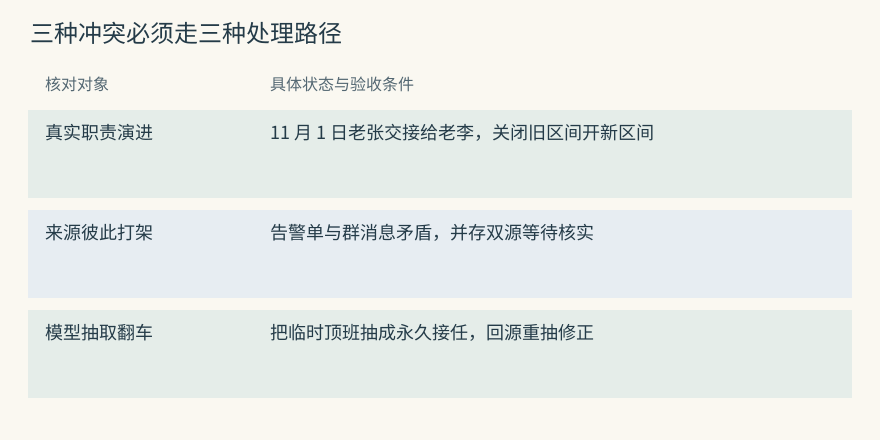
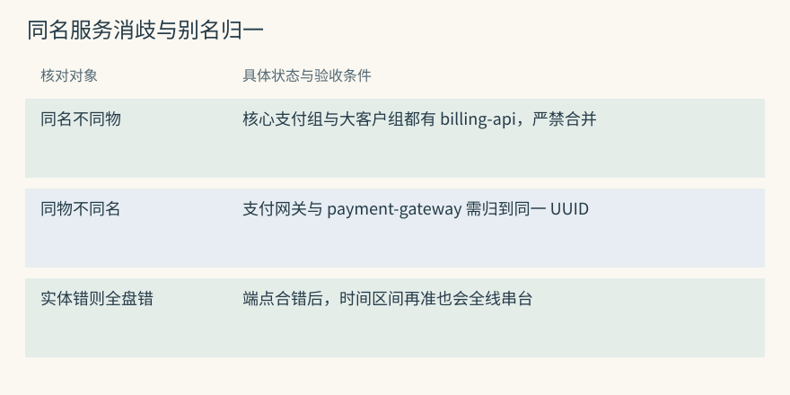
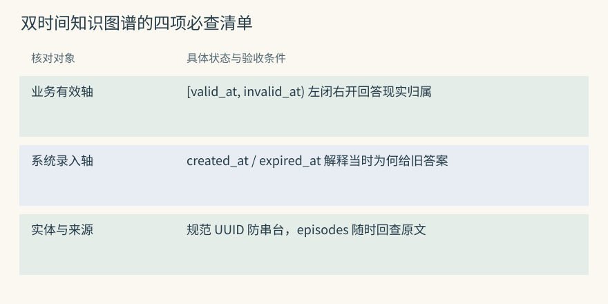

# 时间、冲突与知识图谱

## 两句完全相反的话，其实都曾经是真的

研发团队里人员交接是家常便饭：
- 10 月 3 日起，`payment-gateway` 的 on-call 与发布终审由**老张**负责；
- **11 月 1 日**起，职责正式交接给**老李**；
- 但因为交接表忘填，系统直到 **11 月 4 日**才收到这条交接通知。

现在团队里有两个人来问研发助手：
- 问一（今天查现行规则）：“今天发版找谁终审？” → **老李**。
- 问二（审计历史事故）：“10 月 20 日那次发布为什么找老张签字？” → 因为 10 月 20 日那天现实中就是**老张**负责！

如果你把“老张”直接 `UPDATE` 覆写成“老李”，审计历史就毁了；如果你把两条记录都留在库里却不带有效区间，模型每次都会同时看到“老张负责”和“老李负责”，只能抓阄。

最干净的表达是**左闭右开有效区间 `[valid_at, invalid_at)`**：
- 老张：`[2026-10-03, 2026-11-01)`
- 老李：`[2026-11-01, null)`（`null` 代表“尚未记录结束”，不是“永久不变”）

用左闭右开的好处立竿见影：在 11 月 1 日零点交接那一瞬间，查询只精确落在新关系（老李）上，既不会两个人都生效，也不会出现一秒钟的真空期。

## 为什么一根时间轴不够用：拆开“现实有效时间”和“系统获知时间”

刚才那个“11 月 1 日交接、11 月 4 日才录入”的晚到通知，直接把单时间轴打穿了。看下面两个关于 **11 月 2 日**的追问：

1. **“11 月 2 日那天，现实中到底该找谁当 on-call？”**
   答案是**老李**——这问的是**业务有效时间（Valid Time：`[valid_at, invalid_at)`）**。
2. **“既然 11 月 2 日已经是老李了，为什么那天凌晨告警时，研发助手把告警派给了老张？”**
   因为 11 月 2 日那天，4 日的通知还没录入系统，当时系统手里掌握的合法资料就是老张！这问的是**系统录入时间（Transaction / Ingestion Time：`created_at` / `expired_at`）**，必要时还要配合当时请求实际注入的快照来佐证。

<figure class="concept-diagram" tabindex="0" data-review-figure="memory-bitemporal">
<svg xmlns="http://www.w3.org/2000/svg" viewBox="0 0 960 488" role="img" aria-labelledby="memory-bitemporal-title memory-bitemporal-desc" style="display:block;width:100%;min-width:620px;height:auto">
<title id="memory-bitemporal-title">晚到交接通知：现实生效日与系统获知日不是同一天</title>
<desc id="memory-bitemporal-desc">payment-gateway 的 on-call 职责在 11 月 1 日从老张交接给老李，系统直到 11 月 4 日才录入通知。回答 11 月 2 日现实该找谁与当时助手为何找老张，需要两条不同的时间轴。</desc>
<rect width="960" height="488" fill="var(--paper,#faf8f1)"/>
<g font-family="'IBM Plex Sans','Noto Sans CJK SC',system-ui,sans-serif"><text x="40" y="48" font-size="28" fill="var(--ink,#243b48)" text-anchor="start">晚到交接通知：现实生效日与系统获知日不是同一天</text><text x="40" y="96" font-size="20" fill="var(--ink,#243b48)" text-anchor="start">现实有效时间</text><text x="40" y="284" font-size="20" fill="var(--ink,#243b48)" text-anchor="start">系统获知时间</text><path d="M240 180H840M240 360H840" stroke="var(--muted,#536772)"/><path d="M240 172V188M240 352V368" stroke="var(--muted,#536772)"/><text x="240" y="216" font-size="18" fill="var(--muted,#536772)" text-anchor="middle">11/1</text><text x="240" y="396" font-size="18" fill="var(--muted,#536772)" text-anchor="middle">11/1</text><path d="M440 172V188M440 352V368" stroke="var(--muted,#536772)"/><text x="440" y="216" font-size="18" fill="var(--muted,#536772)" text-anchor="middle">11/2</text><text x="440" y="396" font-size="18" fill="var(--muted,#536772)" text-anchor="middle">11/2</text><path d="M640 172V188M640 352V368" stroke="var(--muted,#536772)"/><text x="640" y="216" font-size="18" fill="var(--muted,#536772)" text-anchor="middle">11/3</text><text x="640" y="396" font-size="18" fill="var(--muted,#536772)" text-anchor="middle">11/3</text><path d="M840 172V188M840 352V368" stroke="var(--muted,#536772)"/><text x="840" y="216" font-size="18" fill="var(--muted,#536772)" text-anchor="middle">11/4</text><text x="840" y="396" font-size="18" fill="var(--muted,#536772)" text-anchor="middle">11/4</text><circle cx="240" cy="180" r="6" fill="var(--forest,var(--accent,#29564c))"/><circle cx="840" cy="360" r="6" fill="var(--forest,var(--accent,#29564c))"/><text x="240" y="140" font-size="20" fill="var(--ink,#243b48)" text-anchor="start">11/1 起：老李接任 payment-gateway on-call</text><text x="480" y="320" font-size="20" fill="var(--ink,#243b48)" text-anchor="start">11/4 才录入交接通知</text><text x="40" y="452" font-size="18" fill="var(--ink,#243b48)" text-anchor="start">问 11/2 现实该找谁：老李；问 11/2 助手为何找老张：查当时系统已知版本与输入快照。</text></g>
</svg>
<figcaption>图：双时间轴把“客观世界何时改变”与“系统何时知道”拆干净，晚到通知才不会把历史审计搅成一锅粥。</figcaption>
</figure>

<details class="source-example">
<summary>源码核验：Mem0 与 Graphiti 怎么处理双时间（选读）</summary>

### Graphiti：四组时间字段 + `SearchFilters` 显式过滤

Graphiti 的 `EntityEdge` 原生带 `valid_at`、`invalid_at`（业务有效轴）和 `created_at`、`expired_at`（系统时间轴），Episode 则带 `reference_time` 作为解析“上周”“1 号起”的锚点。注意：**表里有字段不代表默认 `search()` 会自动帮你筛成严格当前视图**，查询特定日期时要显式传 `SearchFilters`：

```python
from datetime import datetime, timedelta, timezone
from graphiti_core.search.search_filters import ComparisonOperator, DateFilter, SearchFilters

tz = timezone(timedelta(hours=8))
target = datetime(2026, 11, 2, tzinfo=tz)
filters_at_day = SearchFilters(
    valid_at=[[DateFilter(date=target, comparison_operator=ComparisonOperator.less_than_equal)]],
    invalid_at=[
        [DateFilter(comparison_operator=ComparisonOperator.is_null)],
        [DateFilter(date=target, comparison_operator=ComparisonOperator.greater_than)],
    ],
)
```

同一字段的外层列表是 `OR`、内层是 `AND`，合起来就是标准的 `valid_at <= target AND (invalid_at IS NULL OR invalid_at > target)`。

另外在 2026-11 同步的 Graphiti `v0.31.2+`（[graphiti.py](../../sources/repos/graphiti/graphiti_core/graphiti.py)）中，Graphiti 正式引入了 **`SagaNode`** 及其叙事总结能力，可以把围绕同一次故障或长程发版的连续多段 Episode 串成一条主线；同时参考 MCP 和 REST 服务默认收紧为仅监听 `localhost`，减少误暴露内网图库的隐患。

### Mem0：开源版 `created_at` 与 `expiration_date` 都不是双时间

Mem0 的 `created_at` / `updated_at` 只是系统写入/修改时间，`expiration_date` 只是控制卡片到期后不在默认搜索里展示（类似有效期隐藏），开源本地快照也不支持直接传顶层 `timestamp` 或 `search(reference_date=...)` 做双时间查询。如果业务要支持“晚到通知”的历史回溯，必须在业务外层自己维护 `valid_from / valid_to` 版本表。

</details>

## 别把所有“冲突”都一刀切覆盖：三种冲突走三条路

看到新旧两条信息对不上，最偷懒也最危险的做法就是“后写入的直接覆盖先写入的”。其实“冲突”分三种截然不同的情况：

1. **真实状态演进**：11 月 1 日老张正式把 on-call 交接给老李 → 关闭旧有效区间（填 `invalid_at`），开启新区间，历史完整保留。
2. **来源彼此打架**：排班系统写着本周是老李，但运维群公告写着还是老张 → **绝不能按谁晚入库就判谁对！** 必须同时保留两份证据和出处，提示人去核实。
3. **抽取或录入错误**：原话明明说“老李本周五临时顶班”，模型抽成了“老李永久接任” → 这不是状态演进，必须回到原事件重抽并撤回错误的派生记录。

还有一种假冲突要重点提防：**单次例外与不同职责不是冲突**。
- “本周五紧急 hotfix 找老张”和“11 月起常规发布找老李”完全兼容，前者绑定本次任务，绝不能把后者的长期规则关掉；
- “老李负责 `payment-gateway` 的应用发布”和“老王负责 `payment-gateway` 的数据库变更”职责不同，更不能因为都叫“负责人”就互相顶掉！

<details class="source-example">
<summary>源码与边界：警惕“纯靠相似度猜冲突”（选读）</summary>



### Graphiti：先语义判矛盾，再做时间窗口运算

Graphiti 的 `resolve_extracted_edge()` 先由模型判断是否重复或矛盾，再由 `resolve_edge_contradictions()` 按区间重叠关系把旧边的 `invalid_at` 设为新边的 `valid_at`、把 `expired_at` 记为当前处理时间。时间算术本身很严谨，但前提是上一步模型没有把“临时顶班”误判为“永久矛盾”。

### MCP Memory Service：可选的相似度矛盾启发式要慎用

翻看 [contradictions.py](../../sources/repos/mcp-memory-service/src/mcp_memory_service/consolidation/contradictions.py)，它的可选矛盾检测默认关闭，开启后会挑出向量相似度落在 `0.4 ~ 0.75` 之间的近邻，按创建时间把旧的标成 `superseded_by`。这种纯靠相似度区间 + 时间先后猜矛盾的启发式非常容易误伤——“老李管应用发布”和“老王管数据库变更”的相似度很可能刚好落在 `0.55`！开启前一定要先预览并配好反例测试。

</details>

## 实体消歧（Entity Resolution）：端点合错了，时间再准也全线串台

双时间图谱里另一个隐形杀手是**实体消歧**，它同时面临两个方向的坑：
- **过度合并（同名不同物）**：公司里核心支付组有个 `billing-api`，企业大客户组也有个 `billing-api`。如果实体解析光看名字相同就把它们合并成一个节点 UUID，核心支付组的 on-call 交接立刻就会串台到大客户组！
- **过度拆分（同物不同名）**：一份文档写 `payment-gateway`，另一份口语写“支付网关”。如果拆成两个毫无关系的节点，交接通知挂在“支付网关”上，发版查 `payment-gateway` 时就根本查不到更新。



所以做实体解析时，一定要把**作用域（团队/仓库）、唯一标识（服务 ID/代码仓路径）和上下文**一起塞给解析器，验收时直接核对最终的规范 UUID，不要只盯着界面上显示的名字看。

## 什么时候根本不该上知识图谱？

知识图谱听着高级，但它的工程账单实打实摆在那里：每写一条消息都要多跑几次 LLM 结构化抽取、做实体消歧、维护图数据库和索引，而且一旦发生同名误合并，拆节点 + 重建摘要的善后成本极高。

**先别迷信图谱，按这三条标准做决定：**
- 如果你的研发助手 90% 的查询都是“搜单条发布规程、读个人偏好”，老老实实用“受限混合检索 + 外层版本字段”更稳更便宜；
- 只有当你真的面临两类纯检索搞不定的高频痛点——**① 跨文档两跳/多跳关联**（文档 A 写服务归属团队，文档 B 写团队审批人，两份文档字面不重合），或者 **② 严格的双时间历史追踪**——再引入图谱（Graphiti / Cognee / HippoRAG）；
- 引入前，先拿纯检索跑挂的那批真实失败题建基线，固定相同的 Token 预算和回答模型，证明图谱带来的净收益盖得住建图费用和纠错成本。

<details class="implementation-notes">
<summary>实现笔记：图谱的三种不同用途与双时间核验清单（选读）</summary>

市面上同样打着“图谱记忆”旗号的项目，底层解决的根本不是同一个问题：
- **Graphiti（双时间事实图）**：重点在“规范实体 + 双时间事实边 + 来源回溯”，适合解决“什么时间、谁管什么、历史怎么变”。最新 `2026-11` 版本还强化了 `SagaNode` 叙事串联以及 `remove_episode()` 删除后的共享边保护与存活节点摘要重算。
- **HippoRAG（联想传播图）**：用 OpenIE 从文档抽三元组连成短语-段落图，再用 Personalized PageRank（PPR）把查询种子扩散到没出现查询字面的多跳段落。它主攻“跨文档关联到达”，并不原生维护双时间有效区间或用户权限。
- **Cognee（异构 Schema 管线图）**：按自定义 Pydantic Schema 把文档、代码、会话塞进关系+图+向量多存储里。同样，它不是开箱即用的双时间冲突裁决器。
- **Basic / A-MEM / TencentDB CodeGraph**：Basic 的边是人写的 Markdown 链接，A-MEM 的边是模型建议的笔记关联，CodeGraph 的边是代码符号调用关系——同样画成点和线，语义完全不能互换。

如果你决定给研发助手上时间与关系能力，上线前至少拿这 6 道必考题跑一遍回归：
1. 交接前查询（10 月 20 日 → 老张）；
2. 交接瞬间查询（11 月 1 日 00:00 → 仅老李，无双值）；
3. 晚到通知后的现实回溯（11 月 4 日补录后问 11 月 2 日现实职责 → 老李）；
4. 晚到通知前的系统知识审计（11 月 2 日助手为何找老张 → 依赖当时版本或请求快照）；
5. 单次例外隔离（周五 hotfix 找老张，不关闭老李长期职责）；
6. 同名隔离 + 别名打通（两个 `billing-api` 不合并，`payment-gateway` 与“支付网关”合并）。

</details>

## 动手检查

11 月 4 日系统收到一条综合通知：“11 月 1 日起 `payment-gateway` 的夜间 on-call 改由老李负责，本周五紧急 hotfix 仍找老张，白天值班安排不变。”
1. 请列出这三条信息各自的适用范围、生效日与系统获知日；
2. 事后追问“11 月 2 日夜间现实该找谁”与“11 月 2 日凌晨助手当时知道该找谁”，分别要查什么证据？

答案提示：夜间 on-call 变更生效日为 11 月 1 日、获知日为 11 月 4 日，且仅限夜间职责，绝不能顺手改掉白天值班；周五 hotfix 仅绑定本次任务，不能关闭老李的长期区间。问 11 月 2 日现实归属查有效时间轴（答案：老李）；问助手当时为何派给老张，必须查系统时间轴上 11 月 2 日已录入的版本（以及当次调用的实际 Prompt 快照）。

<figure class="concept-diagram" tabindex="0"><figcaption>图：历史问题先分清在问哪条时间轴，再核对实体 UUID 和原文出处。</figcaption></figure>

<details class="comparison-reference">
<summary>项目对照速查（选读）</summary>

## 本章对照结论

| 项目 | 时间与图关联的核心机制 | 落地时最该验证的短板 |
|---|---|---|
| Graphiti | 双时间边（`valid_at`/`invalid_at` + `created_at`/`expired_at`）、实体消歧、`SagaNode` | 显式 `SearchFilters` 过滤、同名误合并与基础搜索不自动多跳 |
| Hippo Memory | 显式 `supersede` + 带 `asOf` 的多跳图召回 | 衰减强度不能替代事实真伪裁决 |
| MCP Memory Service | `as_of` 历史过滤 + 可选相似度矛盾启发式 | 纯相似度猜冲突容易误伤相关但不矛盾的规则 |
| TencentDB | L1 冲突判别 + Wiki 链接 / CodeGraph 符号图 | 代码调用关系不是业务审批关系，L1~L3 并非原生双时间边 |
| Mem0 | `created_at`/`updated_at`、`expiration_date`、实体索引 | 开源版无原生双时间区间，需业务外层维护版本与生效日 |
| Memobase | 合并当前用户画像 + 事件时间线 | 历史旧值与原聊天 blob 的保留策略 |
| Cognee | 自定义 Schema 图谱与来源块 | 需按具体管线核对时间语义与跨存储恢复 |
| HippoRAG | OpenIE 短语-段落图 + PPR 传播 | 擅长多跳到达，不负责双时间历史版本裁决 |
| Basic Memory / Letta Code | 显式链接 / Git 修订历史 | Git commit 时间是编辑时间，不是业务生效时间 |
| A-MEM / MemoryOS / MemOS | 邻居链接演化 / 主题页 / 多形态容器 | 不原生提供可按任意业务日期回溯的双时间关系边 |
| Agent Beacon / Hermes Jev | 动作事件时间线 / 日期锚点判别 | 只提供事件素材或单次判别，不维护长期历史图 |

</details>
