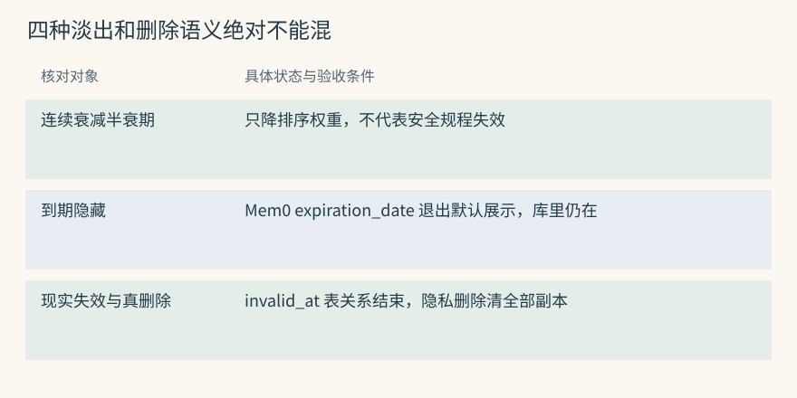
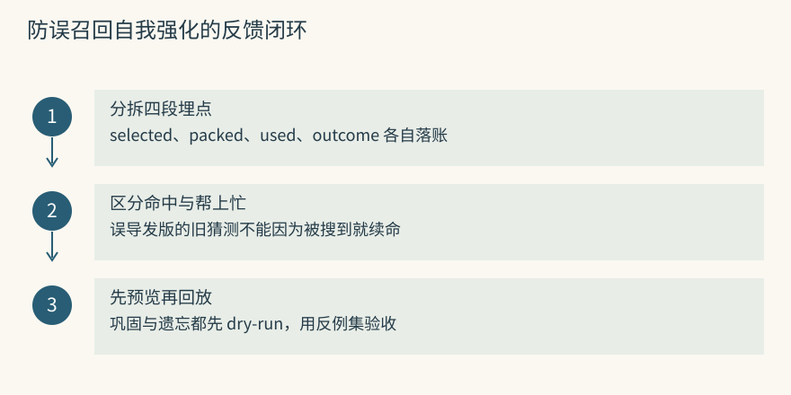
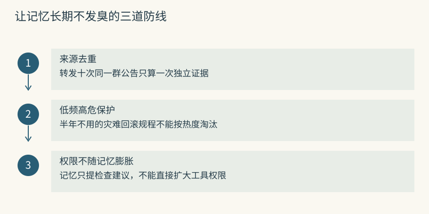

# 巩固、遗忘与自我改进

## 跑了半年之后，为什么记忆库越用越傻？

很多团队刚接上记忆系统那两周觉得特别惊艳，结果跑了半年发现助手越来越蠢：
- 同样一条“发 `payment-gateway` 前查幂等键”，因为每次发版复盘都提一遍，库里攒了十几张说法大同小异的卡片，一搜 Top-5 全是重复废话，把真正不同的例外全挤没了；
- 三个月前修掉的临时 workaround、早就下线的老接口配置，依然靠高字面相似度霸占着搜索前排；
- 更要命的是，某条写错了根因的旧猜测因为标题写得像，每次都被搜出来，而系统只要“搜到就给它加活跃度”，结果**错误记忆越错越顽固**！

解决“记忆发臭”的药方，就是**生命周期治理**：把零散经历提炼成干净规程（巩固）、让过时噪音有序退场（遗忘）、用真实任务结果而不是“命中次数”来校准记忆（反馈闭环）。

## 巩固（Consolidation）：压缩冗余，但别把不同根因强行揉成假规律

举个研发里特别常见的反面教材：过去一个季度，`payment-gateway` 上线被拦下来三次：
- 第 1 次：幂等键 TTL 配短了；
- 第 2 次：改错了环境变量文件，发到了预发集群；
- 第 3 次：幂等键配置没问题，但缺少压测报告审批。

如果你用粗糙的聚类器把这三次“发版失败”揉成一条总结——“以后 `payment-gateway` 每次发版失败都是因为幂等键问题，直接重新生成幂等键配置”——那就酿成了两个经典压缩翻车：
1. **强行归因**：三次根本不是同一个原因，最多只能汇总成清单“发版前分别核对幂等键、目标环境与压测审批”，每条各自挂回自己的原始事故单；
2. **动词悄悄扩权**：原话只是“**核对**幂等键配置”（只读检查），摘要一不小心压成了“每次发版前**重写**幂等键配置”（危险写操作）。字面相似度极高，副作用却放大了十倍！

同时还要提防**“伪独立证据”**：如果老张在飞书群里发了一份通知，被四个转发机器人各转了一遍，巩固器如果傻数来源条数，就会把 1 次通知误算成 5 次独立验证。巩固前必须先追共同源事件，合并重复表达但保住真实来源独立性。

<details class="source-example">
<summary>源码与 2026-11 新进展：Mem0 Dream 与 Graphiti 摘要边界（选读）</summary>

### Mem0：开源仍靠外层治理，托管侧 2026-11 上线了 Dream 引擎

我们前面讲过，Mem0 本地开源同步路径默认是 ADD-only，不会定期自己做高层巩固；哪怕用 `memory_type="procedural_memory"` 总结轨迹，产出的也只是一段待审核的文本草稿，并不会自动跑反例回放。

不过在 **2026 年 10—11 月**，Mem0 在托管 Pro / Enterprise 平台侧正式上线了后台异步巩固引擎 **Mem0 Dream**——专门用来在后台合成高层模式、合并重复事实，并把过时信息标记为 `superseded`。这恰好直接回应了 Mem0 开源版缺少后台 sleep 巩固的短板。**选型时一定要分清：Dream 是托管云能力，自建 OSS 依然需要你自己写巩固脚本和版本治理。**

### Graphiti：重复边能聚来源，但不等于图不会膨胀

Graphiti 遇到重复事实时会复用旧边并往 `episodes` 里追加来源 UUID，节点 `summary` 也会汇总新信息。但长期跑下来，大量一次性临时任务照样会让图越长越胖；而且 `episodes` 列表长度只代表“提过几次”，不代表“验证成功几次”。

</details>

## 四种“淡出与删除”语义，绝对不能混为一谈

工程里最容易吵架的一个词就是“遗忘（Forgetting）”。一定要把下面四种动作彻底拆开，它们干的根本不是一件事：



1. **连续衰减（半衰期降权）**：比如 Hippo Memory 用 `strength = initial * 0.5^(elapsed / half_life)` 调节排序权重——初始 0.8、半衰期 10 天，第 10 / 20 / 30 天分别降到 0.4 / 0.2 / 0.1。
   - **边界**：它只表示“最近少用，排序往后挪”，**绝不代表事实变假**！一条半年才用一次的“支付核心灾难回滚手册”，必须设置 `pinned` 或高危保护，绝不能因为访问少就自动淡出！
   - **参数换算坑**：不同框架的衰减公式不能直接抄天数。Hippo 用 `0.5^(age / half_life)`，而 [MCP Memory Service 的 decay.py](../../sources/repos/mcp-memory-service/src/mcp_memory_service/consolidation/decay.py) 用的是自然指数 `exp(-age / retention_period)`。想要第 10 天正好减半，`retention_period` 得设成 `10 / ln(2) ≈ 14.43` 天，设成 10 天在第 10 天会掉到 `0.368`。
2. **到期隐藏（TTL / Expiration）**：比如 Mem0 的 `expiration_date`，到点后自动退出默认搜索结果（传 `show_expired` 还能看），适合活动通知、临时值班表，但正文还留在库里。
3. **现实失效（Invalidation）**：比如 Graphiti 的 `invalid_at`，表示这条关系在客观世界里结束了（老张不再是 on-call）。只能由真实变更事件触发，绝不能因为“三个月没人问”就给它写 `invalid_at`！
4. **合规物理删除（Erasure）**：用户注销或法规要求清除敏感信息。归档、降权、写 `valid_to` 统统不算删除！你必须顺着血缘图把**原文、向量索引、图边、实体摘要、SQLite 历史表、Git 提交历史和备份恢复重放**全链路扫干净。

## 切断“误召回自我强化”的死循环

回忆一下第 4 章 `mini_memory.py` 里特意展示的那个简化：只要 `recall()` 搜到了一条记录，就立刻给它 `access_count + 1`。

如果在生产系统里也这么干，会发生极其荒诞的死循环：**一条错误的旧猜测因为关键词撞车，每轮都被搜出来 → 每搜出来一次热度就涨一截、半衰期就延长一点 → 下次排名更高、更难退场！**

破局的唯一办法是把检索到任务的链路拆成四个独立埋点：



- **`selected`**：记忆库把它返回在了候选列表里；
- **`packed`**：组装器真的把它装进了最终 Prompt（没被预算跳过）；
- **`used`**：回答或工具调用真的参考了它；
- **`outcome`**：这次任务最终到底成功了还是翻车了，以及成功是不是真的归功于它（如果发版成功是因为人工半路改了参数，别把功劳全记在记忆头上）。

另外记住：**如果一条记忆本身是错的，不要只给它打个负分等它慢慢衰减！** 负分在高相似度查询里照样可能被捞出来，错误事实必须显式纠正或替代。

## 自我改进的安全底线：记忆永远不能自己给自己提权

很多项目宣传“Agent 能自我学习、自动把经验沉淀成技能”，落地时必须按影响面分好闸门：
- **低风险自动**：原始日志落盘、带“待核验”标签的候选事实提取；
- **中风险先预览**：巩固合并和低价值清理一律先 `dry-run` 产出变更报告，确认没有误合并不同根因、没有误伤 `pinned` 高危规程；
- **高风险必须回放 + 审批**：把零散经验升级成长期发布规程或系统核心规则前，必须拿正反例一起回放——比如同时测“配置合规应放行”“幂等键过期应拦住”“演示环境 `dry-run` 不得真发版”“其他服务不受干扰”。

最关键的一条底线：**记忆内容永远不能扩大工具权限。** 哪怕一条巩固后的规程写着“发现配置不对就自动修改线上生产库”，只要工具层没给写权限，宿主确定性代码就必须把它死死拦住。

<details class="implementation-notes">
<summary>实现笔记：各项目的巩固与遗忘到底改了什么状态（选读）</summary>

把生命周期拆成四条彼此正交的状态机，远远好过用一个模糊的“分数”包办一切：

```text
处理状态：received → processed | failed_waiting_retry
证据等级：reported（转述/猜测） → verified（核实） | retracted（撤回）
现实效力：active → superseded（已被替代）
存储保留：online → archived（归档） → erased（物理清除）
```

看看各开源项目里的真实落点，验收时别张冠李戴：
- **MCP Memory Service**：[forgetting.py](../../sources/repos/mcp-memory-service/src/mcp_memory_service/consolidation/forgetting.py) 会按质量、闲置时间和保护规则把候选分别标为 `archived`、`compressed`、`deleted` 或 `skipped`；v13.0.0 还给整个巩固过程加上了 `consolidation_started / consolidation_phase / consolidation_completed` 阶段事件上报，方便盯紧每一步到底做了什么。
- **Cognee**：[stages.py](../../sources/repos/cognee/cognee/modules/improve/stages.py) 把 `improve` 拆成带 gate 和 watermark 游标的多个阶段（反馈权重、会话 QA、Trace 蒸馏等），某个开关没开会被跳过，返回成功不等于所有阶段都跑了。
- **Hippo Memory**：把指数衰减、召回强化、`applyOutcome` 反馈与 `sleep` 巩固分开；值得一提的是，Hippo 作者在仓库里公开记录并撤回了此前无法稳定复现的早期 `sequential-learning` 增幅数据——这种诚实态度非常值得借鉴：任何反馈增强机制都必须用你自己的业务增长池做独立消融验证。
- **MemoryOS / A-MEM**：前者靠热度把页面搬进长期层，后者在写入时修改邻居笔记的描述和链接——它们改变的是层级和发现线索，并不自带事实核验。

</details>

## 动手检查

研发助手库里同时躺着四条记录：
1. 已复盘确认的 `payment-gateway` 幂等键检查规程；
2. 今天下午演示环境只跑 `dry-run` 的临时约束；
3. 某人随口猜的“怀疑是 Redis 连接池抖动”且尚未抓包确认；
4. 禁止把 `PROD_API_KEY` 发送到外网的硬性安全策略。

请分别说明它们应该怎么设置过期、降权、纠正或保护策略。如果第 2 条记录已经“归档”退出了常规搜索，后来客户要求删除与本次演示相关的全部私有记录，归档后的它还需要处理吗？

答案提示：第 1 条设为长期有效并保护（只随正式架构变更版本替代）；第 2 条绑定任务结束即退出；第 3 条标为待核验假设，绝不因被搜到而自动升格，证伪后直接撤回；第 4 条根本不该靠记忆热度维持，必须写死在宿主确定性安全层！归档只是隐藏展示，正文仍在磁盘里，收到隐私删除请求时必须把归档、摘要、向量、历史表和日志副本一并清干净。

<figure class="concept-diagram" tabindex="0"><figcaption>图：把来源独立性、低频高危保护和工具权限边界守住，长期演化才不会帮倒忙。</figcaption></figure>

<details class="comparison-reference">
<summary>项目对照速查（选读）</summary>

## 本章对照结论

| 项目 | 生命周期机制真正改了什么 | 上线必须盯紧的风险点 |
|---|---|---|
| Hippo Memory | 强度、半衰期、outcome 与 `sleep` 合并 | 误召回自我强化、低频高危规程被误衰减 |
| MCP Memory Service | 衰减、关联、聚类、压缩、归档/删除 | 核对每个候选的实际 action，注意 τ 与半衰期换算 |
| Mem0 | OSS 为追加/显式更新与到期隐藏；托管侧新增 Dream 巩固 | 分清 OSS 与托管 Dream 边界，OSS 需外层自建巩固 |
| MemoryOS | 短期溢出转页、热度触发长期画像/知识 | 热度高不等于事实真，单次例外别被压成永久偏好 |
| A-MEM | 改写邻居笔记的 `context` / `tags` / `links` | 邻居描述语气漂移、修改后索引需同步刷新 |
| Graphiti | 重复边聚来源、冲突关旧边、更新节点 summary | `episodes` 转发数不是验证数，别拿 `invalid_at` 当热度 |
| Cognee | 按 gate 与 watermark 分阶段执行 `improve` | 某个阶段被跳过时不要误以为全部学习都已完成 |
| TencentDB | L0 → L1 → L2 → L3 层级归纳与技能版本 | 跨层来源追踪、生成版本与撤权同步 |
| Letta Code | Agent 自编辑 MemFS、Git commit 后重编译 | 自改核心规则过宽，需靠回放与人工 diff 审查 |
| MemOS | Scheduler 异步调度多形态模块 | 队列积压延迟与模型资源难以精确遗忘 |
| Basic / Beacon / Hermes | 人工编辑 / 动作采集 / 候选判别 | 各自不承担自动化长期巩固闭环 |

</details>
