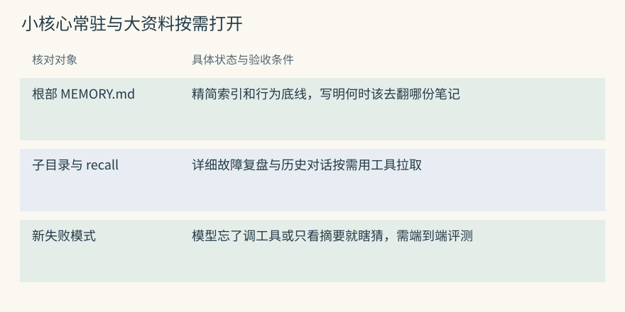
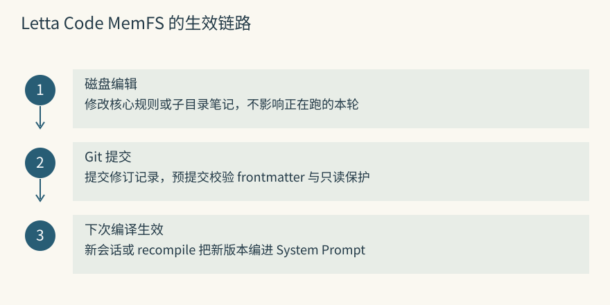
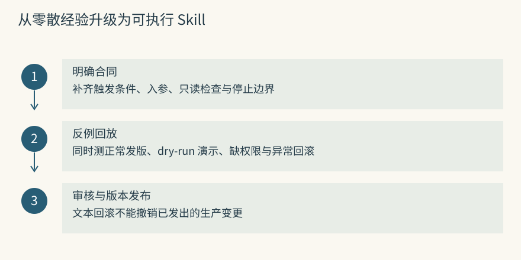

# Agent 原生记忆与技能

## 宿主猜不中要搜什么时，让 Agent 自己去翻笔记

前面几章聊的几乎都是“宿主在调用模型前，先帮它搜好塞进 Prompt”。但研发工作里经常冒出这种问题：

> 林远：“上周三夜里那个重试超时的排查，最后到底为什么没发版？”

这句话里既没有服务名 `payment-gateway`，也没有错误码 `PAY-409`，甚至没提版本号。宿主如果只拿这句话去做一次性向量搜索，十有八九捞回来一堆风马牛不相及的“超时”记录。

**Agent 原生记忆（Agent-Native Memory）**换了个思路：与其让宿主在盲猜中一次性把所有历史塞给模型，不如**给模型一套常驻的极简目录 + 翻阅外部历史的工具**。模型发现自己缺信息，就主动发工具调用去搜上周三的会话、顺藤摸瓜找到 `release-14` 事故单，看缺什么再接着翻——这就是最早 **MemGPT** 提出的“虚拟上下文”控制思想。

注意：它没有变出无限上下文，更没有在线训练模型权重；它只是把“决定下一步读哪段历史”的主动权交给了模型。同时，它也带来了全新的失败模式：**模型可能压根忘了调工具，直接凭模糊印象瞎编一个原因！**

## 2026-11 主线切换：告别旧 Letta 服务端，看懂 `Letta Code` 的 MemFS

如果你去网上搜 MemGPT / Letta 的老教程，很容易撞进旧的 `letta-ai/letta` V1 Python 服务端架构里。**截至 2026 年 11 月，旧服务端仓库已经正式退役归档，Letta 的主战场彻底收敛到了基于文件系统的 [Letta Code](../../sources/repos/letta-code)（MemFS）**。

打开最新 2026-11-21 快照的 [letta_root_memfs.md](../../sources/repos/letta-code/src/agent/prompts/letta_root_memfs.md)，这套设计的优雅之处在于**直接借用了程序员最熟悉的两样东西：Markdown 目录树 + Git**！

它的分层非常清爽：
- **不可变的 Recall 历史**：所有对话消息由 harness 自动落库保存，模型不能篡改历史，需要时通过 recall 工具检索；
- **可编辑的 MemFS（投影到本地 `$MEMORY_DIR`）**：
  - **根目录文件（常驻 System Prompt 的 Core Memory）**：根目录的 `MEMORY.md` 是不带 frontmatter 的总览索引，其他根目录 Markdown（比如 `persona.md`、`preferences.md`）必须严格带 `name` 和 `description` 两个 frontmatter 字段，用来放最核心的身份、行为底线和发现索引；
  - **子目录延迟加载（Deferred Memory）**：只有包含自己 `MEMORY.md` 的子目录才算记忆目录，里面放详细的项目规程、故障复盘（比如 `services/payment-gateway.md`），用普通相对 Markdown 链接串联（不再是旧版的 `[[path]]` 语法），模型先看索引、真需要时才调工具打开全文；
  - **独立技能目录 `skills/` 与共享记忆挂载**：跨项目复用的过程性技能单独放在 `skills/`；多 Agent 共享的团队记忆可以挂成独立的 Git 仓库（默认 shallow checkout 浅克隆，按需 `git fetch` 拉历史）。



2026 年 10—11 月间，`letta-code` 在 `v0.33 → v0.34.x` 版本里又补齐了几个很务实的工程硬骨头：
- **多子 Agent 并发的 Git worktree 隔离**：多个子 Agent 同时干活改代码、写记忆时，用独立 worktree 隔离工作区并上报父子血缘，不再互相踩脏文件；
- **会话级 `client_skills` 冻结与增量提醒**：避免一轮长任务跑了一半，外部技能列表悄悄漂移导致模型行为错乱；
- **安全与长程运行加固**：明确禁止把密钥、Token 写进 Git 跟踪的 MemFS（密钥必须进 harness secrets store，引用 `$SECRET_NAME`），对工具溢出文件做密钥自动脱敏，并在提示词里明确用 `Monitor`（事件驱动）和 `Wake`/`cron`（定时）做跨时间延续，而不是干等轮询。

## 写完记忆文件，为什么这一轮还没生效？

这是刚接触 MemFS 的开发者最容易犯晕的地方：**你在第 3 步改了磁盘上的 `preferences.md`，为什么正在跑的这一轮回复还是按老规矩来？**



看清 [letta_root_memfs.md](../../sources/repos/letta-code/src/agent/prompts/letta_root_memfs.md) 里写死的三步生效契约：
1. **磁盘编辑（Edit）**：你改的是本地文件，不会回头改写已经发给大模型推理的本次 Prompt；
2. **Git 提交（Commit）**：MemFS 是 Git-backed projection，修改必须 `git commit`（pre-commit 钩子会校验 frontmatter 格式与只读保护，共享仓在回合结束后由 harness 推送）；
3. **后续编译（Recompile）**：只有在新开会话、显式触发 recompile 或检测到新的已提交 revision 时，harness 才会把最新根文件重新编译进 System Prompt！

所以规则很直白：**改记忆文件是写给“未来的自己”看的；如果这一轮立刻要按新规则办，直接在当前对话里照做就行，别傻等提示词自动刷新。** 顺带一提，Mem0 调 `update()`、Graphiti 写入新 episode 也是一样——改的都是外部存储，不会魔法般改写正在生成中的那次请求。

## 好索引怎么写，才不会逼模型“盲翻”或“瞎猜”

小核心（`MEMORY.md`）就是 Agent 的脑内地图，写得好不好直接决定按需加载的成败：
- **反面示范**：`- [支付服务](services/payment.md)` → 模型根本不知道什么场景下该打开它，要么每次都打开浪费 Token，要么真需要时直接忽略。
- **正面示范**：`- [payment-gateway 发布与排障规程](services/payment.md) — 凡涉及支付网关发版、幂等键配置核对、PAY-409 排查前必读；仅跑 dry-run 演示时勿触发正式发布`。

同时别把详细步骤既抄一份在根 `MEMORY.md` 里、又留一份在子文件里——两处不同步时，模型读了根里过时的半截摘要就直接干活，肯定出事。

## 从一条教训，升级成一个靠谱的 Skill

“发 `payment-gateway` 前查幂等键”只是一条**记忆（知道要注意什么）**，离真正可复用的**技能（Skill，知道一步步怎么安全干完）**还差一大截。一个能上生产的发布检查 Skill 至少要写齐五项合同：

```text
触发条件：用户明确要求发布 payment-gateway（正式/预发环境）。
必选入参：目标版本、目标环境、当前鉴权身份。
只读核验：读取当前 idempotency_key TTL、最大重试窗口、当日 on-call 审批状态。
停止条件：TTL < 重试窗口、缺审批、或用户明确仅跑 dry-run 时，立即停止并回报缺口。
执行验收：经人工确认后才调用发版工具，并读回真实部署状态与回滚版本号。
```

把经验沉淀成 Skill 之前，最容易犯的错误是**过度泛化**。比如林远纠正了一句“上次只是演示页面，别替我发版”，如果 Agent 自己把核心规则改写成“永远不要帮林远发布 `payment-gateway`”，它以后就废了。

还要记住一条铁律：**Git 回滚文本，救不了已经发出去的生产事故！**
- 就算你用 `git revert` 一秒钟把写错的 `skills/deploy.md` 滚回上一版，也只能保证**以后**不再犯错；刚才那次误触发的线上发布、已经发出去的告警通知，必须靠业务侧的回滚和补偿流程处理。
- 同样，像 [TencentDB 的技能版本实现](../../sources/repos/tencent-agent-memory/MemoryCore/src/core/skill/skill-versioning.ts) 那样，即便做了严格的版本号递增、hash 校验和资源目录拷贝，**版本化只管发布流程不丢文件，绝不等于替你做完了安全评审和行为回放**。

<details class="implementation-notes">
<summary>实现笔记：不同项目的“渐进加载”与自编辑边界（选读）</summary>

“小入口常驻、大资料按需读”不只是 Letta Code 在用，好几个主流项目都走了渐进加载，但控制权和生效方式很不一样：
- **Letta Code（MemFS）**：编译时把根 Markdown 塞进 System Prompt，子目录文件和 recall 历史由模型自己调工具读；修改必须 `git commit` + 下次编译才生效。`/doctor` 会盯紧核心文件别膨胀过大。
- **TencentDB Agent Memory**：Proxy 在请求前注入高层核心摘要（L3）和技能路由摘要，L0/L1 明细和完整技能步骤由 Agent 调工具按需拉取；同时要盯紧资产版本和代理缓存同步。
- **Basic Memory**：人写 Markdown 当真相源，Agent 已知 `memory://` URI 时直接精准读取，再按有限深度展开关联笔记。
- **把 Mem0 / Graphiti 包装成工具**：宿主也可以把 `mem0.search()` 或 `graphiti.search_()` 封装成模型可调用的 Tool，但认证和可见范围必须由宿主代码硬注入，**绝不能让模型自己填 `user_id` 或 `group_id` 去查别人的数据**，同时还要给工具调用次数设上限防止无限追查。
- **防“自言自语当证据”**：不管用哪种自管理架构，都别让 Agent 把自己上一轮没验证的猜测写进记忆文件，下一轮再把这份文件读回来当成“第二份独立证据”。规则修订必须锚定回用户原话、真实工具输出或正式复盘文档。

</details>

## 动手检查

研发助手使用类 MemFS 的文件记忆，出现两次故障：
1. 你更新了 `services/payment-gateway.md` 里的最新幂等键规则，但根 `MEMORY.md` 里没加链接，下一次发版时助手完全没读到它；
2. 助手自己改了根 `preferences.md` 保存林远的新偏好，但忘了 `git commit`，而且林远希望**就在当前这一轮对话里**立刻生效。

请分别说明这两次故障该查哪几个环节，以及第 2 种情况怎么处理才能让当前对话立刻按新偏好走？

答案提示：第 1 次属于“发现入口缺失”，查根索引有没有写清触发条件与相对路径、模型有没有发起文件读取工具调用；第 2 次要区分磁盘编辑、Git 提交和下次编译三种状态——先补提交保证后续新会话能编译进去，而**当前这一轮对话里，必须直接遵循本轮消息里的最新要求**，绝不能指望改完文件后当前正在跑的 Prompt 会自动热更新。

<figure class="concept-diagram" tabindex="0"><figcaption>图：记住了教训不等于拥有了安全技能；合同、反例回放和权限边界一个都不能少。</figcaption></figure>

<details class="comparison-reference">
<summary>项目对照速查（选读）</summary>

## 本章对照结论

| 实现 | 小入口到详情的加载方式 | 生效机制与最容易踩的坑 |
|---|---|---|
| MemGPT / 历史 Letta | 核心常驻 + recall/archival 读写工具 | 已归档，适合学主动换入思想，不要照搬旧 V1 协议 |
| Letta Code（2026-11 主线） | 根 `MEMORY.md`/core 常驻 + 子目录/recall/skills 按需读 | 须 `git commit` 且在后续编译生效；v0.34 强化 worktree 隔离与技能冻结 |
| TencentDB | Proxy 注入高层摘要 + 工具按需查低层与完整 Skill | 核对版本、缓存一致性与资产撤权 |
| MemOS | Reader 与插件组织经验/策略/技能 | 模块处理延迟，别和 KV/LoRA 物理形态混淆 |
| Basic Memory | 已知 `memory://` URI 直读 + 限深展开 | 文件同步窗口、并发编辑与 Git 历史隐私残留 |
| Hippo Memory | 本地项目 `.hippo/` + hook 注入与按需 recall | 防止误强化，Markdown 镜像遵循同步约定 |
| Cognee | 类型化 Skill / Session 路由召回 | 拿到步骤文本不等于拥有工具执行权限 |
| Agent Beacon | 捕获跨宿主工具轨迹供人工/下游提炼 | 轨迹是原料，还不是审核过的 Skill |
| Hermes Jev Skills | `skillpick` 在大量技能中做轻量路由选择 | 只管单次选择，不管技能发布与授权 |
| Mem0 / Graphiti | 宿主可封装成 Tool 供模型按需查 | 必须由宿主锁死认证 scope，并限制递归查证次数 |

</details>
