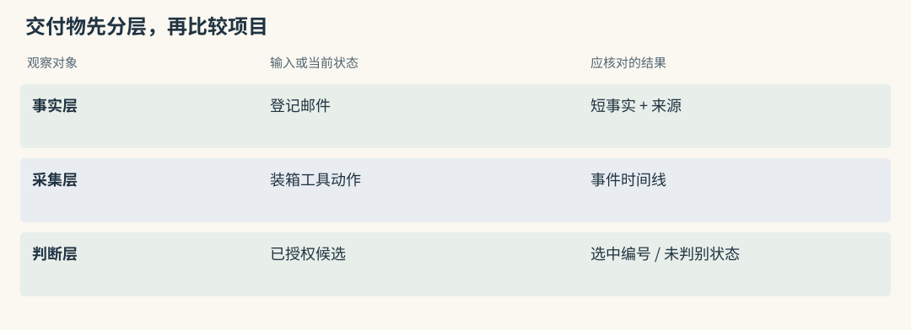
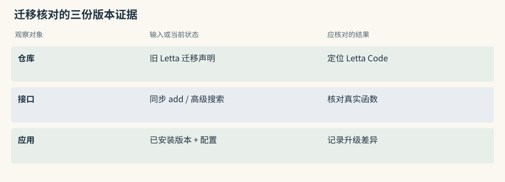
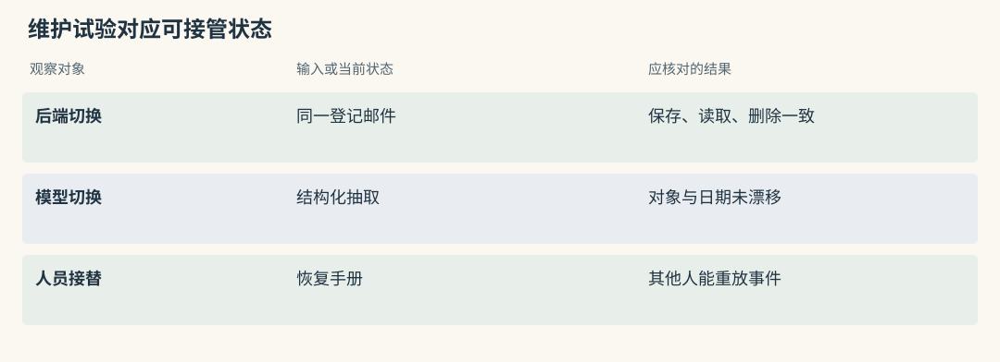
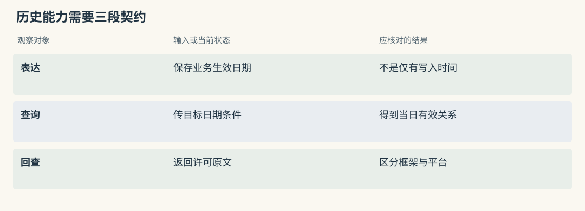
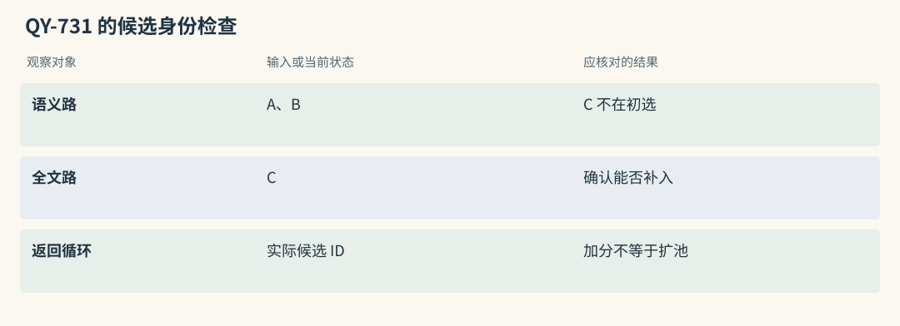
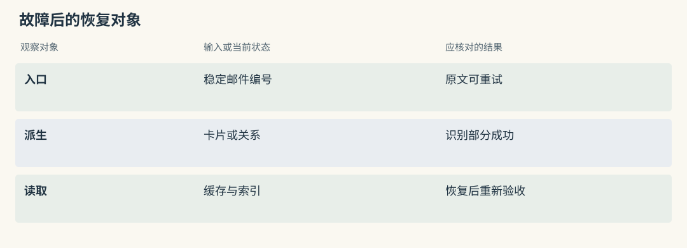
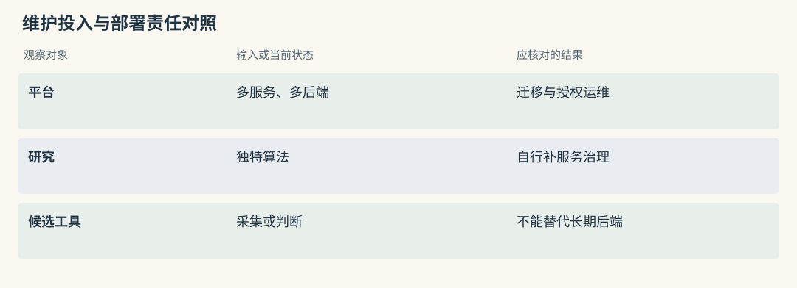

# 怎样读懂一个记忆项目

## 找到了项目，先确认它要替你做哪件事

博物馆借展助手收到一封邮件，要记住登记员周岚的沟通习惯，也要查清青釉执壶由谁管理、借出前须取得哪份许可。这三件事分别涉及用户资料、藏品关系和审批证据。先把需要交付的结果写清，再打开项目主页，搜索范围会小很多。

可以为候选项目填写一条数据契约：从哪里接收材料，持久化哪些对象，查询返回什么，应用还要做哪些工作。Mem0 返回短事实候选，Beacon 提供行动记录，Hermes 可以判断一批已有候选。后两者不会因为出现在记忆项目清单里，就成为前者的替代数据库。

教学中假定馆内已经保留邮件原文。若目标只是让助手下次记得周岚希望用表格列借展清单，可以先试事实存取；若目标是解释为什么某次装箱被暂停，则需要工具记录和审核意见。选项目之前，把这两道题分开验收。

源码路径与适用范围（选读）

### Mem0：先区分 SDK、平台与业务 assembler

安装 Python 包得到的是调用入口。模型客户端、embedding 和向量后端仍须配置，登录身份和最终消息由业务程序负责。借展系统通过本地 `Memory` 保存“清单按藏品编号排序”时，应记录实际启用的 provider，不能把官网托管产品中的权限面板、延迟承诺一并算作已安装功能。

检查交付物可以追三个位置：构造对象时读了哪些配置，写入时发往哪些服务，搜索结束时谁把候选放进模型输入。任何一处仍是空白，都属于接入方的工作，而非一句 managed memory 能够填上的能力。

### Graphiti：框架负责建图与搜索，不等于完整托管服务

`Graphiti` 可以把入馆记录、管理部门和借展约束组织为 episode、实体和关系。图数据库、模型以及索引并不随业务需求自动就绪。借展助手还要决定哪些馆员可读某个分组，何时等待建图完成，查询后如何回到原始许可文件。

评估时画出服务边界：框架负责的抽取和搜索放一侧，组织认证、网络代理和服务可用性放另一侧。若采购的是托管方案，再单列合同与服务接口，避免用开源库测试结果替整个产品验收。

## 用 Letta 的迁移练习找对仓库

仓库名称会沿用，代码入口可能早已移动。准备研究 Agent 自改长期规则时，应检查旧 `letta-ai/letta` 的迁移说明，再转到 Letta Code。旧版客户端教程可以帮助复现历史设计，却不能直接解释当前 MemFS 的提交与提示编译过程。

为借展原型保留一份依赖清单，写明仓库地址、commit、安装包版本和文档来源。发生行为差异时，可以据此区分是安装版本落后、文档针对另一分支，还是应用配置改变。只写“使用最新版”无法完成这种定位。

论文复现仓可能很久没有提交，但实验入口仍可学习；平台仓频繁更新也可能主要修改文档。找到承载当前调用的仓库，才有必要继续讨论活跃程度。

源码路径与适用范围（选读）

### Mem0：版本核对要追真实函数体

追同步 `add()` 时，要进入实际写入函数，而不要把旧 docstring 的 ADD、UPDATE、DELETE 描述当作执行日志。本书快照中的普通推断采用分阶段追加流程。若借展温湿度要求改变后仍出现两条卡片，应先检查调用分支，再决定由业务维护现行版本。

异步 `AsyncMemory` 有独立实现，不能只核对同步函数便宣称两者完全一致。升级检查应锁定所用入口，并保存一组变更前后的输入与输出。

### Graphiti：接口迁移也会影响阅读路线

基础 `search()` 和高级 `search_()` 的返回对象与配方存在区别；旧 `_search()` 的弃用标记还会影响调用路线。阅读教程时，把函数名、配置和结果粒度同时记下，不能仅凭“搜索成功”判断兼容。

借展查询若需要从执壶找到保管部，再找到借出许可，旧教程展示的遍历行为可能来自特定高级配置。迁移时先核对当前基础接口启用了哪些搜索方法，缺少的扩展由应用明确补上。

## 把维护数字还原成日常问题

维护数据适合用来估算接管工作。比如更换 embedding 后索引无法读取，能否找到迁移说明、对应测试和近期修复？比起总提交数，这些材料更接近部署后真正遇到的责任。

近三十天有很多提交，可能由少量维护者和自动化账号完成。作者数量也需结合内容判断：一次修正文档的贡献与长期负责存储后端的贡献不能简单等同。对跨服务平台，还应检查安全、迁移和不同后端是否都有维护入口。

馆内小团队可以接受一个研究原型的有限功能，但必须有人能补失败恢复。没有能力接管多个服务时，一个提交活跃但配置繁多的平台，也可能比简单存储更难承担。

源码路径与适用范围（选读）

### Mem0：维护应覆盖多后端的一致行为

向量库工厂允许替换后端，语义分数、全文支持和列表分页却可能变化。试用借展卡片时，应覆盖批量保存、按身份筛选、实体关联以及多页删除，不把单次搜索成功当作全部后端一致的证明。

事实写入与 SQLite 历史是不同状态。维护审查还要找部分失败后的处理方式，确认故障发生时能够识别哪张卡已保存、哪条历史未完成。

### Graphiti：模型输出与 driver 都是维护面

图后端的索引和查询语法只是维护面的一部分。实体结构化输出、日期解析、模型 provider 兼容和 group 分区也会改变建图结果。更换 driver 后应重新输入两份许可资料，核对节点身份、关系时间以及来源回查。

维护记录若只覆盖搜索性能，仍不能证明 ingestion 或删除路径成熟。采用前应找到对应测试，缺失部分列入团队自己的接管范围。

## 再检查“开源支持”具体指什么

把“支持开源”拆成可调用的功能。例如馆员要问“本月五日的借出条件”，需要保存历史、表达生效时间、按目标日期筛选三个环节。项目主页提到 history，只能作为继续查证的线索。

源码支持参数，证明这一入口能够表达某类请求；论文分数证明某个实验协议下的表现；恢复与权限测试证明实际部署的边界。三种材料各自回答问题，不能互相代替。Mem0 OSS 与托管平台、Graphiti 与 Zep 的服务能力都应分列。

若资料有限，可以先写“未找到本地入口”而不作能力推断。随意把未知填成支持，后续通常会变成应用不得不补的代码。

源码路径与适用范围（选读）

### Mem0：OSS 的时间参数有明确边界

快照允许配置 `expiration_date`，而向 `add()` 传 `timestamp` 会遇到 OSS 参数限制。到期控制与任意历史生效时间并非同一能力。试验“九月五日的包装要求”时，应先确认应用能够保存并读取业务日期，而非将系统创建时间充当答案依据。

托管算法报告中的优化和分数也要独立标注。本地存在某些相似处理，不代表安装相同接口就获得同样的时间推理结果。

### Graphiti：时间图与业务历史 API 分开验证

边上的有效时间和系统时间为历史问题提供表达方式，`SearchFilters` 则决定某次检索如何使用日期条件。两者要连起来验证。收到补录材料时，先核对 `reference_time` 与实际发生日期，再查变更前后的关系。

完整审计视图、权限网关和线上延迟不能从字段存在推导出来。馆内若要求可追责历史，仍需保存原文版本以及查询时使用的过滤配置。

## 读源码时，怎样把一个宣传词拆成实际动作

宣传中的“自动”可以被改写为一串可观察动作。登记邮件进入公开函数后，是否调用模型，模型输出什么结构，哪些内容会被丢弃，失败是否抛错，持久化究竟写了几处？这条路线能预测“请仍按上次方式包装”如何变成事实，而不只是知道库里用了 LLM。

读取也要追到底。返回候选正文，意味着宿主还有组装工作；返回文件地址，意味着后续要读文件；返回生成答案，则应检查内部 reader 和引用。这些结果都可能被介绍成上下文服务，实际接入责任差别很大。

验证“混合检索”时，可以造一张含精确藏品号 `QY-731` 的卡片，让它不进入语义初选，再观察全文命中能否把它加入最终集合。先记候选身份，再看评分公式，漏召回的位置会更清楚。

源码路径与适用范围（选读）

### Mem0：从输入条件追到最后候选循环

先检查 `infer`、`memory_type` 和身份相关分支，确定这次借展邮件进入哪条路径。搜索部分则继续追最终 `candidates` 的构造，而非看到 `keyword_search()` 就停止。

若全文单独找到 `QY-731`，但返回循环仍只遍历语义结果，提高词匹配权重不会创造新候选。这个源码判断对应特定快照和路径，不能扩大成所有版本都具有相同行为。

### Graphiti：从配方追到实际任务列表

搜索配置列出了 BFS，只说明框架存在该选项。需要看本次 recipe 如何构造 `edge_search()` 的任务列表，再检查各路 UUID 怎样汇总、重排和截断。

给文字路和向量路各安排一个独占命中，能够检验合并是否真的保留两者；再增加邻域资料，核对是否启用了遍历。配置名和实际执行任务一起保存，才能解释结果差异。

## 维护风险要与自己的接管能力一起看

接管能力可以用一次受控故障来测。暂停提取模型后提交一封新登记邮件，观察原文是否仍在、调用是否明确失败、待处理任务能否重试。随后恢复依赖，检查重放是否产生重复卡片或重复来源。

复杂平台可能把状态分散在任务表、正文库、索引和缓存中。维护者需要能解释这些位置的关系。研究原型虽然组件少，也可能要求自己补认证和数据导出。两种成本不同，不宜只按功能数量判断。

故障注入只在隔离环境进行，并记录版本和变更范围。本章提出的是建议验收步骤，没有声称已经替所有项目完成实验。

源码路径与适用范围（选读）

### Mem0：小故障实验揭示你要补的状态管理

让提取 provider 超时，可检查应用是否区分依赖错误与合法空事实。再模拟批量插入失败，核对逐条回退后事实 ID、历史和实体链接的覆盖范围。

源邮件最好先由应用保存并分配稳定编号。这样即使提取未完成，也能重试同一事件，不必依赖用户再次转发材料。SDK 的错误返回本身不能替代这份入口记录。

### Graphiti：测试失败之后图有没有部分变化

分别中断抽取、关系解析和存储阶段，再检查 episode、规范节点、旧边区间和索引。抛出异常只能说明调用没有完成，不能据此断言所有外部变化已经撤销。

采用前应理解 driver 的保存范围以及事件重放的幂等策略。如果唯一恢复方案是清空整个图，馆内仍需要评估这会不会破坏已审核的历史和其他团队资料。

## 动手检查

为博物馆挑两个位于不同层的候选，各写一张试用卡：输入材料、交付对象、版本证据、应用责任。可以选择 Beacon 与 Mem0，明确前者交付工具时间线，后者交付可搜索短事实。

再补一条失败用例，例如登记邮件已接收但模型不可用。说明谁保留原文、谁报告未完成、谁负责重试。

答案提示：Beacon 的动作事件可以证明捕获发生，Mem0 的事实写入需要另查结果。若提取模型不可用，保存原邮件与待处理状态，由宿主安排受限重试，不能把捕获成功写成记忆已可搜索。

实现细节与复查入口（选读）

## 评分原则

维护快照固定在 **2026-09-21 UTC**，数据入口为 `sources/maintenance.json`。它反映当时本地 Git 历史，包括近期提交、活跃日期与作者分布，不代表本次改稿重新获取了上游状态。

A、B、C 用来安排阅读与试用投入。约六成考虑维护、四成考虑其他因素只是定性倾向，没有归一化评分表。开源交付范围、许可证、独特机制、测试和恢复能力共同影响取舍，不能把等级解释成算法质量的精确分差。

浅克隆和自动化提交会影响样本。若要据此制定采购或上线决策，应重新拉取当前主仓并检查实际修复内容。

## 维护优先的推荐顺序

| 试读层级 | 项目 | 最近提交日期 | 30 天提交 / 活跃日 / 作者 | 接下来要问的问题 |
|---|---|---|---|---|
| A | Cognee | 09-19 | 793 / 30 / 40 | 多种管线的恢复是否可控 |
| A | Letta Code | 09-21 | ≥301 / 28 / 19 | 当前运行时的记忆修改如何生效 |
| A | MCP Memory Service | 09-20 | 291 / 23 / 30 | 每条远程读取路径是否受限 |
| A | Mem0 | 09-18 | 36 / 15 / 15 | 所选后端与 OSS 契约是否匹配 |
| A | Graphiti | 09-21 | 34 / 15 / 10 | 对象与有效区间能否可靠解析 |
| A | MemOS | 09-21 | 87 / 14 / 11 | 实际启用模块成熟到哪一步 |
| A | TencentDB Agent Memory | 09-21 | 29 / 14 / 19 | 资产权限是否延续到内容服务 |
| B | Basic Memory | 09-15 | ≥301 / 16 / 11 | 文件同步与 AGPL 义务如何承担 |
| B | Agent Beacon | 09-21 | 644 / 27 / 8 | 目标宿主能直接采到哪些动作 |
| B | Hippo Memory | 09-21 | 63 / 11 / 1 | 单维护者之外谁能处理故障 |
| B | HippoRAG | 09-03 | 6 / 4 / 4 | 研究检索如何包成业务接口 |
| C | MemoryOS | 07-07 | 0 / 0 / 0 | 分层机制是否值得自行维护 |
| C | Memobase | 01-11 | 0 / 0 / 0 | 画像合并与并发缺口由谁修复 |
| C | A-MEM | 2025-12-12 | 0 / 0 / 0 | 是否只作为演化实验参考 |

`≥301` 表示浅历史截断，不能当成准确上限。旧 Letta 留作迁移证据，不纳入当前主仓排序；Hermes 处理候选判断，也不放进长期后端的维护表。

继续阅读可按问题跳转：[事实与画像](10-fact-profile.md)、[图检索](11-graph.md)、[生命周期](12-memory-os.md)、[工程接入](13-integration.md)。这些章节比较状态与调用契约，维护表只决定先投入哪里。

## 不能把该表当成统一 SOTA

不同报告可能分别统计检索命中、回答得分或任务完成。Hippo 的 retrieval R@k 与 MemoryOS 的生成指标没有共同分母；Mem0 托管报告还含本地未交付的优化。LoCoMo、LongMemEval 和 BEAM 也有不同规模、reader 与数据切分。

即便名称相同，预先按题限定 haystack 和检索全局长期库的难度也不同。Cognee 的探索性 BEAM 路由设置、Hippo 撤回的 sequential-learning 幅度都应连同限制阅读，不能挑最大的数字放在同一列。

这份排序只能帮助安排源码阅读和验证资源。决定借展助手采用哪条路线，还需同一份材料、同一回答模型与预算下的本地对照。

## 维护信号应怎样影响不同技术路线

平台路线需要覆盖身份、数据迁移、多个后端和服务通信。维护者多有利于分工，但接口更新频繁也增加升级验证。研究路线可能更便于看清算法，部署、安全和持续修复则更多由应用承担。

Mem0 与 Graphiti 的试用应锁定模型和后端，重点看提取与候选边界；Letta 要先确认当前主仓；Hippo 要考虑人员接替；Beacon 的高提交主要说明采集工具在演进，不能直接推出长期事实质量更好。Hermes 的维护状态也无法替代云请求的数据政策。

对馆内团队，合适的项目应让故障后的责任可分配：谁能重建索引，谁能解释错误合并，谁能在上游暂不响应时修复部署。这比一条“近期活跃”结论更有操作性。

<figure class="concept-diagram" tabindex="0"><figcaption>图：维护投入与部署责任对照。各行分别验收，不能用某一行的成功替代其他结果。</figcaption></figure>

横向查阅表（选读）

## 本章对照结论

| 候选类别 | 重点读取的维护材料 | 馆内必须自己验收的结果 |
|---|---|---|
| Mem0、Memobase | 提取分支、画像处理、后端兼容测试 | 偏好更新与原文保留符合政策 |
| Graphiti、Cognee | 结构抽取、schema 迁移、任务恢复 | 许可链与历史状态可回查 |
| HippoRAG、A-MEM、MemoryOS | 论文入口与实现差异 | 机制收益可复现，外围权限齐全 |
| MemOS、Hippo | 模块配置、反馈与恢复说明 | 调度或价值更新不误用旧规则 |
| Letta Code | 迁移公告、当前提示协议 | 提交后的长期规则确实用于后续请求 |
| Basic、MCP、TencentDB | 同步、授权、共享资产与删除 | 撤权后所有读取出口一致拒绝 |
| Beacon、Hermes | 采集覆盖、外发契约、降级路径 | 原始动作可信，未判别状态可见 |

同一项目可跨多个类别，表格按本章最关心的采用风险分组。保留最小失败案例与依赖版本，日后升级时重跑它们，不用新的热度数字覆盖旧的验收记录。

