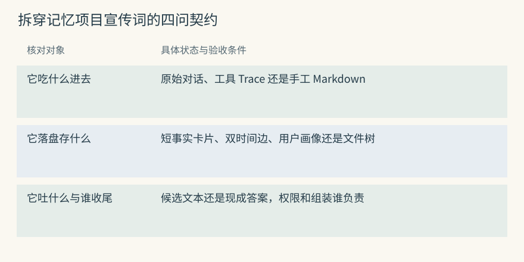
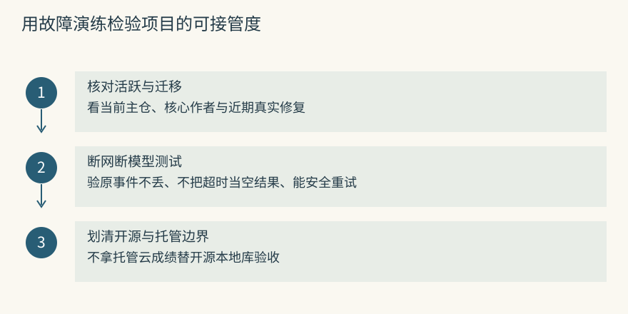

# 怎样读懂一个记忆项目

## 打开 GitHub 之前，先用“四问契约”给项目卸妆

GitHub 上打着 “Agent Memory” 旗号的项目动辄几万 Star，首页宣传词一个比一个玄乎：“自我演化”“无限长期记忆”“类人脑海马体”“一行代码接入”。

真要给团队的研发助手选型，别先看宣传图和跑分表，拿一张白纸对着目标项目问清楚四句话：
1. **它吃什么进去？** 是吃原始聊天消息、工具执行日志（Trace），还是吃人类手写的 Markdown？
2. **它落盘存成什么？** 是独立短事实卡片、结构化用户画像、双时间知识图谱，还是本地文件树？
3. **查询时它吐什么出来？** 吐回原始候选文本让宿主拼装、吐文件路径让模型自己读，还是直接调内部模型把最终答案生成好了？
4. **剩下的脏活累活谁干？** 身份鉴权、多租户隔离、Token 预算、原始日志留底、合规删除、工具执行授权——哪些是库自带的，哪些得你自己写代码补？

拿三个经常被放在同一张对比表里的项目一验就现原形：
- **Mem0** 吃聊天消息，落盘短事实卡片，吐候选事实文本；
- **Agent Beacon** 吃 Claude Code / Cursor / Codex 等 20+ 宿主的钩子和遥测，落盘标准化动作事件流（`runtime.jsonl`）；
- **Hermes Jev Skills** 根本不存库！它吃检索出来的候选片段，帮你做相关性、防注入和充分性判别，吐安全 ID 列表。

三者压根就不在同一层，谁也不是谁的替代品。先把交付契约划清楚，选型范围立刻缩小一半。

源码与边界：先划清开源库、托管云和业务宿主的边界（选读）

### Mem0：装个 Python 包 ≠ 拿到了官网全套托管能力

`pip install mem0ai` 给你的是本地 SDK 入口，底层的抽取模型、Embedding 服务和向量数据库都得你自己配，登录态鉴权和最终 Prompt 组装更得宿主自己写。

特别容易踩的坑是**把官网托管云的能力算在开源版头上**：比如 2026 年底上线的后台巩固引擎 **Mem0 Dream**、托管平台的企业级权限面板、以及官网挂出来的某些 Benchmark 优化分数，都属于托管云交付物。本地开源核心（`fff8a6472512`）跑的是同步 ADD-only 追加和语义池内加分——而且异步 `AsyncMemory` 和同步 `Memory` 是独立实现，核对代码时要按你实际调用的入口看函数体，别信早就过时的老 docstring！

### Graphiti：图引擎框架 ≠ 完整托管服务 Zep

Graphiti 开源库负责把 Episode 抽成规范实体和双时间边并提供混合搜索，但图数据库（Neo4j / FalkorDB 等）运维、用户鉴权网关、异步任务队列和失败重试都落在你这边。开源 Graphiti 和商业托管平台 Zep 之间隔着一整层平台工程，千万别拿一方的运维或延迟体验去推断另一方。

## 先找对今天的主仓库，别对着归档墓碑学框架

AI 生态半年换一轮天，仓库名字还在，主战场可能早就搬家了。最典型的就是 **Letta**：如果你跟着一年前的老文章跑去翻 `letta-ai/letta`，会发现 V1 服务端已经退役归档，真正日更迭代的现役主仓是 **`letta-ai/letta-code`**（MemFS 架构）。

所以团队做技术预研时，必须留一份精确的**依赖锁定清单**：写清楚仓库 URL、具体 commit hash、安装包版本号以及对照的文档日期。出了问题才知道是装错旧版本、看了过时教程，还是框架真有 Bug。

## 把“维护活跃度”翻译成真正会砸到你头上的日常问题

看一个项目能不能上生产，别只盯着 GitHub Star 数和总 Commit 数，问三个非常接地气的运维问题：
1. **换 Embedding 模型或升级大版本时，有没有迁移文档、回归测试和真实修复记录？**
2. **核心代码是不是只有单维护者，或者大量提交其实是机器人刷文档？**（单作者项目如 Hippo Memory 迭代极快、思想扎实，但上生产前你得评估万一作者停更，团队能不能自己接管维护。）
3. **依赖链有没有安全审计和发布纪律？**（比如 2026 年 9 月底 MemOS 遭遇过的 PyPI / npm 供应链投毒事故，就在提醒所有人：拉包前核对官方发布渠道和洁净版本。）

## 把宣传词拆成源码里可验证的动作

看到文档写“自动更新矛盾事实”“支持混合检索”“自动遗忘”，别信广告词，直接用最小反例追进源码验证：
- **测“混合检索”**：造一条带精确报错码 `PAY-409` 的记录，确保它掉在向量初选池外，看全文命中能不能把它救回最终名单（直奔构造最终 `candidates` 的那个循环，别看到有 `keyword_search()` 函数就以为赢了！）；
- **测“自动更新”**：先写“老张负责审批”，再写“11 月 1 日起换老李”，查旧记录到底有没有被关闭、10 月 20 日的历史查询还对不对；
- **测“故障接管”**：在测试环境直接把抽取 LLM 的 API Key 拔掉或让它超时，塞进一条新通知，看三件事——**原话丢没丢？接口是明确报错还是悄悄返回空列表假装成功？网络恢复后重放会不会造出双份重复卡片？**

实现细节：16 个项目截至 2026-11-21 的维护快照与试读分级（选读）

下面这张表基于仓库最新的 `sources/maintenance.json`（11 个活跃项目已同步至 **2026-11-09 ~ 2026-11-21** 最新提交，5 个静态/归档项目保留原快照），按“工程接管成熟度与优先投入顺序”分成 A / B / C 三档，供安排源码试读与预研排期（绝不是算法跑分排行榜）：

| 试读层级 | 项目 | 最新锁定提交日期 | 2026-11 关键动态与必查问题 |
|---|---|---|---|
| **A** | **Cognee** | 2026-11-20 | 极活跃；v1.6.8 强化 SSRF 与服务器路径拦截，重点查跨存储失败恢复 |
| **A** | **Letta Code** | 2026-11-21 | 极活跃；唯一 Letta 主线，v0.34 补齐 worktree 隔离，查 MemFS 提交与编译生效 |
| **A** | **MCP Memory Service** | 2026-11-20 | 极活跃；v13.0.0 强化每 store 凭据隔离与 `as_of`，查每条远程出口鉴权 |
| **A** | **Mem0** | 2026-11-18 | 活跃；托管推 Dream 与 User Profiles，查清 OSS 同步 ADD-only 与语义池边界 |
| **A** | **Graphiti** | 2026-11-20 | 活跃；v0.31.2+ 新增 `SagaNode`、删源摘要重建、默认仅绑 localhost |
| **A** | **MemOS** | 2026-11-09 | 活跃；经历供应链告警后加固至 v2.0.36，重点核验洁净版本与实际启用模块 |
| **A** | **TencentDB Agent Memory** | 2026-11-19 | 活跃；聚焦团队 ACL/Loadout/Proxy，查撤权后代理缓存与内容服务一致性 |
| **B** | **Basic Memory** | 2026-11-20 | 活跃；Markdown 真相源，重点评估文件并发冲突与 AGPL-3.0 协议义务 |
| **B** | **Agent Beacon** | 2026-11-20 | 活跃；覆盖 20+ 宿主动作 Trace 采集，核对目标宿主实际 `fidelity` 与脱敏 |
| **B** | **Hippo Memory** | 2026-11-21 | 个人极活跃；v3.12.0 重构 `src/entry/` 与带 `asOf` 图召回，评估单维护者接管风险 |
| **B** | **Hermes Jev Skills** | 2026-11-12 | 活跃；0.25.3 扩展至 13 项轻量判别，评估数据外发政策与 `unjudged` 回退 |
| **B** | **HippoRAG** | 2026-09-03 | 研究型低频；PPR 多跳思想极佳，上生产需自行补齐租户、服务与删除治理 |
| **C** | **MemoryOS** | 2026-07-07 | 长期低频/停滞；学短中长期页搬运状态机，谨慎直接作生产依赖 |
| **C** | **Memobase** | 2026-01-11 | 停滞；学 buffer/flush 画像热读取设计，生产使用需自担 fork 与并发修复 |
| **C** | **A-MEM** | 2025-12-12 | 停滞；研究笔记邻居演化思想，不建议直接上生产 |

*注：旧 `letta-ai/letta`（2026-09-10 归档）仅留作历史与迁移对照，不纳入现役排序。*

### 为什么绝不能把各家 README 的 Benchmark 分数拼成榜单

不同项目的自报分数根本没有共同分母：有的报检索 `Recall@5`，有的报生成 `F1`，有的拿 LLM-as-a-Judge 打分；有的在每题预先切好的 10 个会话里搜（Haystack 极小），有的在全局长期库里搜；有的还混入了开源版没有的托管专有优化。唯一靠谱的比较，是在**同一批研发语料、同一个回答模型、同一个 Token 预算**下跑你自己的真题对照。

## 动手检查

现在让你为研发助手挑两个处在不同层级的开源项目（例如 **Agent Beacon** 和 **Mem0**），请分别写出它们的“四问契约”：吃什么、存什么、吐什么、应用层要补什么？再设计一个“抽取模型 504 超时”的断网演练，说明谁保住原文、谁报告未完成、谁负责重试。

答案提示：Beacon 吃宿主的钩子/遥测活动，落盘标准化工具 Trace（`runtime.jsonl`），吐出可回放的时间线，它不负责提炼长期规程；Mem0 吃清洗后的对话或文本，落盘短事实与向量/历史，吐出候选事实列表，鉴权、版本裁决和最终 Prompt 组装由宿主补齐。当抽取模型超时时，宿主事件表负责保住原文并标记 `retryable`，监控必须把它和“合法提取到 0 条新事实”区分开，等依赖恢复后按稳定事件 ID 幂等重试。

<figure class="concept-diagram" tabindex="0"><figcaption>图：看懂一个记忆项目最好的办法不是背宣传页，而是核对契约再拔一次网线做故障演练。</figcaption></figure>

横向查阅表（选读）

## 本章对照结论

| 候选路线 | 源码与维护审查重点 | 团队上线前必须自己验完的硬指标 |
|---|---|---|
| Mem0 / Memobase | 真实提取分支、异步与同步差异、后端兼容性 | 开源与托管能力边界、偏好更新与原文留存 |
| Graphiti / Cognee | 实体消歧、Schema 迁移、安全路径防护、跨库恢复 | 审批链正确率、历史双时间查询与删源重建 |
| HippoRAG / A-MEM / MemoryOS | 论文机制与本地代码的实际差异 | 固定预算下的净收益复现，补齐外围权限与并发 |
| MemOS / Hippo | 实际启用的模块、依赖链安全与衰减反馈 | 官方洁净版本核验、低频高危规则保护 |
| Letta Code | 主仓迁移后的最新 MemFS 协议与 worktree | 自编辑提交后是否真的在下一轮编译生效 |
| Basic / MCP / TencentDB | 同步窗口、传输认证、每 store 隔离与撤权 | 撤权后所有搜索、直读和缓存出口一致拒绝 |
| Beacon / Hermes | 宿主采集覆盖率、数据外发脱敏与降级回退 | 原始动作保真、`unjudged` 状态可见、零越权 |

