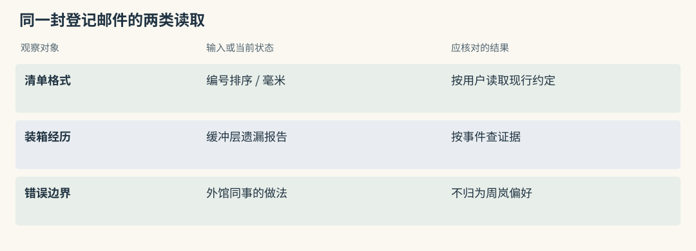
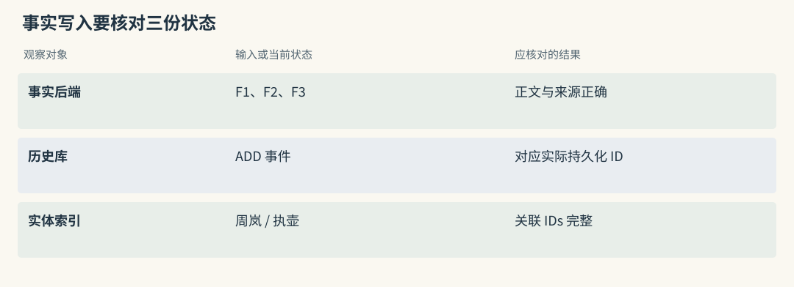
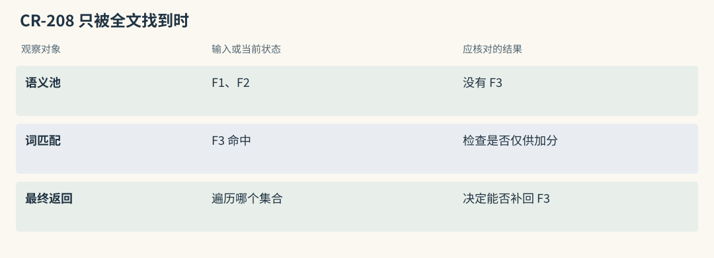
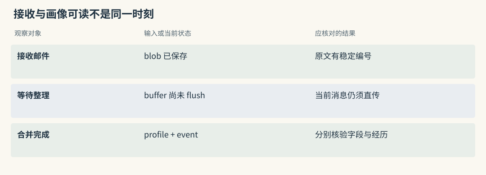
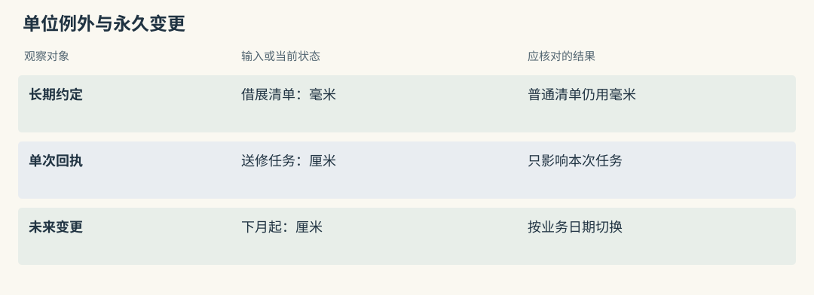
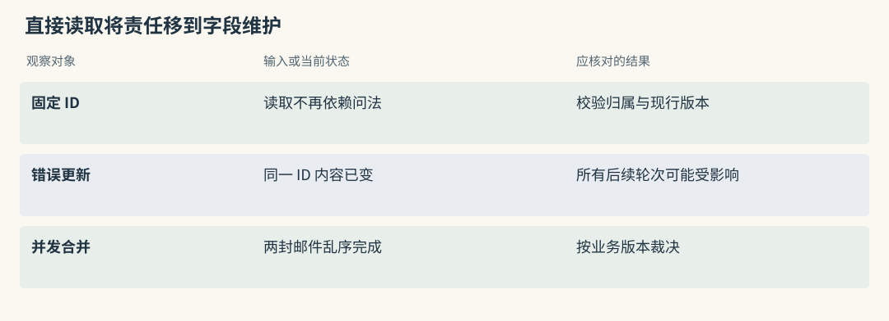
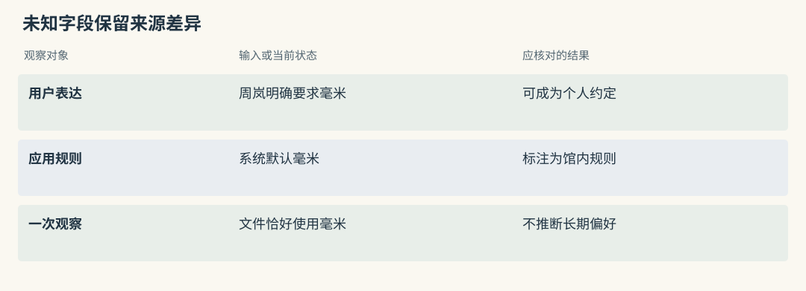
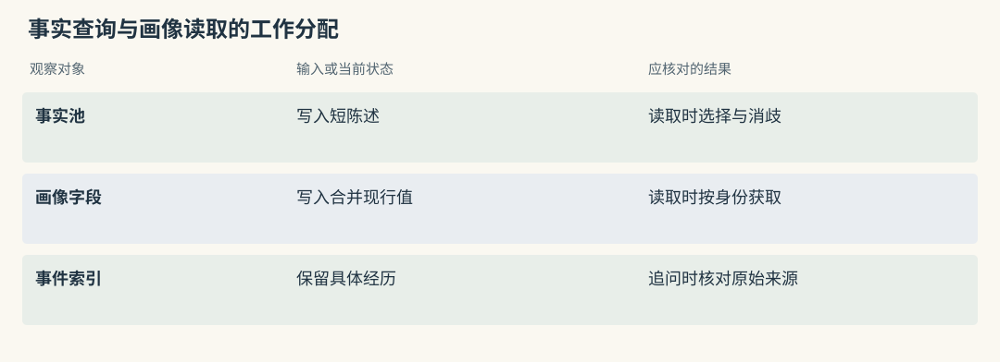

# 事实与画像路线：Mem0 / Memobase

## 同一位用户，两种不同的问题

登记员周岚告诉借展助手：“清单按藏品编号排，尺寸用毫米。上次青釉执壶装箱时，内托尺寸少算了缓冲层。”前两项会影响今后的清单格式，后一项是一次需要保留证据的经历。把三句话全部塞进个人简介，查询装箱原因时会缺细节；每次只按问题搜索，又可能漏掉始终需要的单位约定。

事实路线把内容拆成可搜索陈述，画像路线提前形成可直接读取的用户字段。两者都能保存这段输入，区别在于下一次读取要临时做多少选择，以及哪些错误会持续影响后续请求。

本章用馆内借展资料作教学模拟。记录编号和预期输出便于推演，不代表已向项目服务写入或测得准确率。

<details class="source-example">
<summary>源码路径与适用范围（选读）</summary>



### Mem0：同一个 user scope 不意味着所有事实都该出现

周岚的存取范围中可能同时有沟通偏好、装箱报告和临时草稿。`user_id` 把记录归到同一用户，并不会判断它们在这次回答里的用途。应用可将审核后的尺寸单位直接读出，再搜索与内托相关的经历，合并到一个输入中。

普通事实池没有因此自动成为唯一字段画像。若“毫米”有多条不同陈述，仍需由应用定义现行值、适用任务和来源，不能拿当前问题的相似度决定用户的长期设置。

### Graphiti：用户属性与项目经历需要不同主体

可以让格式约定关联周岚，让装箱经历关联藏品与借展任务。这样问“她的清单习惯”与问“那次装箱哪里错了”有不同起点，不会把一次任务结果当成人的永久属性。

主体解析仍可能出错。周岚转述外馆同事“他们都用厘米”，不支持给周岚建立厘米偏好。写入核验应比较 episode 原文、关系两端及限定，而非只检查出现了哪些词。

</details>

## Mem0：先形成卡片，再按问题挑选

假设应用把这封邮件交给 `add()`，并从可信登录会话取得周岚的身份。普通推断路径参考近期消息和已有记忆，提取可以单独复用的新增事实。教学预期可以写成：

```text
F1：周岚的借展清单按藏品编号排序。
F2：周岚要求尺寸以毫米表示。
F3：某次青釉执壶装箱的内托估算遗漏了缓冲层。
```

F3 仍只是原邮件中的报告，应带来源，不能自行升级成所有破损的已验证根因。卡片生成向量后进入存储，历史和实体关联还有各自的写入动作。批量处理降低请求次数，并不保证所有持久状态共同提交。

下次问“内托为何要加余量”，应用搜索经历，再把对应原文交给回答模型；下次生成清单，则保证 F1、F2 直接进入输入。返回候选与实际使用之间需要一个明确的组装位置。

<details class="source-example">
<summary>源码路径与适用范围（选读）</summary>



### Mem0：卡片从模型输出走到两种持久状态

提取 JSON 中有效的 `text` 经 `embed_batch()` 生成向量，payload 附正文、hash、词形和 metadata。批量插入事实后，历史库记录 ADD；实体处理中再把周岚、执壶等对象关联到 memory IDs。

因此一次写入要检查的状态不止卡片条数。若批量插入回退逐条保存，或实体链接步骤失败，应分别看实际事实、历史与辅助索引。业务自己的源邮件编号可作为这些对象的共同回查起点。

### 追一次 Mem0 调用的输入、内部形状与输出

以下是**接口说明片段**，需要预先配置真实的 `memory` 对象，包括模型、embedding 与向量后端。本章没有运行远程服务。身份由应用提供，不能让模型自行指定登记员。

```python
letters = [
    {"role": "user", "content": "借展清单按藏品编号排序，尺寸写毫米。"},
    {"role": "user", "content": "送修回执这一次仍用厘米，不改借展清单约定。"},
]
receipt = memory.add(
    letters,
    user_id="registrar-zhou",
    metadata={"collection": "ceramics", "source": "letter-084"},
)
candidates = memory.search(
    "借展清单采用什么尺寸单位",
    filters={"user_id": "registrar-zhou", "collection": "ceramics"},
    top_k=4,
    explain=True,
)
```

`receipt` 记录写入结果，`candidates` 保存另一轮查询结果，它们都不是 `letters` 的原样复制。一次输入可以没有新事实，也可以生成多项，必须检查毫米默认和厘米例外是否保留各自边界。搜索的 `top_k` 限制数量，不保证四项就是合适的输入长度。

教学 payload 可以简化为：

```json
{
  "data": "周岚要求借展清单尺寸采用毫米",
  "user_id": "registrar-zhou",
  "collection": "ceramics",
  "source": "letter-084",
  "hash": "由实际正文生成",
  "text_lemmatized": "由当前词形处理生成"
}
```

`source` 来自业务，只证明应用标注了邮件编号，不证明模型的每句话都能由它支持。若一次提交多封信，应保留事实到具体原句的映射，否则回查只能得到整批材料。

自定义 `collection` 用于外层筛选，还要检查它是否影响内部既有记忆读取。本地普通分支在部分内部范围处理中只取 user、agent、run 身份键，不能假设所有 metadata 都自动约束实体与上下文。多个馆共用同名藏品时，需增加隔离或单独提取测试。

### Graphiti：相同消息被拆成对象与关系

相同邮件进入图框架后，episode 承载原文；实体抽取区分登记员、藏品和借展任务；关系记录清单约定与事件。规范 UUID 映射会修正边端点，关系解析再给出重复、新增和失效结果。

三张事实卡与三条图边不能按数量直接比较。一次图写入可能主要增加已有关系的来源，也可能改变旧关系时间；节点摘要又是派生视图。核验时应从原文到规范对象逐项比对。

</details>

## 一个细节：Mem0 没看见的卡片不会被关键词救回

造一个易定位的编号案例：F3 正文包含内托单号 `CR-208`，查询只写这个编号。若语义初选没有 F3，后续词匹配即使找到它，也可能因为候选循环只处理语义集合而无法输出。

这里需要区分“找到一条记录”和“给已有记录多加分”。前者改变候选身份，后者只改变顺序。当前本地路径主要对 over-fetch 后的语义池融合关键词和实体信号，不能直接读成三路候选无条件取并集。

排查时保留三组 ID，先看 F3 在哪一步消失，再决定扩大初选、增加受限查询或改用独立候选并集。调整权重无法修复一个没有被评分的对象。

<details class="source-example">
<summary>源码路径与适用范围（选读）</summary>



### Mem0：实体 boost 也无法补回 M3

实体索引若将 `CR-208` 或执壶映射到 F3，可以产生 boost，但最终集合仍可能没有 F3。泛化实体关联太多时还会降低影响，避免所有陶瓷记录都因“藏品”二字获得同等奖励。

验收应单独安排 entity-only、keyword-only 和 semantic 命中，把每路 ID 与最终结果比对。只看 `explain` 中已有候选的分项，无法知道池外有哪些漏项。

### Graphiti：独立全文路可补向量遗漏

边 RRF 配方可以独立取得全文与 cosine 结果，再合并 UUID。因此一条仅被全文找到的内托关系有机会进入候选，与 Mem0 当前语义池内加分的边界不同。

这仍要求正文确实进入关系全文索引，并且本次调用启用了相应配方。若只找到执壶节点，不能直接当作找到了内托原因；若最终被截断，也需继续检查预算和名次。

</details>

## Memobase：提前整理用户资料，经历另放事件

Memobase 先接收聊天 blob，再将它登记到用户与项目的 buffer。可以把 buffer 理解为尚未整理的输入集合；flush 才开始把这批材料转换为画像和事件。

对周岚的邮件，教学目标是资料字段“尺寸单位=毫米”，事件则保留内托估算经过。生成借展清单时按身份读资料字段，追问装箱原因时另查事件。这样把稳定属性选择放到写入阶段，读取时不再依赖某次问题是否与“毫米”足够相似。

保存成功和整理完成不是同一时刻。若她刚要求今后使用厘米，buffer 尚未 flush，长期字段可能仍写毫米。本轮回答应直接携带新消息，并显示整理状态，不能把旧画像当成高于当前明确要求的命令。

<details class="source-example">
<summary>源码路径与适用范围（选读）</summary>



### Mem0：没有 buffer flush 合并画像的同等协议

Mem0 的近期消息帮助解释省略和重复，并没有同样的用户 buffer、flush、profile 合并状态机。异步调用形式也不代表后台自动完成画像批处理。

应用若要合并几封借展邮件，应自行保存批次、保证处理顺序，定义何时可读。否则调用 `AsyncMemory` 成功返回，只能说明某个异步操作的结果，不能解释现行字段已经更新。

### Graphiti：previous episodes 提供理解上下文

`retrieve_episodes()` 可以在 group 与时间范围内取前序材料，也可显式指定 `previous_episode_uuids`。其作用是提供抽取上下文，例如识别“这件”所指的执壶。

这些前序材料并非 Memobase 意义上排队等待 flush 的 blob。事件是否已处理、还有哪些新输入未建图，需要由宿主任务状态说明，不能从“找到历史 episode”推定队列已清空。

</details>

## 两种路线怎样处理同一句例外

保持长期单位为毫米，加入“这张送修回执按厘米填”。正确行为是回执采用厘米，下一张借展清单仍用毫米。若新消息改为“今后所有借展清单统一用厘米”，才有更新长期字段的依据。

事实路线要在卡片正文保留任务限定，画像路线要避免把单次要求合并进当前默认。二者都会受模型理解错误影响，差别在于错误会以多条矛盾事实还是一个错误字段出现。

历史还需要业务生效时间。九月补录一封七月回执，不应因为创建时间最新就改变九月默认。当前值选择与原始经历保留最好有独立规则。

<details class="source-example">
<summary>源码路径与适用范围（选读）</summary>



### Mem0：一次例外追加，永久变更需指定策略

单次回执要求可以追加为带任务编号的卡片，不应直接覆盖毫米默认。永久变更则可产生新默认候选，由应用审核后切换当前视图，并留下旧值及其有效区间。

如果只从 `created_at` 选最新，就会把补录时间、任务例外和真正变更混为一类。应明确当前值依哪份用户表达、从何日生效，不能仅靠加权搜索处理冲突。

### Graphiti：同一用户也可以有情境化偏好

可将回执要求连到送修任务，把长期清单单位连到登记员的借展工作约定。两种关系即使都出现“厘米”，也不应相互失效。

新长期约定进入后，应核对被关闭的边是否只涉及借展清单单位。若误把修复报告、测量结果等所有毫米关系结束，说明条件解析过宽，需要用任务反例修正 schema 或抽取方式。

</details>

## 从下一次读取，反推事实库和画像库的代价

借展清单每次都要采用约定单位，事实库若只执行当前主题搜索，“运输路线”可能找不到单位卡片。可按固定类型直接读现行单位，再搜索运输经历，两条读取路径在组装时合并。

画像把单位整理为字段，能减少这类漏召回，代价是写错后影响会反复出现。把“本次回执厘米”错合并进画像，之后每张清单都会稳定读到错误。确定读取不能替代写入核验。

并发更新也要考虑：周岚先说今后厘米，又立即撤回为毫米。两个任务若乱序完成，当前字段不能由最后完成的 worker 决定。需要版本条件、串行处理或更新裁决，并测试重试是否覆盖较新的值。

<details class="source-example">
<summary>源码路径与适用范围（选读）</summary>



### Mem0：直接读降低漏召回，也放大错误写入

固定的单位卡片 ID 可用 `get()` 直接读取，但读回后仍须验证身份、现行版本与适用业务。记录 ID 没变不代表正文始终正确。

应用可维护“借展清单单位”到已审核 ID 的指针，更新通过审核后再切换，并使缓存失效。这样把语义搜索的遗漏风险换成显式字段维护责任，错误与回滚也更容易定位。

### Graphiti：summary 热读取需要事实校验规则

已知用户 UUID 的 summary 可以快速提供个性化入口，但其中可能含旧值、概括或任务混合。尺寸单位、许可主体等必须确定的内容，宜读具体有效关系并回查来源。

若缓存摘要，至少要绑定 group、对象身份与内容版本。以显示名作为键会让同名登记员或跨馆资料串线，而摘要正确性无法靠节点存在证明。

</details>

## 画像里写什么，才不会越整理越偏

用户没有表达某种偏好时，字段应允许未知。馆内系统默认用毫米，并不意味着周岚个人要求毫米；这次导出的文件恰好使用毫米，也不能证明她认可长期设置。

重复表达可作为线索，但不能代替语义。连续三次填厘米回执可能只是处理同一批送修单，一句明确的“以后借展清单都用毫米”却已经给出长期边界。写入时保留业务范围，比单纯数出现次数可靠。

读取优先级应明确：本次具体要求覆盖一般偏好，可信业务政策限制可执行动作。用户希望简短清单，但当前要求解释缓冲层计算时，仍应给出完整计算，不能让画像压过任务。

装箱经历则继续保留为事件。一个“重视包装”的画像标签不足以回答哪次遗漏了多少缓冲量，详细问题需要回到对应材料。

<details class="source-example">
<summary>源码路径与适用范围（选读）</summary>



### Mem0：缺失偏好不能靠结构默认伪造

应用默认与用户事实应分开保存。没有周岚的表达，就不要给她新增“偏好毫米”卡片；可以在组装器中注明单位来自馆内格式规则。

自定义提取指令可要求保留本次例外，但 SDK 搜索不会自动建立指令优先级。当前要求、长期偏好与系统政策之间的裁决仍由宿主负责，并通过回归题验证。

### Graphiti：属性抽取应允许未知与情境

schema 可以限定字段形状，不应强迫模型从空白处补值。与其用流畅文本填满用户摘要，不如保留未知状态，并让应用选择默认或请求澄清。

抽样检查 episode、实体属性、关系 fact 和 summary，尤其关注同一猜测是否被反复复制后变成确定表述。一次事件中的测量单位不能无条件变成登记员的永久偏好边。

</details>

## 动手检查

按顺序提交三条教学输入：“借展清单用毫米”“这份送修回执用厘米”“下月起借展清单改厘米”。每一步写下当前任务单位、长期默认和未来变更，不提前让前两轮看见第三条。

答案提示：第二条只覆盖这份回执，不改变长期默认；第三条记录未来变更，到下月开始后才成为现行值。再分别检查 buffer 尚未整理和整理完成的读取。若原 blob 配置为处理后删除，应另说明如何保留合规的来源证据，不能仅凭有画像字段就声称能够回看邮件全文。

<details class="implementation-notes">
<summary>实现细节与复查入口（选读）</summary>

## Mem0：给应用增加通用记忆层

Mem0 给现有业务提供事实处理与存取入口。借展系统提交消息、接收候选，再自行安排权限、源材料和生成前组装。同步与异步接口，以及可配置模型、向量库和重排器，属于接入工具，不是整套业务运行时。

评价它是否合适，可以从一条用户约定开始，记录从源邮件到事实卡再到本轮模型输入的身份映射。路径越明确，后续增加自动提取时越容易定位错误。

### 一次 add 实际做了什么

在 [`mem0/memory/main.py`](../../sources/repos/mem0/mem0/memory/main.py) 中，普通 `_add_to_vector_store()` 使用 phased batch 组织抽取和保存。其顺序可以按检查点理解：先取得近期消息与同范围既有事实，提取新增 `text`，再批量生成向量，构造 payload，写事实、写历史，最后维护实体关联和近期消息。

已有 UUID 被映射为短标签供模型参考，减少让模型直接输出任意数据库标识的风险。合法标签仍可能被错误使用，短标签约束不能证明语义正确。

文本 hash 针对本批与已召回记录做精确去重，并非遍历全库识别所有同义。两封邮件分别写“尺寸采用毫米”和“单位填 mm”，可能都成为卡片。实体存储聚合相关 IDs，方便评分，但没有建立“谁要求哪种单位”这样的类型化时间边。

`infer=False` 则直接嵌入有效消息，保留 role、actor 等信息，并跳过系统消息。它适合经过审核的内容，噪音、注入和敏感数据筛查随之更多由调用方承担。

### search 如何使用三路信号

三种信号各有作用：语义向量适合“包装余量”和“缓冲空间”的不同措辞，关键词擅长 `CR-208` 这类编号，实体链接把同一藏品关联的事实作为评分线索。可选 reranker 还会重新比较问题与文本。

本地最终候选来自扩大的语义结果集，后两种信号主要给它加分。若只被关键词找到的内托报告没有进入该集合，后续处理无法自动补回。模型重排也只能处理交到它面前的记录。

不同后端的全文实现、分数范围与降级不同。用户筛选字段只说明数据库如何定位数据，不证明请求者有权读取。试用时同时验证候选集合和可信身份来源。

### 用偏好变化理解 ADD-only

旧卡写“借展清单用毫米”，新卡写“下月起采用厘米”，追加保存能避免抽取器立即删错旧证据，但会把现行值裁决留给读取端。今天和下月的问题应取不同状态。

业务日期不能从创建日期简单推算。预告变更、迟到邮件、单次回执都应保留条件。需要严格历史时，可另建版本视图、替代关系与有效区间，或选择时间图；显式 update 和 delete 仍可用于审核后的纠正与治理。

### 成本、失败与开源边界

推断写入的成本包括模型抽取、既有候选查询、新事实 embedding、正文与历史保存、实体处理。批量操作可以摊薄网络开销，不能把这些工作变成免费。

部分步骤失败可能回退逐条处理，提取 provider 异常则可能抛 `LLMError`。生产入口应保存未完成状态，并区分“没有新事实”和“无法完成判断”。跨存储部分成功需要专门核验。

README 的托管 QA 成绩只对应其公开协议与专有优化，不能作为本地 OSS 实测。本地采用应实际覆盖重复、例外、主体混淆、删除和依赖错误，再看费用及最终任务收益。

## Memobase：把用户画像放在读取热路径

画像路线优先降低稳定资料的在线选择成本。Memobase 将用户 profile 与事件时间线分开，前者用于每轮个性化，后者用于回查具体发生过的事情。

借展清单单位是可结构化的长期约定，某次内托遗漏则是事件。分开并不会自动保证正确，但让应用可以分别测字段准确率与事件证据覆盖，避免所有内容都用一个 top-k 评价。

### buffer 如何降低在线写入成本

[`controllers/buffer.py`](../../sources/repos/memobase/src/server/api/memobase_server/controllers/buffer.py) 以 blob ID、用户、项目、类型、token 和状态登记待整理材料。容量、后台条件或显式 flush 可触发处理，再经过画像提取、组织合并与事件摘要，得到 done 或 failed 状态。

把模型工作移出即时回答可以降低主链等待，但刚接收的纠正未必已进入 profile。当前会话仍要携带新要求，界面也要区分接收与整理完成。

状态字段本身不提供并发互斥。快照中存在并发 flush 的未解决说明，部署需审计锁、幂等与顺序。多个 worker 不应让早一封邮件的处理结果覆盖后一封明确撤回。

### 画像提取与合并怎么工作

`controllers/modal/chat/` 中提取与组织过程按照 topic、subtopic 形成属性，再结合旧 profile 判断重复、补充和改变。schema 能把尺寸约定与沟通格式分开，却无法保证模型正确理解“仅这份回执”。

合并前后可以保存字段差异与支持来源，针对高影响字段进行审核。若从毫米变成厘米，应能指出是哪封邮件给出了长期变更，而不是只看到一个更新后的完整画像。

### 为什么画像直接读取，事件另行检索

生成个性化消息时，按用户读取少量画像内容，免去每轮重新检索默认设置。事件问题则使用时间、标签或语义搜索，访问成本和查询语义都与画像热读取不同。

项目曾自报低于 100ms 的热读取及特定调用、成本配置，这些不能当作任意部署的性能承诺。馆内仍要测实际网络、存储、画像大小和事件检索的 p95，不能把直接取字段的延迟套给复杂追问。

### 保留与维护的限制

`persistent_chat_blobs` 关闭时，flush 后可能清理原聊天 blob。这样能减少原文驻留，但画像和事件已是派生表达，无法保证重建全部原句。上线前需明确保留期、来源映射和数据删除政策。

维护快照的最后提交为 2026-01-11，近期缺乏更新。研究其读写不对称仍有价值，作为长期生产依赖则要准备 fork、并发补强、导出和安全维护，不把教学价值当成维护承诺。

## 两种路线的关键差别

事实库倾向保留一组可按问题挑选的陈述，画像库倾向先确定稳定字段再直接读取。前者容易遇到候选遗漏和多版本消歧，后者容易遇到错误合并与可见延迟。

同一套验收应拆成两部分：清单生成是否持续采用正确单位，装箱追问是否获得所需事件与原文。稳定字段正确而经历证据缺失，或事件查全但默认单位错误，都需要分别报告。

## 同样保存偏好，其他项目怎样做

MemoryOS 通过短期容量与热段分析将页面信息提升到长期画像。低频但明确的纠正可能尚未进入长期层，因此不能让旧画像覆盖当前邮件。Memobase 的 flush 触发批处理，MemoryOS 的 heat 还参与提升，参数含义并不相同。

Letta 由 Agent 编辑 core 和按需文件，提交后再编译后续输入；TencentDB 从 L0、L1 归纳场景与 core，生成版本和资产范围参与读取。两者都可让常用约定稳定出现，但分别增加自编辑审核或跨服务溯源责任。

MemOS 的可选偏好模块取决于 cube 配置与 backend，不是固定的 Memobase 字段协议。Graphiti 可表达带时间的约定关系，仍须查询与筛日期。Basic、MCP、Hippo 能保存约定文本，Cognee 可配置结构管线，不能因此称它们已自动实现相同画像合并。

HippoRAG 与 A-MEM 的资料结构可以含用户信息，但主要机制是关联检索和笔记演化。Beacon 提供观察材料，Hermes 选择候选，均不应被当成现行用户字段的权威维护者。

</details>

<figure class="concept-diagram" tabindex="0"><figcaption>图：事实查询与画像读取的工作分配。各行分别验收，不能用某一行的成功替代其他结果。</figcaption></figure>

<details class="comparison-reference">
<summary>横向查阅表（选读）</summary>

## 本章对照结论

| 实现 | 默认信息的形成位置 | 读取要检查什么 | 特有代价 |
|---|---|---|---|
| Mem0 | 消息抽成短事实 | 直接读或按问题检索 | 当前值与例外由应用裁决 |
| Memobase | flush 合并 profile | 字段是否已更新 | 并发、原文保留与维护接管 |
| MemoryOS | 热段页面长期分析 | 近期纠正是否覆盖旧画像 | 提升阈值可能延后低频变化 |
| TencentDB | 多层归纳与 prompt 版本 | 身份、资产与注入版本 | 生成链和权限缓存 |
| Letta Code | Agent 修改 core / 详情文件 | commit 后是否重新编译 | 错误规则会持续驻留 |
| MemOS | 启用 pref 或 text 模块 | backend 的实际返回 | 容器名不提供固定字段语义 |
| Graphiti | 属性、关系与摘要 | 有效关系及其来源 | 对象解析和关系失效 |
| Cognee | schema 与选择的管线 | recall 的实际路由 | 配置不同，交付对象不同 |
| Basic、MCP、Hippo | 笔记或分类记忆 | 应用是否定义现行字段 | 存文本不等于自动合并 |
| A-MEM、HippoRAG | 笔记与文档索引 | 证据能否支持偏好 | 非画像优先访问协议 |
| Beacon、Hermes | 采集或候选决策 | 下游怎样形成资料 | 不维护权威画像 |

</details>

