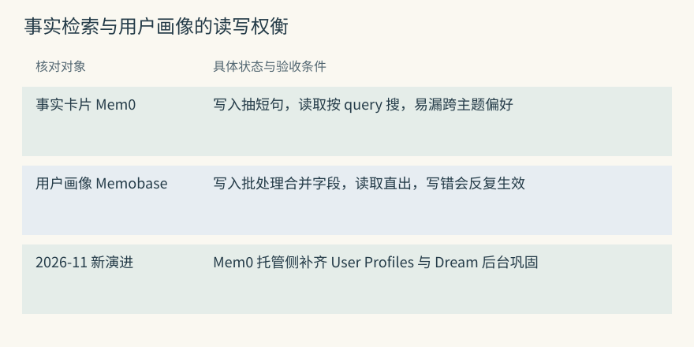
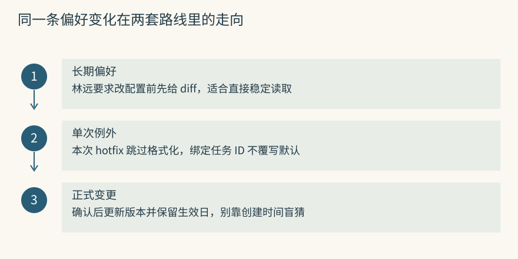

# 事实与画像路线：Mem0 / Memobase

## 同一个开发者，藏着两种截然不同的读取需求

林远给研发助手发过这么一段话：

> “以后回答我都用中文，改配置文件之前必须先给我看 diff。对了，上周 `payment-gateway` 出 `PAY-409` 是因为幂等键 TTL 配成了 30 秒，比重试窗口还短。”

仔细看，这里面藏着两种访问模式完全不同的东西：
- **稳定偏好（“中文回复、改配置先给 diff”）**：几乎每一轮对话都用得上。如果每次都靠“拿当前问题去向量库碰运气”，哪天林远只问一句“帮我看看这段 SQL 慢在哪”，问题里完全没提“配置”和“diff”，向量搜索很可能根本捞不出偏好卡片！
- **具体经历（“上周 `PAY-409` 的根因”）**：平时不用每轮占着 Prompt 宝贵的 Token，只有下次排查支付网关或发版时才需要精准捞出来。

**事实路线（Mem0）**和**画像路线（Memobase）**的分歧，本质就是：**你打算在“读取时按问题现挑”，还是在“写入时提前合并成固定字段直读”？**



## Mem0：把对话拆成短事实卡片，再按问题捞回

在 Mem0 里，上面那段话交给 `add()` 后，抽取模型会尝试把它拆成几张独立短事实：

```text
F1：林远要求默认使用中文回复。
F2：林远要求修改配置文件前必须先展示 diff。
F3：payment-gateway 上周出现 PAY-409，因 idempotency_key TTL(30s) 小于重试窗口。
```

把 Mem0 用好，必须看透它本地开源版（`2026-11-18` 快照 `fff8a6472512`，[main.py](../../sources/repos/mem0/mem0/memory/main.py)）的四个真实脾气：

1. **同步默认是 ADD-only 批量追加**：写入时参考最近 10 条消息和最多 10 条旧事实，只负责抽出新增文本、批量算向量、写入向量库与 SQLite 历史表，再更新实体链接。旧卡片不会因为林远改了主意就自动消失。
2. **精确编号容易掉在语义池外**：如果林远下次直接搜 `PAY-409`，而 F3 没挤进向量初选池（`max(limit * 4, 60)`），后续的 BM25 和实体 boost 只在语义池内加分，**永远救不回 F3**（第 5 章我们已经扒过 `scoring.py` 源码）。
3. **过滤边界要自己把严**：下面的接口调用示意展示了基本契约——注意 `user_id` 必须由服务端鉴权传入，不能让模型自己挑：
   ```python
   messages = [
       {"role": "user", "content": "以后改配置前先给我看 diff，默认用中文回复。"},
       {"role": "user", "content": "不过今天演示环境的 hotfix 跳过格式检查，不改长期习惯。"},
   ]
   receipt = memory.add(
       messages,
       user_id="linyuan",
       metadata={"repo": "payment-gateway", "source": "chat-084"},
   )
   hits = memory.search(
       "改配置有什么要求",
       filters={"user_id": "linyuan", "repo": "payment-gateway"},
       top_k=4,
       explain=True,
   )
   ```
   这里要注意：`metadata` 里的自定义字段（如 `repo`）可以用来做外层检索过滤，但在 Mem0 内部部分范围处理里，默认只认 `user_id / agent_id / run_id` 这几个一级身份键——跨项目同名服务千万别只靠一个自定义 tag 隔离。
4. **2026-11 最新演进：托管侧补齐了 User Profiles 与 Dream，安全补丁要及时升**
   - 过去 Mem0 最大的短板是“既缺直接读取的结构化画像，又缺后台自动合并旧卡片的巩固引擎”。2026 年 9—11 月间，Mem0 在 Python SDK `v2.2.x` 补出了按 JSON Schema 异步维护的 **User Profiles**（`get_profile()` / `generate_profile()`）和防重放 `Idempotency-Key`，并在托管 Pro / Enterprise 侧上线了后台异步巩固引擎 **Mem0 Dream**（负责合并重复事实、标过时信息为 `superseded`），同时发布了存量聊天导入能力和针对作用域/会话隔离漏洞（如 `CVE-2026-116575`）的安全补丁（要求 Python SDK ≥ `2.0.18`、TS SDK ≥ `3.1.6`）。
   - **架构师必看**：User Profiles 和 Dream 主要是托管平台侧的能力；如果你部署的是本地自建 OSS，版本升级拿安全修复很必要，但**结构化偏好直读、版本切换和后台巩固仍需业务外层补齐**。

## Memobase：把写入推到后台 buffer，换来读取热路径零检索

Memobase 走了另一条思路——它把**用户画像（Profile）**和**事件时间线（Event）**彻底拆开：
- 聊天消息进来先扔进 `buffer` 缓冲表（见 [buffer.py](../../sources/repos/memobase/src/server/api/memobase_server/controllers/buffer.py)），主回复完全不用傻等大模型抽取；
- 等 buffer 攒满一定 Token、会话空闲或显式调用 `flush` 时，后台批量抽成按 `topic / subtopic` 组织的结构化用户字段（比如 `preferences.language = "zh"`、`preferences.config_edit = "show_diff_first"`），同时把具体踩坑记进事件时间线；
- 下次对话时，宿主**直接按用户 ID 读画像字段**塞进 System Prompt（不用做向量搜索，延迟极低且永不漏召回），只有追问“上次 `PAY-409` 怎么回事”时才去搜事件库。

这套“读写不对称”设计非常聪明，但也有三个绕不开的工程代价：
1. **写错放大效应**：事实库里多了一条错卡片，顶多某次搜到才出错；画像里如果把“今天 hotfix 跳过 diff”错合并进了长期字段，**之后每一轮对话都会稳定犯同一个错**！
2. **可见延迟与并发乱序**：刚发完“以后改回先给 diff”，在 `flush` 跑完之前直接读画像，读到的还是旧值；如果并发触发两次 `flush`，还必须防旧任务晚完成反而把新纠正给覆盖掉。
3. **停更维护风险**：Memobase 仓库自 **2026-01-11** 之后没有新提交。它的“buffer/flush + 画像直读与事件分离”是非常值得抄作业的架构模式，但如果你打算直接拿它的代码上生产，得做好自己 fork 维护并发锁、原文保留（注意 `persistent_chat_blobs` 关闭后 flush 会清理原始聊天 blob！）和安全补丁的心理准备。

## 面对“单次例外”与“正式变更”，两条路线怎么才不翻车？

拿三条连续输入测试任何事实或画像系统，立刻就能验出成色：
1. “以后改配置前先给 diff。”（长期默认）
2. “今天这个紧急 hotfix 直接改，不用先给 diff。”（单次例外）
3. “下周一开始，所有配置改动统一走 PR，不再在终端看 diff。”（未来生效的正式变更）

守住三条设计规矩，两条路线都能跑稳：
- **允许字段“未知”**：林远从没表态过代码缩进用 2 空格还是 4 空格，画像里就留空，别让抽取模型从一次默认模板里硬猜一个偏好写进去；
- **单次例外只绑当前任务，绝不覆写长期字段**，同时在组装层保证“当前对话明确要求 > 长期偏好”；
- **绝不拿 `created_at` 当生效日**：补录上周的复盘或者提前预告下周的新规矩，都不能按“谁最后写进库就听谁的”来裁决现行值。

<details class="implementation-notes">
<summary>实现笔记：其他框架怎么保存稳定偏好？（选读）</summary>

把稳定偏好放进读取热路径，不只有 Memobase 一种写法，可以按团队现有技术栈对号入座：
- **最朴素的 SQL / JSON 表 + Mem0 组合**：个人稳定偏好用一张极简的关系表按 `user_id` 直接读取（支持事务和版本审计），发版教训与历史排障交给 Mem0 或混合检索按问题搜——既零漏召回，又没有黑盒合并风险。
- **Letta Code（MemFS）**：把稳定偏好写进根目录 `preferences.md` 常驻 System Prompt，修改走 Git commit 与审核，透明且随时可 `git diff`。
- **TencentDB Agent Memory**：从 L0/L1 逐层归纳出 L3 核心记忆并通过 Proxy 注入，需要注意版本与缓存同步。
- **MemoryOS**：靠中期页面热度触发长期画像分析，缺点是低频但明确的偏好纠正可能迟迟达不到晋升阈值。
- **Graphiti**：可以把偏好建成带有效时间的关系边（`林远 --[prefers_config_workflow]--> 先给 diff`），按需筛选生效区间，比直接读可能混杂旧信息的节点 `summary` 更稳妥。

</details>

## 动手检查

按顺序向研发助手发送三条消息：① “以后改配置前都先给 diff”；② “今天这次紧急 hotfix 直接改，别走 diff”；③ “下月起配置统一走 GitOps PR，不再看终端 diff”。请写出每一步执行后，“本轮动作”“当前长期默认”和“未来预定变更”各自该是什么状态？如果后台采用 buffer/flush 机制且配置了 flush 后删除原始聊天记录，还要补什么来保证可追溯？

答案提示：第 ② 步仅覆盖本次 hotfix，当前长期默认仍是“先给 diff”；第 ③ 步只登记下月生效的新版本，本月内依然维持“先给 diff”，到下月 1 日才切换。采用 buffer/flush 时，在 flush 完成前必须让当前会话直接携带最新纠正；如果关闭了原始 blob 保留，则必须在外层保留带脱敏和合规期限的变更来源索引（记录哪次对话触发了字段修改），否则画像一旦合错连回查原话的依据都没有。

<figure class="concept-diagram" tabindex="0"><figcaption>图：稳定偏好直读、临时例外绑任务、正式变更管版本，三者分开才不会互相踩脚。</figcaption></figure>

<details class="comparison-reference">
<summary>横向查阅表（选读）</summary>

## 本章对照结论

| 实现 | 稳定偏好的落地方式 | 读取时重点验什么 | 必须买单的工程代价 |
|---|---|---|---|
| Mem0（OSS / 托管） | OSS 存短事实卡；托管 v2.2+ 新增 User Profiles & Dream | 跨主题偏好会不会漏召回、OSS 与托管边界 | OSS 需外层管现行版本与巩固；及时升安全补丁 |
| Memobase | 后台 `flush` 合并结构化 Profile + 独立事件库 | 刚改完偏好时 flush 前后的可见延迟 | 错误合并会每轮生效；仓库停更需自担维护 |
| Letta Code | 根目录 Markdown 常驻核心 + Git 版本控制 | `git commit` 后是否在下次编译生效 | 写错规则会常驻窗口，须控核心长度 |
| TencentDB | 多层归纳形成 L3 核心 + Proxy 注入 | 身份、资产版本与代理缓存一致性 | 跨服务状态同步与撤权失效 |
| MemoryOS | 短期溢出转页，达热度后提升进长期画像 | 低频明确纠正有没有被旧画像压住 | 热度门槛带来的晋升滞后 |
| Graphiti | 面向用户的带时间偏好边 + 实体摘要 | 查有效边而非只读可能过时的节点摘要 | 建图抽取成本与实体消歧 |
| Basic / MCP / Hippo | 显式笔记或标签记忆条目 | 业务层自己约定现行字段读取方式 | 存文本本身不自带字段自动合并 |

</details>
