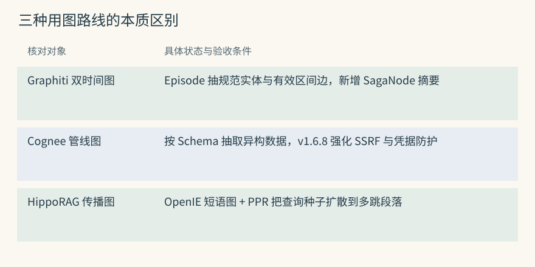
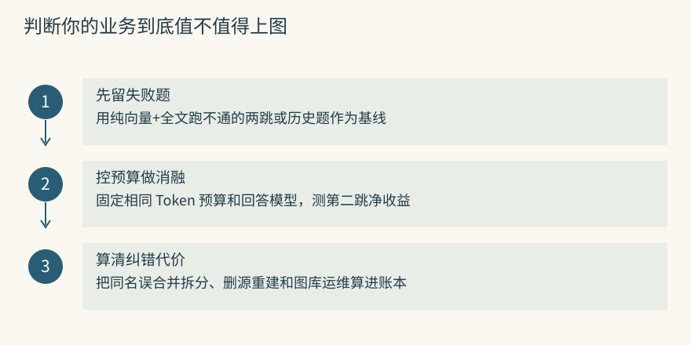

# 图谱路线：Graphiti / Cognee / HippoRAG

## 一份文档没答案，两份拼起来才有

看一个研发日常里纯向量检索最容易卡壳的题——团队文档库里有两份完全独立的文件：

```text
文档 A（服务目录）：payment-gateway 由基础交易组维护。
文档 B（审批规程）：基础交易组的生产发布必须由老李终审签字。
问题：今晚发布 payment-gateway，找谁终审？
```

文档 A 里有 `payment-gateway`，但没写审批人；文档 B 里有“老李”，但全文压根没出现过 `payment-gateway` 这几个字！

单次向量或全文检索几乎一定会捞回文档 A，却很可能漏掉文档 B。**图谱路线的核心价值，就是把共同出现的中间节点“基础交易组”连成可遍历的桥，让第二份证据稳稳进入上下文。**

不过市面上三大主流图路线——**Graphiti、Cognee、HippoRAG**——虽然名字里都带图，解决的问题、建图方式和踩坑点完全不同。



## Graphiti：面向动态运行态的双时间事实图

Graphiti 的核心对象非常规整：`EpisodicNode`（原始输入）→ `EntityNode`（规范实体）→ `EntityEdge`（带双时间区间的事实边）。

把上面两份文档按顺序喂给 `add_episode()`，内部会经历四个关键动作（入口见 2026-11-20 最新快照 [graphiti.py](../../sources/repos/graphiti/graphiti_core/graphiti.py)）：
1. **节点抽取与消歧**：把文档 A 里的“基础交易组”和文档 B 里的“交易基础组/基础交易组”归并到同一个规范 UUID 上。如果公司里正好另一个事业部也有同名部门，绝不能误合并，必须靠 `group_id` 和上下文消歧；
2. **边抽取与短索引裁决**：先给模型看一个短整数索引列表（同端点已有边 + 同组可能冲突边），由代码把模型返回的索引映射回真实 UUID——防止模型凭空编造数据库 ID，但挡不住模型选错合法候选；
3. **双时间更新**：如果 11 月 1 日老李接替老张，旧边的 `invalid_at` 设为 11 月 1 日、`expired_at` 记为当前处理时间，新边开启新区间；
4. **节点摘要与 `SagaNode` 叙事汇总（2026-11 新进展）**：`v0.31.2+` 新增了 **`SagaNode`**，能把围绕同一次长程故障排查或发布流水的多段连续 Episode 串成叙事主线并汇总；同时参考 MCP 和 REST 服务默认收紧为仅监听 `localhost`。

还要特别点出两个**翻源码才能避开的真相**：
- **基础 `search()` 默认不自动走完第二跳**：它的默认配方是边混合 RRF，如果只捞回文档 A 的边，你需要用 `search_()` 启用带 BFS 的高级配方，或者读到规范团队 UUID 后主动补查第二跳——而且补查时务必限定 fanout（基础交易组如果挂着 200 个微服务，无限制展开会把无关服务全灌进来）。
- **2026-11 的 `remove_episode()` 已大幅升级**：早期版本删源时简单按 `episodes[0]` 删边且不刷新节点摘要，容易留脏数据；在 2026-11 最新 `graphiti.py` 中，`remove_episode()` 已经会保留仍被其他 episode 共同支持的边（仅从 `edge.episodes` 移除被删来源），只删除失去全部来源的孤儿边与单源节点，**并对存活节点自动调用 `_extract_entity_summaries_batch()` 重算 `summary`**！不过如果业务需要彻底回滚一次误触发的旧边失效，仍需依靠备份或按原始事件重放。

```python
from datetime import datetime, timezone
from graphiti_core.nodes import EpisodeType

ref_time = datetime(2026, 11, 1, 9, 0, tzinfo=timezone.utc)
for title, body, desc in [
    ("服务目录", "payment-gateway 由基础交易组维护。", "catalog-v4"),
    ("审批规程", "基础交易组的生产发布必须由老李终审签字。", "policy-v2"),
]:
    await graph.add_episode(
        name=title,
        episode_body=body,
        source_description=desc,
        reference_time=ref_time,
        source=EpisodeType.text,
        group_id="team-core-payments",
    )
```

## Cognee：按 Schema 治理异构资料的知识工程管线

如果说 Graphiti 像一个专注“对话与事件演进”的精准手术刀，**Cognee** 更像一整套企业级多模态知识数据工程平台。

从它的上层统一入口 [remember.py](../../sources/repos/cognee/cognee/api/v1/remember/remember.py) 和 [recall.py](../../sources/repos/cognee/cognee/api/v1/recall/recall.py) 可以看到：文档、代码仓库、对话 Session、Skill 轨迹会被路由到不同的加载、切块、`cognify`（按 Pydantic Schema 抽取知识）管线，最后分别落进**关系元数据库 + 图数据库 + 向量数据库**三套存储。

用 Cognee 时，盯紧四个工程重点：
1. **Schema 宽窄的平衡**：Schema 定太窄会漏掉“仅限预发环境”“紧急回滚特例”这类关键限定词；定太宽又会把无关人名全抽成审批人。一定要保留原始文档块供回查。
2. **明确区分 `recall()` 的实际路由**：有的 Retriever 只返回原始证据块或图路径，有的直接替你调 LLM 生成了最终答案——做评测或接入组装器时，千万别把“模型生成的二道结论”当成原始证据。
3. **2026-11 安全与性能加固（`v1.6.7 ~ v1.6.8+`）**：我们在最新 `remember.py` 源码中核实，Cognee 已默认引入 `screen_server_paths` / `require_server_path_access` 拦截外部 HTTP URL、裸数据库连接串和任意服务器本地路径，严防 SSRF 与凭据泄露；同时在向量后端批量打分提速、新增 RabbitMQ `embedding_worker` 与混合查询分解上做了企业化增强。
4. **跨存储一致性与接管成本**：写三套库天然存在部分成功风险，而且后台任务锚定（`_BACKGROUND_REMEMBER_TASKS`）只防当前进程 GC 回收协程，不等于进程重启可恢复的持久化队列。适合有专门数据工程运维能力的团队。

## HippoRAG：用 Personalized PageRank（PPR）做多跳段落联想

**HippoRAG**（[HippoRAG.py](../../sources/repos/hipporag/src/hipporag/HippoRAG.py)）走了极具启发性的第三条路——它不强求给业务建一套严格维护历史版本的数据库，而是专门解决**“跨文档多跳检索”**。

它的核心步骤非常清晰：
1. **离线建图**：用 OpenIE 从每段文档抽三元组，把实体短语、三元组事实、原始段落（Passage）以及同义短语连成一张大联想图；
2. **查询找种子**：用户提问后，先用向量找出最相关的事实三元组（映射到短语节点作 `phrase seeds`），同时找出最相关的直接段落（`dense passage seeds`），合并成初始种子分布 `s`；
3. **沿图跑 PPR 传播**：按 `r(t+1) = (1 - d)s + d Pᵀ r(t)` 迭代把权重沿图边扩散，最后按段落节点的稳态得分返回 Top-K 原始段落！

用一个 3 节点手算小例子（链 `U - V - W`，种子全在 `U`，每轮 30% 重启回 `U`、70% 沿边均分），一眼就能看懂为什么它能捞回“字面零重合”的第二跳文档：

```text
初始：U = 1.000, V = 0.000, W = 0.000
第1轮：U = 0.300, V = 0.700, W = 0.000
第2轮：U = 0.545, V = 0.210, W = 0.245   ← W 完全没命中查询词，照样分到了质量！
```

但 PPR 也有天生的双刃剑：**泛化大节点会带偏传播**。如果“生产发布”或“基础交易组”连着全公司 500 份无关文档，质量一散出去就会捞回一堆噪音。而且 HippoRAG 属于研究型检索内核（附带非常值得学习的 `index_manifest.json` 模型空间防混用机制），本身不带多租户鉴权、双时间冲突裁决和在线删除调度——上生产必须由外围工程补齐。

## 警惕一个高频误区：连上了 ≠ 证明了

不管你用的是 Graphiti、Cognee、HippoRAG，还是 Basic Memory 的人写链接、Hippo Memory v3.12.0 的 [graphExpandRecall](../../sources/repos/hippo-memory/src/domain/graph/recall.ts)（支持 `MAX_HOPS=3` 与 `asOf` 过滤）、TencentDB 的 CodeGraph，记住两条验收铁律：

1. **不同图的边语义绝不能互换**：CodeGraph 里 `A 调用 B` 是代码符号依赖，绝不等于“A 团队审批 B 服务”；Mem0 的 `linked_memory_ids` 只是共现清单，既没方向也没谓词。
2. **逐跳核验原文用途，证据缺一跳就坦承不足**：哪怕图上顺着 `payment-gateway → 基础交易组 → 老李` 连出了一条通畅路径，回读原文发现文档 B 写的是“老李负责基础交易组的**报销审批**”而非“**生产发布终审**”，这条链就必须作废！

<details class="implementation-notes">
<summary>实现笔记：怎么低成本验证你的业务到底值不值得上图？（选读）</summary>

不要一上来就重构整套存储去上图数据库，按下面三步跑完验证再拍板：

1. **先拿最简单的对照测底线**：先把文档 A 和文档 B 放进普通“全文 + 向量并集”里，再加一个“两次受限查询”对照（先搜服务拿团队名，再用团队名搜审批规程）。如果两次简单查询已经把 95% 的多跳题解决了，你根本不需要为了剩下 5% 去养一整套图数据库！
2. **固定预算做消融**：把纯检索跑失败的两跳题和历史时间题单独拎出来，**保持完全相同的原始文档、回答模型和最终 Token 预算**，对比图方案到底补回了多少必要证据、引入了多少跨组噪音和延迟。
3. **把“纠错和删源成本”算进总账**：故意制造一次“两个 `billing-api` 误合并”和一次“撤回错误审批文档”，实地走一遍拆节点、清残留、重算摘要有多费劲。只有当净收益明确盖过建图费用和纠错运维成本时，图谱才真正值得留下。

</details>

## 动手检查

库里有三条记录：① 核心支付组的 `billing-api` 归基础交易组维护；② 企业大客户组的 `billing-api` 归企服组维护；③ 基础交易组的生产发布由老李终审。如果图谱在写入时把两个 `billing-api` 误合并成了同一个节点，现在有人问“企业大客户组发 `billing-api` 找谁终审？”，加大 BFS 遍历深度能修好这个错吗？应该怎么修？

答案提示：加大 BFS 遍历深度不仅修不好，反而会更稳定、更高效地把“老李”这条跨组错误链路送给模型！根因在写入阶段的实体消歧（Entity Resolution）丢失了团队/项目作用域。正确修法是给实体引入规范复合身份（如 `group_id` + 仓库唯一路径），拆分误合并节点，按原始 `episodes` 重新绑定各自的关系边并重算受影响的节点摘要。

<figure class="concept-diagram" tabindex="0"><figcaption>图：图谱值不值钱，看它在固定预算下救回了多少纯检索跑不通的真题，以及出合错时能不能安全拆回来。</figcaption></figure>

<details class="comparison-reference">
<summary>横向查阅表（选读）</summary>

## 本章对照结论

| 项目 | 边是怎么建出来的 | 最适合解决的问题 | 上线最怕的误读 |
|---|---|---|---|
| Graphiti | Episode 抽规范实体 + 双时间事实边 + `SagaNode` | 历史职责演进、审批链回溯、晚到通知 | 以为默认 `search()` 会自动跑完多跳 |
| Cognee | 自定义 Pydantic Schema 管线写关系/图/向量三库 | 异构文档+代码+会话统一入库（v1.6.8 强化 SSRF 防护） | 混淆返回原始证据与直接生成答案的路由 |
| HippoRAG | OpenIE 三元组短语图 + PPR 质量传播 | 跨文档无字面重合的多跳段落联想 | 把 PPR 传播分当成事实概率或权限证明 |
| Hippo Memory | 本地实体关系图 + 带 `asOf` 的限跳 `graphExpandRecall` | 轻量本地代码库经验的池外邻居补召回 | 忽略池内融合与池外图扩展的边界差异 |
| Basic Memory | 人类在 Markdown 中显式维护的 wikilink / relation | 透明可人审的团队规范与架构笔记 | 忘了链接存在不代表目标文档内容仍有效 |
| A-MEM | 写入时模型自动建议的笔记 `links` | 实验性动态笔记联想 | 末端 `[:k]` 截断把刚补的邻居切掉 |
| TencentDB | Wiki 页面链接 + CodeGraph 符号调用图 | 研发代码影响分析与团队知识导航 | 拿代码静态调用边当业务审批关系 |
| Mem0 | 实体关联 `linked_memory_ids` 列表 | 给语义池内相关卡片加分 | 误以为实体索引等于带方向和谓词的知识图谱 |

</details>
