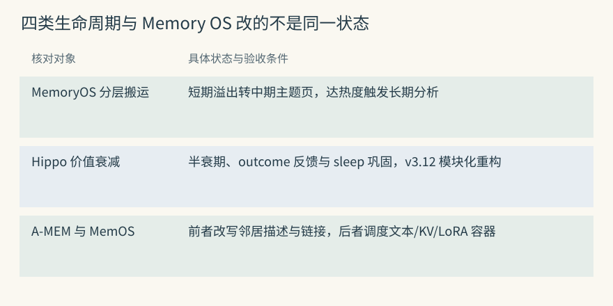
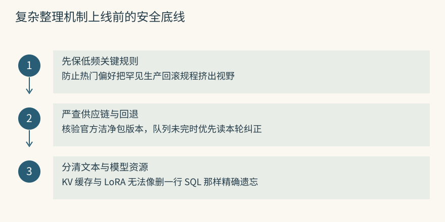

# Memory OS 与生命周期路线

## 四个都在“整理记忆”的项目，动的根本不是同一个东西

研发助手在团队里跑满半年，你会同时撞上四种完全不同的膨胀压力：
1. 对话太长，近期上下文装不下，翻旧账越来越慢；
2. 半年攒了几百条排障提醒，常用规程和过时 workaround 混在一起互相挤占名额；
3. 一次新复盘推翻或补充了三个月前那份旧笔记的排查线索；
4. 不仅想管文本记忆，还想把长提示词前缀的 KV Cache 或定制微调 LoRA 一起调度起来。

**MemoryOS、Hippo Memory、A-MEM、MemOS** 四个项目经常被打包称作“Memory OS / 生命周期路线”，但翻开代码就会发现，它们动的手术对象完全不同！

## MemoryOS：按容量溢出搬页，按热度提升长期知识

MemoryOS 把对话记忆按操作系统多级缓存的思路拆成三层（详见 [updater.py](../../sources/repos/memoryos/memoryos-pypi/updater.py)、[mid_term.py](../../sources/repos/memoryos/memoryos-pypi/mid_term.py)、[retriever.py](../../sources/repos/memoryos/memoryos-pypi/retriever.py)）：
- **短期层（Short-term）**：定长队列放最近几轮问答。一旦塞满，最老的问答被弹出，打包成带时间戳和前后链接的 `page`；
- **中期层（Mid-term）**：不是按聊天窗口分，而是按**主题连续性**把相近的 `page` 归到同一个主题 `session` 下，维护主题摘要、访问次数和热度 `heat`（容量满了走 `evict_lfu()` 淘汰冷主题）；
- **长期层（Long-term）**：某个主题的热度跨过阈值，才触发长期分析，提炼成用户画像和长期知识。检索时先粗筛中期主题摘要，再在命中的主题里挑高分 `page`，最后连同长期画像拼进 Prompt。

这套状态机写得很直观，但它有两个必须防住的坑：
1. **摘要漏词一竿子打翻一船人**：如果中期主题摘要只写了“支付网关配置讨论”而漏掉了 `PAY-409`，那这个主题下面所有含 `PAY-409` 细节的 `page` 都会在粗筛阶段被直接挡掉；
2. **冷纠正被旧画像压死**：林远刚发了一句低频但极其明确的纠正“以后别自动格式化 SQL”，因为只说过一次热度不够，还没晋升到长期层，下轮读取旧画像照样会覆盖新要求。

此外，MemoryOS 仓库自 2026 年 7 月后长期低频停滞，非常适合用来学习“短中长期页面搬运”的状态机思想，直接上生产需自担并发、多租户与维护成本。

## Hippo Memory：把“影响力”拆成时间、召回与真实结果

**Hippo Memory**（2026-11-21 最新 `v3.12.0` 提交 `51c74c33dbe9`）是一款非常贴近编码 Agent 的本地记忆工具：零模型调用默认写入、SQLite + 人类可读 Markdown 镜像（`.hippo/`）、原生支持多款编码 Agent（Claude Code / Codex / Cursor / OpenCode 等）共用同一个项目记忆库。

我们在 2026-11 最新快照里看到，Hippo 已经完成了非常漂亮的架构模块化拆分：
- **强度与半衰期（[memory.ts](../../sources/repos/hippo-memory/src/entry/memory.ts)）**：一条记忆的内容可以多年不变，但它的影响力随闲置天数按半衰期指数衰减（比如半衰期 6 天，18 天后纯衰减项降到 `0.125`）；高危必守规程可以通过 `pinned` 锁死永不衰减；
- **把“被搜到”和“帮上忙”拆开（`applyOutcome`）**：检索命中一次只算访问，任务翻车时执行 `hippo outcome --bad` 才真正削弱误导记忆的寿命，避免垃圾记忆自我强化；
- **集中巩固（[sleep.ts](../../sources/repos/hippo-memory/src/entry/sleep.ts)）**：把相关经验合并、把低强度过时条目归档待恢复；
- **多路检索与物理粒子实验（[physics-search.ts](../../sources/repos/hippo-memory/src/domain/search/physics-search.ts)）**：除了 BM25 / 向量混合与带 `asOf` 的多跳图召回，还保留了基于单位球面粒子引力/排斥力的启发式重排实验。

值得特别点赞的是 Hippo 作者的工程诚实度：它在 README 和评测报告里明确标出了哪些实验结论无法归因于记忆捕获、主动撤回了早期无法稳定复现的 `sequential-learning` 增幅数据。同时选型也要正视它的现实边界——**核心几乎由单人维护**，团队大规模生产使用前需要评估接管能力。

## A-MEM：新笔记进来，顺手改写旧笔记的发现线索

**A-MEM**（[memory_system.py](../../sources/repos/a-mem/agentic_memory/memory_system.py)）受卡片盒笔记法启发：
- 写一条新笔记时，`analyze_content()` 先帮它生成 `context`、`keywords`、`tags`；
- 紧接着 `process_memory()` 拉出最相近的旧笔记，让大模型做演化决策：要么建立双向 `links`（`strengthen`），要么直接改写旧笔记的 `context` 和 `tags`（`update_neighbor`）！

比如三个月前有一条含糊的旧笔记“支付网关超时需要查缓存”，今天新写了一份复盘“确认 `PAY-409` 来自幂等键 TTL 不足”。A-MEM 可以顺手给旧笔记补上 `PAY-409` 和 `idempotency_key` 线索，以后一搜就能串起来。

但用不好就会踩两个坑：**一是邻居描述漂移**（把今天的猜测写进三个月前的旧笔记，改歪了历史语气，审计时分不清哪句是原话）；**二是检索截断吞邻居**——`search_agentic()` 先拿近邻再追加 `links` 邻居，最后一把 `memories[:k]` 切下去，刚补进来的邻居很可能全被切光了。A-MEM 自 2025-12 起已停更，主要作为笔记演化思路的参考样板。

## MemOS：把明文、KV Cache 和 LoRA 装进同一个资源容器

**MemOS（`MemTensor/MemOS`）**野心最大——它想做面向 Agent 的“记忆操作系统”，用 [`GeneralMemCube`](../../sources/repos/memos/src/memos/mem_cube/general.py) 把三种物理形态完全不同的记忆统一封装起来：
- **Plaintext（明文 / 图）**：常规可检索、可引用、可逐条删除的文本事实；
- **Activation（KV Cache）**：特定模型处理超长固定前缀的中间激活缓存，用来省推理计算，**绝不是可按词搜索的业务事实**，换个基座模型立刻作废；
- **Parametric（LoRA Adapter）**：通过参数适配改变模型行为，**几乎无法像删一行 SQL 那样“精准遗忘某一条用户隐私”**。

再配合 [`queue_ops.py`](../../sources/repos/memos/src/memos/mem_scheduler/base_mixins/queue_ops.py) 的异步 Scheduler（支持本地和 Redis 队列，按 user/cube 分组派发和限流），把重型整理任务甩到后台。配置时注意：标记 `uninitialized` 的模块根本不会初始化实例，**先只开 Plaintext 把队列积压、读取延迟和回退跑顺，别一上来就混着上 KV 和 LoRA**。

> **2026-11 重要安全警示：MemOS 供应链事件教训与 `v2.0.36` 加固**
> 2026 年 9 月底，MemOS 生态曾遭遇一起严重的供应链投毒事件——PyPI 上的恶意 `MemoryOS v2.0.34` 及相关 npm 插件包被植入窃密程序。10—11 月间，官方团队进行了全面依赖审计与发布链加固，并在 **`v2.0.36`**（本书同步至 `2026-11-09` 提交 `3a16e5fe3048`）等洁净补丁中修复了 PostgreSQL 图存储对齐、Redis GCRA 限流与 BGE Reranker 配置问题。
> **任何团队试用 MemOS（或任何高频迭代的开源记忆包）前，务必核对官方洁净版本号、仓库来源与包哈希，并在隔离环境中审计出站网络行为！**

## 拿同一条“条件化规程变更”考考这四套系统

假设团队原本的铁律是：“所有服务发版前必须人工逐项核对配置。”今天新规则上线：“**已接入自动化配置巡检的服务，仅在巡检报警时才需人工复核；未接入的服务仍须人工逐项核对。**”

看看四套系统分别该防什么错：
- **MemoryOS**：新规则刚进来还在短期层，没到热度不会进长期层——本轮和近期会话必须优先携带新规则，别让旧长期层继续逼人手工复核；
- **Hippo Memory**：光靠给旧规则打负分降权不够！“降权”表达不了“仅对未接入服务仍有效”的条件分叉，必须显式 `supersede` 成新规程并写清适用条件；
- **A-MEM**：把新旧笔记连起来补线索没问题，但别把三个月前的旧笔记改写成“一直都有自动化巡检”，歪曲历史事实；
- **MemOS**：盯紧 Scheduler 队列有没有把这条文本更新消费完；如果启了 KV 或 LoRA，别幻想文本队列跑完就会自动同步改写模型参数。

实现笔记：别直接抄另一套系统的“遗忘/晋升参数”（选读）

工程师最容易犯的懒病，就是把 A 项目的默认参数直接抄给 B 项目：
- MemoryOS 的参数是**近期条数容量、主题相似度和热度阈值**；
- Hippo 的参数是**以天为单位的半衰期和 outcome 奖励系数**；
- MCP Memory Service 的参数是**自然指数时间常数 `τ`**（记住半衰期是 `τ * ln(2)`）；
- MemOS 的参数是**队列优先级和不同物理形态模块的序列化 Schema**。

省 Token 和防发臭永远是一把双刃剑：主题摘要省了扫描，代价是摘要重建；衰减清了噪音，代价是低频高危的灾难回滚手册可能被埋掉。所以每次引入整理机制，**必须留一条低频高危规程（比如“数据库主从切换回滚清单”）作为必考反例**——如果新机制把平均检索分提了 5%，却把灾难回滚手册搞丢了，立刻叫停！

## 动手检查

请你针对刚才的“自动化配置巡检条件变更”，分别给 MemoryOS、Hippo Memory、A-MEM 和 MemOS 各写一条具体的验收断言；再解释为什么单纯看到“后台队列完成”或“旧规则 strength 降到 0.1”，依然不足以证明下一次发版一定按新规则执行？

答案提示：MemoryOS 查短期/主题页保留了条件分叉且近期未被旧长期画像覆盖；Hippo 查旧规则已被显式 `supersede` 为带条件的清晰新规程（而不只是靠降权）；A-MEM 查新旧笔记链接已建立且旧笔记原话未被篡改、检索末端 `[:k]` 没把新笔记切掉；MemOS 查对应 cube 文本任务已从 queued 变为 completed 且读回正文正确。队列完成或强度下降只说明**存储层状态变了**，最终是否生效还要验证下一次真实发版请求时，新规则是否进了 Prompt 且针对“已接入/未接入”两类服务做出了不同动作。

<figure class="concept-diagram" tabindex="0"><figcaption>图：凡是会自动改写或淘汰记忆的机制，上线前都要先验低频保护、安全版本与回退通道。</figcaption></figure>

横向查阅表（选读）

## 本章对照结论

| 路线 | 真正发生改变的对象 | 排障时必须留下的中间状态 | 最容易翻车的故障 |
|---|---|---|---|
| MemOS | MemCube 各形态模块与异步任务队列 | 启用模块清单、任务 trace 与队列延迟 | 供应链版本污染、队列积压、KV/LoRA 不兼容与难删除 |
| MemoryOS | 短期队列、中期主题页、长期画像/知识 | 问答→Page→主题的归组映射与晋升 diff | 主题摘要漏词、低频明确纠正被旧画像压住 |
| Hippo Memory | 条目强度、半衰期、outcome 与 `sleep` 合并 | 时间衰减、召回次数、outcome 分开记 | 误召回自我强化、低频高危规程未 pin 被淘汰 |
| A-MEM | 笔记的 `context`、`tags` 与双向 `links` | 邻居改写前后 diff、向量刷新状态与返回 ID | 邻居语气漂移、末端 `[:k]` 截断丢掉刚连的邻居 |
| Mem0 / Graphiti | 短事实卡 / 双时间边与节点摘要 | 托管 Dream 状态 / 失效边列表与摘要重建 | OSS 误以为自带自动巩固；图里误拿 `invalid_at` 当热度 |

