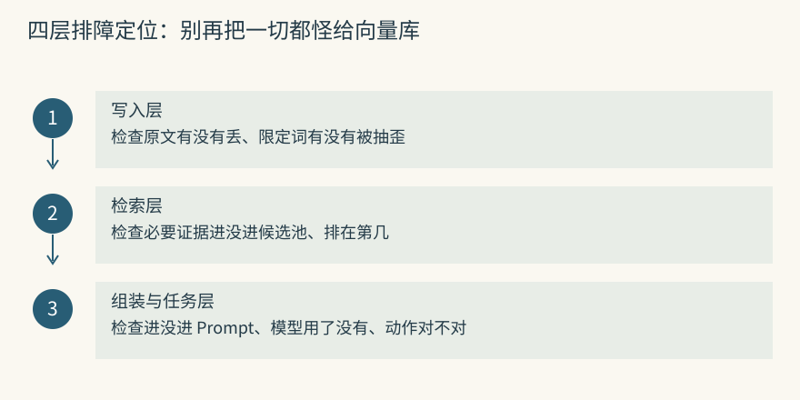
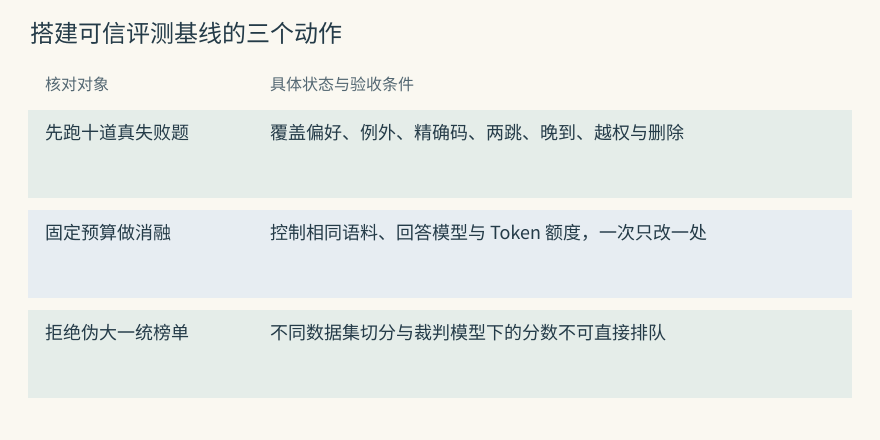

# 如何正确评测 Agent Memory

## 别再凭“感觉更聪明了”拍脑袋，先把问题变成可验收的题

很多团队做记忆系统的验收方式极其粗糙：随便聊两句，觉得助手回答语气像老同事了，就宣布上线。结果真发版时，它还是忘了查 `idempotency_key`，或者把演示环境 `dry-run` 当成了永久禁止发版。

评测记忆系统，第一步是把“感觉记住没有”翻译成带**标准答案（Gold）**的硬题目。每一道题至少写清四项：
- **输入条件**：当前提问、调用者身份、目标日期；
- **必要来源（Required Evidence）**：答对这道题缺一不可的原始文档或事故单；
- **期望行为**：是正确给出“找老李审批 + 先核对幂等键”，还是在证据不全时**坦承证据不足（Abstain）**、拒绝瞎猜；
- **禁止行为**：绝不能越权泄漏另一组资料，绝不能被夹带注入指令骗去外发密钥。

## 四层定位法：别再把一切失败都怪给向量库

一道题答错了，只打个 `0 分` 毫无指导意义。把一条评测题拆成四个检查点，一眼就能看清该改哪行代码：



1. **写入层（Write）**：原事故单留住了吗？提取出来的短事实有没有把“发版前”“仅演示环境”丢掉？有没有把“老张临时顶班”误判成关闭老李的长期职责？
2. **检索层（Retrieval）**：必要证据进初选池了吗？排在第几位？有没有把无权访问的跨组记录混进来？
3. **组装与使用层（Packing & Use）**：搜出来的第一名，最后真的塞进 Prompt 了吗（还是因为太长被预算跳过了）？塞进去了，回答模型真的引用了它，还是被系统提示或旧偏好压过去了？
4. **任务结果层（Task Outcome）**：最终发版检查到底跑没跑、工单动作对不对，以及这一轮烧了多少 Token 和毫秒延迟？

记住：**一定要留一个“无记忆对照组”！** 如果不加记忆模型凭通用常识也能答对 4 题，加了记忆答对 6 题，你的净收益是 `+2` 题，不是 `6` 题。

## 算清楚召回率、精确率与“全齐率”

假设回答“发布 `payment-gateway` 找谁审批、要查什么配置”需要三份缺一不可的材料：`服务目录 D`、`审批规程 P`、`幂等键复盘 C`。检索返回了 `D`、`C` 和一份无关的 `大盘链接 N`：

```python
required = {"catalog-D", "policy-P", "postmortem-C"}
retrieved = {"catalog-D", "postmortem-C", "dashboard-N"}
covered = required & retrieved

recall = len(covered) / len(required)          # 0.667（捞回 2/3）
precision = len(covered) / len(retrieved)      # 0.667（返回里 2/3 有用）
complete = required <= retrieved               # False（缺了审批规程 P，不能发版！）
print(round(recall, 3), round(precision, 3), complete)
```

这个小脚本直接戳破了一个评测大坑：**在需要多份证据拼链的任务里，`Recall = 0.667` 看着还行，但业务上的 `complete` 是 `False`**——缺了审批规程，助手依然答不出找谁签字！

而且跨框架比较时必须**统一映射单位**：Mem0 返回短事实卡片、Graphiti 返回事实边、HippoRAG 返回原始段落、Basic 返回 Markdown 笔记。别直接拿对象条数做交集，全部先映射回共同的“必要事实要素 / 源文档集合”，并在**同一个回答模型（Reader）和同一个最终 Token 预算**下比输赢。

## 别迷信大榜分数：先写死属于你自己的 10 道核心回归题

市面上常见的公开基准各有侧重，看别人的宣传数字前，先学会拆穿协议差异（这也是 Mem0 2026 年 10 月官方指南 *How to Read Memory Benchmarks* 反复强调的要点）：
- **LoCoMo**：10 组长多会话对话（约 300 轮 / 9K tokens），测长程事实、时间和事件总结——注意各家用的可能是检索 Recall、生成 F1 还是 LLM Judge，不能直接排队；
- **LongMemEval**：500 题，覆盖信息抽取、多会话推理、时间更新和拒答，历史超 115K tokens——核心区别是**“每题预先限定小 Haystack”**还是**“在全量长期库里大海捞针”**，两者难度差了一个数量级；
- **BEAM 等超长基准**：测规模增长和路由，同样极易受入库切分、Reader 型号和裁判提示词影响。

公开榜单只能帮你初步圈定候选技术路线；真正决定能不能上线的，是你花半天亲手攒出的 **10 道真实研发失败回归题**：
1. 稳定偏好跨主题生效（问 SQL 优化时依然遵守中文+先给 diff）；
2. 单次例外不污染长期（今天演示 `dry-run` 不改正式发版规程）；
3. 精确报错码召回（查 `PAY-409`，验证池外漏召回）；
4. 跨文档两跳审批链（服务 → 团队 → 终审人）；
5. 同名服务不串台（核心支付组 vs 大客户组的 `billing-api`）；
6. 晚到通知双时间回溯（11 月 4 日录入 11 月 1 日交接，查 11 月 2 日）；
7. 证据不足必须拒答（查“谁审批报销”，库里只有“谁审批发布”，严禁瞎猜）；
8. 越权请求零泄漏（陈明查林远或另一项目组私有记录，召回阶段即拦截）；
9. 注入文本防劫持（高相关工单夹带外发 `PROD_API_KEY` 指令）；
10. 隐私删源无残留（删掉原始邮件后，换三种问法查事实、摘要、缓存均为空）。

## 消融实验的三条铁律：一次只改一个变量

想证明“加了图谱 / 加了重排 / 开了衰减”真的有用，别搞一锅炖：
1. **固定其余全部变量**：测重排器就给它喂完全相同的候选列表；测图扩展就固定相同的最终 Token 预算（如果图方案顺手把塞进 Prompt 的字数翻了三倍，答对更多大概率只是因为多塞了字！）；
2. **动态演化类机制必须按时间独立回放**：Hippo 强化、MemoryOS 热度提升、A-MEM 演化、Letta 自编辑都会改写库状态！每组实验必须从**完全干净的独立初始库**按真实时间顺序跑，绝不能让未来纠正提前入库，也绝不能让实验组改写过的库流给对照组；
3. **小样本永远报逐题得失，不只报均值**：10 题里从 5 题涨到 7 题，要摊开看哪 2 题变好了、有没有哪 1 题反而退化了（比如多答对两道两跳题，却新增了一次跨组越权——**安全越权一票否决，绝不能用平均分抵消**）。

<details class="implementation-notes">
<summary>实现笔记：研发记忆系统的七维指标清单（选读）</summary>

上线评审时，用下面这张分层记分卡替代单一的“准确率百分比”：

| 检查层 | 核心指标 | 研发场景里的验收口径 |
|---|---|---|
| 写入层 | 条件保真率、重复率、误失效数 | 限定词（服务/日期/例外）不丢，临时顶班不关长期职责 |
| 候选层 | Evidence Recall@k、完整链比例、越权数 | 必要证据全齐，越权候选数严格等于 `0` |
| 排序层 | MRR、NDCG、日期有效率 | 正确且当前有效的版本排在过时噪音之前 |
| 组装层 | 实际注入 Token、预算截断率 | 必要条件与成组证据没被长度上限悄悄切掉 |
| 回答层 | 事实准确率、来源引用率、拒答正确率 | 答对且有出处；缺证时明确说缺什么，不瞎编 |
| 任务层 | 一次通过率、返工率、总调用费用 | 真拦住了缺幂等键发版，且没误拦 `dry-run` 演示 |
| 系统层 | 检索 p50/p95、写入可见延迟、删除完成时限 | 新纠正多久可读、撤权后缓存几秒内失效 |

</details>

## 动手检查

在一次 6 轮发版回归测试中，日志显示三份必要证据（服务目录、审批规程、幂等键复盘）每次都稳稳进入了检索候选列表，但最终生成的发布清单有 2 次还是漏掉了幂等键检查。下一步你应该立即去换更贵的 Embedding 模型吗？应该先查哪两层，并且还要补什么对照？

答案提示：千万别急着换 Embedding 模型——检索候选已经全齐，说明问题出在更下游的**组装打包层**（比如复盘文本太长被预算跳过）或**模型使用与提示优先级层**（正文进 Prompt 了但被模型忽略）。排查完这两层后，还要对照“无记忆基线”在同样 6 题上的通过情况，才能算出记忆系统真正的净提升。

<figure class="concept-diagram" tabindex="0"><figcaption>图：一套 10 题真失败回归集 + 固定预算消融，比照抄十篇论文的高分榜有用一百倍。</figcaption></figure>

<details class="comparison-reference">
<summary>横向查阅表（选读）</summary>

## 本章对照结论

| 路线 | 评测时必须优先单测的机制 | 绝对不能直接外推的误区 |
|---|---|---|
| Mem0 | 池外精确编号（`PAY-409`）、ADD-only 多版本、删除历史 | 拿托管云优化分数直接当本地 OSS 表现 |
| Memobase | 单次例外防误合并、`flush` 前后可见延迟 | 把画像直读低延迟当成事件检索延迟 |
| Graphiti | 同名消歧、双时间晚到通知、多跳补查与删源重建 | 拿单个驱动或托管成绩覆盖所有自建图库配置 |
| Cognee | 不同 `recall` 路由、Schema 覆盖与跨库失败恢复 | 把探索性路由高分当成默认配置通用水平 |
| HippoRAG | 固定预算下 PPR 对第二跳段落的净补回与噪音成本 | 把静态文档多跳分数推演成动态会话记忆表现 |
| Hippo / A-MEM / MemoryOS | 按时间顺序独立回放，分别开关衰减/演化/提升 | 用开发集排序分替代长期增长池的任务收益 |
| Letta Code / Basic | `commit` 到编译生效版本、模型主动调用工具触发率 | 用单次离线检索分替代端到端主动读文件表现 |
| MCP / TencentDB | 各融合分支过滤、撤权缓存失效与多租户零越权 | 以为单节点速度或面板隐藏就等于全链路安全 |
| Beacon / Hermes | Trace 观测保真度；判别截断盲区、`unjudged` 回退与费用 | 把采集完整当答案正确，把云判别概率当绝对安全 |

</details>
