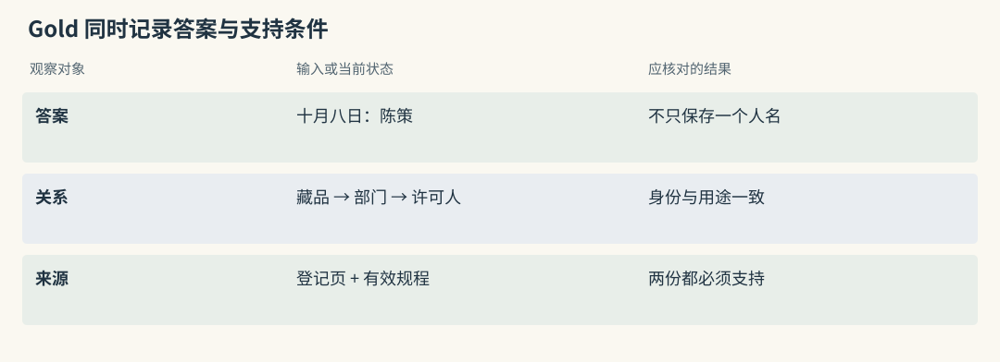
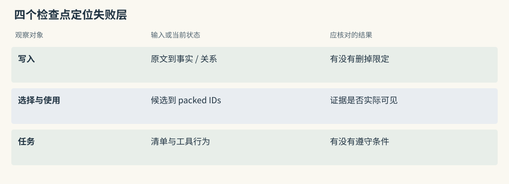
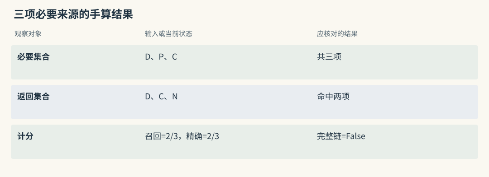
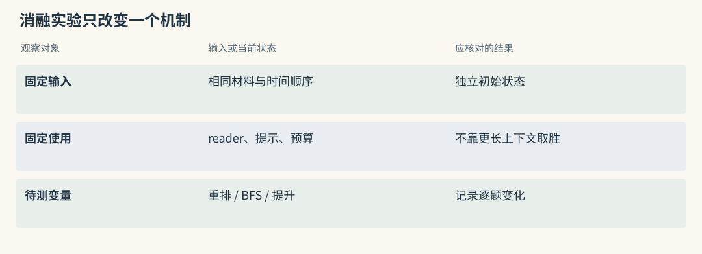
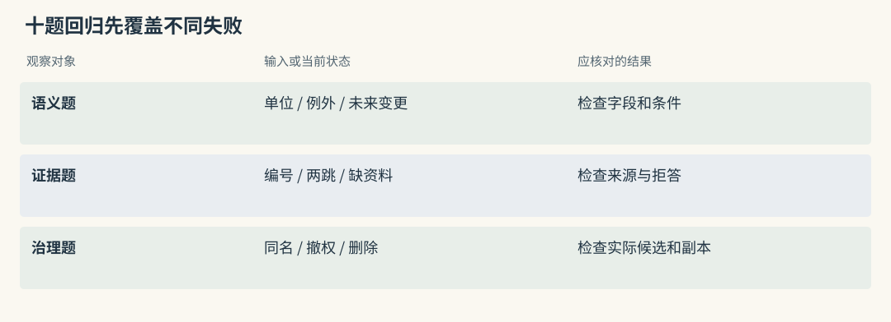
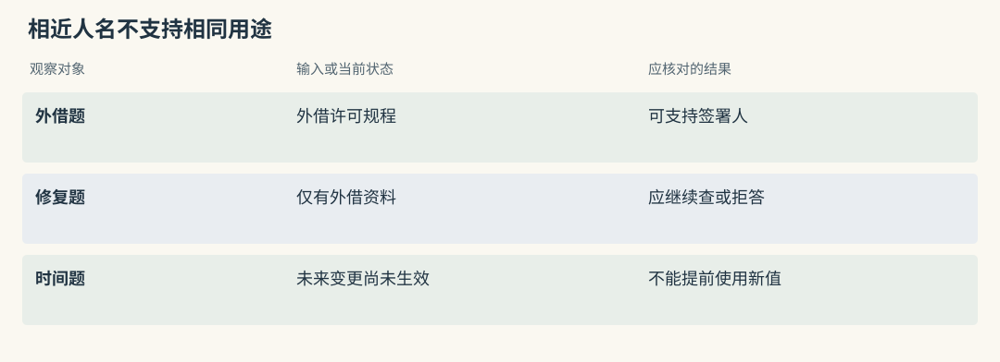
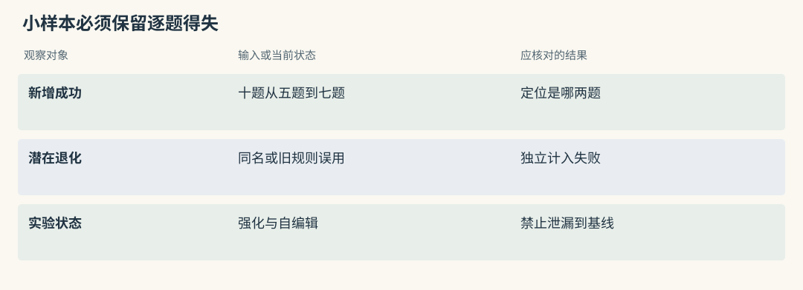
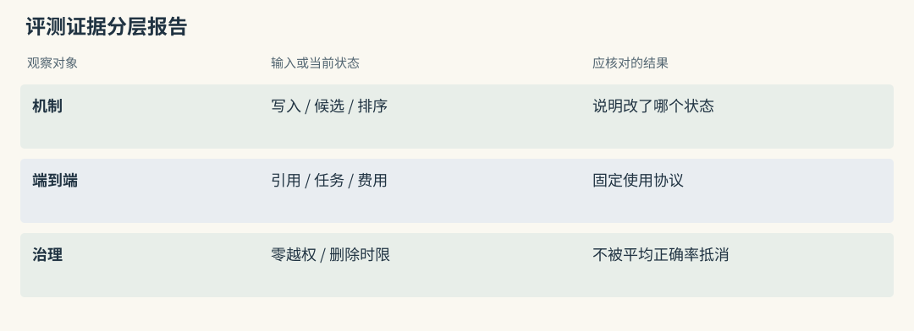

# 如何正确评测 Agent Memory

## 把“感觉更聪明了”变成能检查的问题

借展助手回答得很详细，却把执壶的尺寸单位填错，还没有读到最新许可。评价记忆不能只问回答是否像馆员，应提前定义可检查的结果：默认单位正确，包装条件完整，许可链有来源，无证据时不猜签署人。

可以先建立小型参考集。每题标出支持答案的原材料、必要事实、查询日期与期望行为，这些人工核验的参考称为 gold。它既可以规定“陈策签署”，也可以规定“只找到部门，必须继续查或说明不足”。

本章给出评测协议与手算例，没有独立复现各项目的大规模 benchmark，也没有运行真实出库操作。

<details class="source-example">
<summary>源码路径与适用范围（选读）</summary>



### Mem0：gold 应关联源事实，不只关联生成 ID

提取后 memory ID 可能变化，参考集应锚定源材料与陈述。比如“尺寸用毫米”既要主体正确，也要限定为借展清单；模型把它拆成两张卡或合成一张，不应只因 ID 数量不同就改变判分。

可以先标所需事实，再将本轮卡片映射到它们。卡片提到陈策，但来自另馆的修复签收，不能算命中本题许可证据。

### Graphiti：gold 应包含规范对象与支持关系

许可题的 gold 应包含藏品管理关系与该部门外借签署关系，并要求中间规范身份一致、目标日期有效。episode 原文与 fact 用途共同支持答案。

人物节点出现不算关系覆盖，返回两条边但部门 UUID 不同也不能拼链。参考集应能识别这些错误，而非只检查最后的人名。

</details>

## 一次问题，分四个位置检查

一题可以在四处留下检查点。写入检查源材料是否保留、提取是否删改条件；检索检查必要事实是否进入候选并留下；使用检查最终输入是否包含它们、回答是否正确引用；任务检查生成清单或装箱动作是否遵守要求。

例如单位卡在搜索中排第一，最终清单仍写厘米。若组装器根本没带卡片，应修组装；若模型忽略已带入的约定，应查指令优先级或执行验证。继续扩大候选不会自动修复这两类失败。

四层分开后，最终任务收益仍需与无记忆对照比较。单次答对可能来自当前消息、模型既有知识或猜测，不能全算在长期记忆上。

<details class="source-example">
<summary>源码路径与适用范围（选读）</summary>



### Mem0：四层各留一份中间结果

保存提取正文与 metadata，检索各路 ID、最终 ID，组装时的 packed ID，以及任务结果。这样能区分漏提取、漏入池、预算挤出和读错四种情况。

同时保留确定程度。若原文只说“估计缓冲层遗漏”，提取变成已确认原因，即使搜索准确命中，也不能把写入算作正确。

### Graphiti：写入还要核对错误失效

图写入还要记录规范节点、new edges 与 invalidated edges。一条正确新许可伴随错误结束其他部门关系，不能算完整成功。

查询记录 recipe、driver、日期与来源，后续由宿主关联 packed IDs 和实际动作。只有图内部 trace 而无使用日志，无法证明模型读到了哪份规程。

</details>

## 用集合算一次召回率

设一题要求三项材料：登记页 D、许可规程 P、包装计算单 C。检索返回 D、C 和无关会议纪要 N，命中两项，漏掉许可。

```python
required = {"register-D", "permit-P", "calculation-C"}
retrieved = {"register-D", "calculation-C", "minutes-N"}
covered = required & retrieved
recall = len(covered) / len(required)
precision = len(covered) / len(retrieved)
complete = required <= retrieved
print(round(recall, 3), round(precision, 3), complete)
# 预期：0.667 0.667 False
```

召回率表示必要证据覆盖，精确率表示结果中相关部分。完整性布尔值更适合多份材料缺一不可的任务：覆盖三分之二仍不足以批准借出。

计算前必须固定单位。按 session 命中任意一条就计成功，与按必要事实全部到齐，不能使用同一个百分比解释。不同项目返回卡片、边、段落或笔记，应先映射到共同来源与事实要素，再比较预算。

<details class="source-example">
<summary>源码路径与适用范围（选读）</summary>



### Mem0：一张卡可能覆盖多个 gold 要素

一张卡可能同时覆盖登记关系与许可规则，需核对来源确实支持两部分。一张长卡不该因只占一个 ID 被判为漏掉一半，也不能因为含正确人名就跳过来源检查。

精确率的分母也需固定。若按陈述计数，应统计卡片内无关或错误陈述；若按记录计数，则说明判相关的标准，不把短结果列表直接视为高质量。

### Graphiti：边与 episode 的召回要区分

fact 与 episode 是不同对象。边可覆盖一个关系要素，来源段落可能同时支持多个要素。基础 `search` 与组合 `search_` 的返回结构不同，直接做对象 ID 交集会产生伪差异。

可以同时报告关系覆盖和来源覆盖，再观察必要原文是否进入最终输入。这样能识别短 fact 正确而原始条件未被 reader 看到的情况。

</details>

## 怎么知道是新机制带来的改善

设置无记忆、仅近期消息、关键词、dense 与 hybrid 等对照，保持来源、reader、提示与最终预算一致。想研究重排时，给它同一批候选；想研究 PPR 时，固定图和 reader，不顺手增加十倍上下文。

会改变长期状态的机制需要按时间回放。Hippo 的召回强化、MemoryOS 的提升、A-MEM 的演化和 Letta 的自编辑，都会影响下一个问题。每组从独立初始状态开始，不能让试题反馈写进另一组基线，也不能提前载入未来纠正。

异步链还要固定等待约定：立即读取、等 flush 完成或等队列完成。否则比较出的差别可能只是可见延迟，并非事实质量。

<details class="source-example">
<summary>源码路径与适用范围（选读）</summary>



### Mem0：把候选扩展和重排分别控制

把三个变量分开：候选池大小、池内评分和外层重排。先保存相同语义池，比较 keyword 与实体信号；再固定最终候选测试 reranker。

若一组增大 `top_k` 又加模型重排，答对更多难以归因。提取实验还应新建事实库，避免人工纠正过的旧卡片为某组提供额外优势。

### Graphiti：固定 ingestion 后再比较搜索配方

先完成并核验同一批 ingestion，再在固定图上比较 BM25、cosine、RRF、BFS 或 cross-encoder。各路限额、重排模型和 driver 都进入配置记录。

若 schema、抽取模型和查询配方一起改变，第二跳改善可能来自写入而非搜索。把建图与检索实验拆开，才能解释收益来源。

</details>

## 先检查十个案例，再读大分数

先做十个馆内案例：单位约定、单次回执例外、未来变更、同名部门、两跳许可、晚到通知、精确编号、缺失证据、撤权、删除。每题保存源输入、中间状态、最终消息和任务输出。

逐题看错在哪里，再扩大到更长会话。调参数的题与最终测试题分开，不能反复针对同一答案修到满分后宣称泛化。

LoCoMo、LongMemEval 或 BEAM 能增加规模与任务覆盖，但不自动包含馆内权限和流程边界。大分数需要连同 reader、粒度、数据切分和等待协议阅读。

<details class="source-example">
<summary>源码路径与适用范围（选读）</summary>



### Mem0：本地评测不能直接领取托管分数

本地 OSS 有批量提取、关键词与实体机制，不代表托管模型和优化已全部交付。真实试用应保存实际卡片与返回，不能直接领取 managed platform 的得分。

先检查单位例外、编号池外漏项、同义重复、删除和 provider 故障。某项不通过就记录具体失败，避免用另一个数据集的高 QA 分数覆盖本地缺口。

### Graphiti：建图正确率与回答率分开抽样

抽样计算节点身份、关系条件和有效时间的正确率，再看最终问答。若部门合并已经错误，改搜索公式也可能只是更稳定地返回错误许可。

框架、托管服务和论文的 reader 或上下文管理不同。引用时明确交付物，不把托管成绩写成所有本地 driver 与 recipe 的保证。

</details>

## 一条测试题，应说明证据怎样支持答案

一条许可题可写成：查询十月八日青釉执壶外借签署人；参考答案陈策；登记页证明归属东馆陶瓷保管部，规程证明该部外借由陈策签署，二者在该日有效。

再加近邻反例：谁签署该藏品修复工程许可？若没有这类材料，参考行为应说明不足。人名和部门共现不足以支持不同用途的问题。

顺序测试也应逐步查询。先写毫米默认，查一次；再写本次回执厘米，查一次；最后写下月起厘米，分别在变更前后查询。全部预先入库再问第一轮，会让系统看见未来信息。

<details class="source-example">
<summary>源码路径与适用范围（选读）</summary>



### Mem0：测试条件应保留业务有效时间

metadata 可保存业务日期，但普通追加不会自动维护唯一当前字段。测试需覆盖应用如何解释多版本，而不仅是卡片是否出现。

对未知许可要求 abstain，防止 reader 借相近的修复签收推断外借权。合法空结果与依赖故障也要区分，二者对应不同的预期提示。

### Graphiti：增加关系相近但用途不同的反例

修复许可、外借许可和出入库签收可以连接同一部门与人员，却应回答不同问题。gold 要包含关系用途、目标日期和规范身份。

增加“有相邻人名但缺许可边”的题，检查 reader 是否仍承认不足。图上找到某个人不能成为强制回答的理由。

</details>

## 小样本改善应该怎样解读

教学假设旧方案十题答对五题，新方案答对七题。应先列出两道新增成功和所有退化题，再看是否都是同一种编号表达或同一部门链。如果全部来自一份规程，暂不能推广到其他藏品。

成本同样逐题记录。新方案多执行查询与模型重排，可能用更高费用换到有限收益。报告绝对差异、样本范围与失败类型，比只写相对提升更有解释力。

重复运行也可能改变状态。一次查询强化记忆，或 Agent 把答案写入 core 后，第二次测试已经不是同一初始条件。应清理实验副作用，或明确研究的是连续学习过程，而非静态对照。

<details class="source-example">
<summary>源码路径与适用范围（选读）</summary>



### Mem0：逐题比较漏提取、漏入池和漏使用

新增成功若都来自语义池扩大，应说明是召回边界改善；若某些旧题被错误单位干扰，应报告退化。分别统计漏提取、漏入池、漏打包与误使用。

不要把测试期间显式更新的事实留进 baseline。每组保留独立数据版本，并记录提取、检索、重排及输入的总成本。

### Graphiti：多跳改善要同时检查身份错误

BFS 补回许可后，也可能更易沿同名部门返回别馆资料。平均回答率提高不能抵消越权，应把安全失败独立计数并设门槛。

重建图时保持事件顺序、模型与 schema 一致。一次人工纠正影响了规范节点后，就不应在另一对照中继续使用该图而称为全新实验。

</details>

## 动手检查

假设三项必要来源都进入候选，但六次清单生成中有两次漏掉包装条件。下一步检查最终打包和模型使用，而非立即更换 embedding。

再与无记忆组比较，确认其成功次数和失败类型。答案提示：四次成功只描述当前方案；要保留无记忆组在同题上的成功和失败，才能估计新增机制的净变化。候选齐全但输出漏项，应先查打包和使用，而非宣称召回失败。这里的数值仅供推演，不是项目实测报告。

<details class="implementation-notes">
<summary>实现细节与复查入口（选读）</summary>

## 先拆开四种能力

写入评估检查保存覆盖与忠实度，检索评估检查候选和排序，使用评估检查输入与引用，任务评估检查动作和总成本。可以为每题保存四项判定，而不只给一个最终分。

同一题可能写入正确、检索失败，也可能证据完整但任务仍不合规。拆开后才能针对具体层修复；Recall@k 的改善不能自动记为任务成功。

## 常见 benchmark

常用 benchmark 的资料形态和计分方式不同。阅读结果时先确定问题池、历史规模、检索单位、reader 与评分器，再决定它能否回答借展系统关心的某个问题。

### LoCoMo

LoCoMo 包含十组长、多 session 对话，平均约三百轮、九千 tokens，任务涉及问答、事件总结和多模态。适合查看长程事实、时间与跨会话证据。

项目可能用 evidence recall、生成 F1、BLEU 或 LLM judge。相同数据名不代表相同实验，引用分数时须连同单位与回答协议说明，不能和纯检索结果直接排队。

### LongMemEval

LongMemEval 有五百题，涉及信息抽取、多 session 推理、时间、知识更新与拒答，历史可超过 115K tokens。关键区别是每题是否预先限定 haystack，还是在共享长期库中搜索。

还需记录 turn 或 session 的存储粒度，数据清洗内容，是否等待后台处理，以及重排参数是否在测试题上调过。R@5 与回答准确率不能混为一个指标。

### BEAM 与项目自建评测

BEAM 的超长上下文设置适合考察规模增长，但不同实现的 ingest、路由与 judge 会改变结论。探索性报告尤其应查看路由和评分是否使用同一题集。

DevBench、PersonaMem 或 sequential-learning 等自建集可贴近特定用途，外部可比性较弱。报告来源、样本范围与负面结果，不把开发集优势扩大成通用排名。

## 指标矩阵

| 检查位置 | 可报告指标 | 借展题中的具体含义 |
|---|---|---|
| 写入 | 覆盖率、忠实度、重复与冲突 | 是否保留两侧各 12 毫米及适用范围 |
| 候选 | evidence Recall@k、越权数 | 登记、许可、计算单是否到齐 |
| 排序 | MRR、NDCG、日期适用率 | 必要来源是否靠前且有效 |
| 输入 | tokens、证据密度、截断率 | 预算有没有挤掉许可条件 |
| 回答 | exact、F1、引用与拒答 | 人名正确且有对应规程 |
| 任务 | 成功、返工与总费用 | 清单合规，未跳过验证 |
| 系统 | p50、p95、积压与删除时限 | 更新多久可读，撤销多久生效 |

MRR 关注首个相关结果，NDCG 还依赖等级和位置折扣。日期适用、越权和完整链覆盖可独立作为门槛，不能被平均排序指标抵消。

## 最小可信实验

一个可解释的实验先保存固定源材料和测试题，再为每组建立独立状态。建议顺序是无记忆、近期消息、BM25、dense、hybrid，最后加入重排或生命周期，每一步只改变待研究部分。

保存原始候选、分项、最终输入与答案。模型 judge 需配合人工抽样，尤其检查同名部门、缺证据和来源不支持的正确人名。小样本可给置信范围或逐题配对结果，不只给单个漂亮均值。

如果要测连续学习，明确反馈在何时写入，只评估随后发生的任务，并保留未学习对照。静态检索与持续演化是不同实验，不应混用状态。

## 每个项目需要自己的机制验收

| 项目 | 建议机制试验 | 重点观察 |
|---|---|---|
| Mem0 | 编号只被全文或实体命中 | 是否能进入语义池边界之外 |
| Memobase | 单次例外与 flush 前后 | 字段值、延迟、原 blob |
| Graphiti | 别名、跨馆同名、迟到变更 | 规范 UUID、有效区间与来源 |
| Cognee | 固定材料替换 retriever | schema 覆盖与实际 route |
| HippoRAG | dense 漏规程，PPR 补取 | 第二跳来源与传播噪音 |
| MemoryOS | 开关主题提升和热段分析 | 页遗漏、错误晋升、冷纠正 |
| MemOS | 先文本，再单测模型资源 | 队列可见窗口与兼容 |
| Hippo | 分别关 decay、outcome、physics | 状态泄漏、误强化与误遗忘 |
| A-MEM | 静态近邻对照 evolution | 邻居持久化与最终 k |
| Letta Code | 未提交、已提交、已编译 | 后续输入到底使用哪个版本 |
| Basic | 修改、改名与空索引重建 | 文件身份、链接和同步 |
| MCP Service | 两种融合及后端故障 | 每路过滤、补取与删除 |
| Beacon | 已知工具序列跨宿主采集 | 直接观察、推断、漏采与重复 |
| TencentDB | 不同 ACL、Loadout 与撤权 | 候选、内容服务和注入缓存 |
| Hermes | 截断、危险相关段与批失败 | selected、unjudged 与回退 |

这些是建议用例，不表示已完成测试。历史 MemGPT 还可单测主动读取工具是否触发，归档 Letta 不能代替当前运行时的验收。

## 警惕饱和 benchmark

当每题预先限定的历史里 R@5 已接近满分，继续优化该设置可能看不出全局库风险。可增加同名部门、旧规程、噪音、持续增长与拒答题，让候选选择更接近实际使用。

长期任务还应测第几十次借展是否少犯早期错误，以及删除与撤权后是否仍有残留。质量、费用、延迟、维护和安全共同决定方案，单一饱和指标不能说明这些边界。

## 用同一条 query 拆开错误归因

一题三项必要来源只返回两项，evidence recall 为三分之二；若协议只要求任一 gold session 出现，hit@k 却可能为 1。比较前应写下公式、单位与映射，防止相同缩写掩盖不同问题。

卡片、边、passage、笔记和 page 应映到共同源事实。摘要覆盖事实但没有旧 turn ID，不必机械判漏；摘要说对却来自错误机构，也不能计为可靠覆盖。之后用固定 reader 和 token 预算比较答案。

演化对照按时间独立回放，异步对照固定等待，遥测对照测覆盖，权限对照要求零越权。Hermes 和 Hippo reranker 先共用候选测排序，再做端到端，才能分开召回收益与选择收益。

</details>

<figure class="concept-diagram" tabindex="0"><figcaption>图：评测证据分层报告。各行分别验收，不能用某一行的成功替代其他结果。</figcaption></figure>

<details class="comparison-reference">
<summary>横向查阅表（选读）</summary>

## 本章对照结论

| 路线 | 适合先报告的证据 | 不能直接外推的结论 |
|---|---|---|
| Mem0 | OSS 提取与候选集合 | 托管分数等于本地质量 |
| Memobase | 字段准确率与更新时间 | 热读取延迟等于事件检索延迟 |
| Graphiti | 消歧、失效与许可链覆盖 | 托管结果覆盖所有 driver |
| Cognee | loader、schema、route 对照 | BEAM 探索结果等于统一排名 |
| HippoRAG | 固定 reader 的第二跳段落收益 | 文档多跳等于用户画像质量 |
| MemoryOS、MemOS | 提升状态或实际模块结果 | 一类模块成绩代表所有形态 |
| Hippo、A-MEM | 价值或演化消融 | 开发集排序代表长期任务收益 |
| Letta、Basic | 生效版本、工具与文件重建 | 单次搜索能概括运行时行为 |
| MCP | 融合、过滤与同步恢复 | 特定后端速度适用于所有部署 |
| Beacon | 事件覆盖与 fidelity | 采集完整等于答案正确 |
| TencentDB | 资产权限、版本与注入 | 多服务可用等于共享边界正确 |
| Hermes | 选择、截断、故障和费用 | 概率输出天然校准且安全 |
| 历史论文与旧 Letta | 对应数据和归档协议 | 历史实验保证当前产品表现 |

</details>

