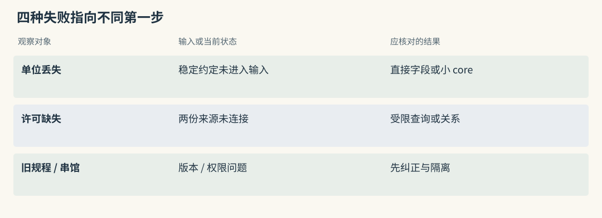
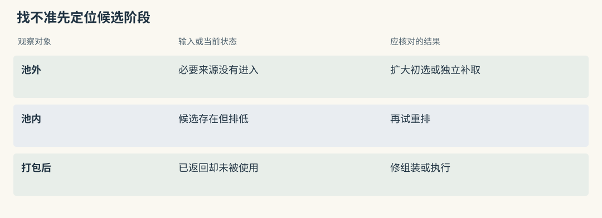
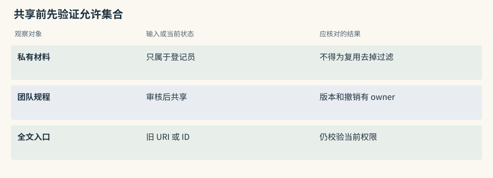
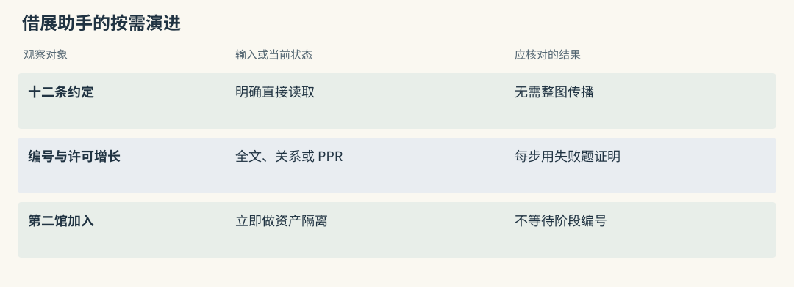
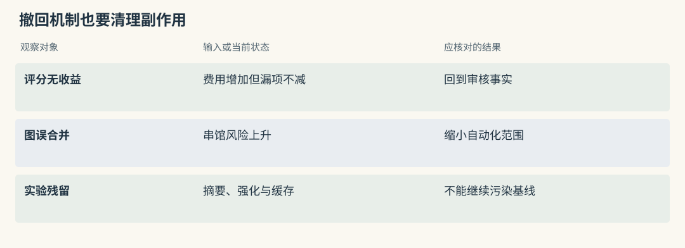
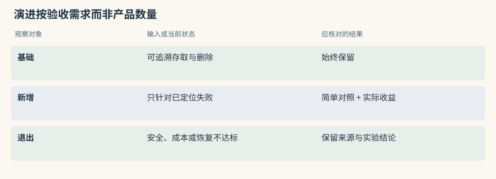

# 选型与演进路线

## 用你的失败，决定下一步学哪种技术

借展助手可能出现四种失败：清单遗漏长期单位约定，签署人散在两份文档而查不到，停用内托方案仍被推荐，西馆资料混入东馆请求。它们对应字段读取、跨来源连接、版本纠正与权限隔离，不需要同一种升级。

先保留一条失败记录：当前输入、必要来源、候选、最终消息和实际输出。能指出第一处偏离预期的位置，再选择改变机制。若西馆资料已经越权进入候选，加更好的重排只会更有效地利用泄漏资料。

本章的路线和试用条件围绕教学借展场景展开，不是对所有项目进行统一排名，也不表示已经运行了各候选部署。

源码路径与适用范围（选读）

### Mem0：选择 SDK 的理由应落在事实管线上

现有应用只需把“内托含两侧缓冲层”提取成短事实并下次查回时，SDK 是合理起点。试用看正文是否忠实、候选是否覆盖、过滤是否可信以及模型费用。

若毫米约定总被问题搜索漏掉，可先增加直接字段读取，不急着换系统。SDK 小不代表业务无需版本、授权和组装责任，这些应写进接入清单。

### Graphiti：选择时间图的理由应落在关系失败上

同名部门、跨文档许可和晚到变更为时间图提供更直接理由。采用时还需模型、driver、索引、实体解析与日期查询，成本应与显式关系表比较。

先用两份许可资料加一次代签变化验证：规范对象正确、历史区间正确、原文可回查。若这些失败没有改善，图形结构更丰富本身不构成迁移理由。

## 起步：把你能解释的数据路径跑通

小型馆内助手可从少量人工审核记录开始：保存、读取、替代与删除都有明确入口，原文有稳定 ID，最终消息有预算。基础权限从第一天就存在，不因原型简单而搜索全库。

需要程序化事实可试 Mem0，需要直接画像可研究 Memobase，需要馆员编辑知识可试 Basic。更简单的 SQL 表或现有运行时 store 也应留下对照。

准备一组回归题，包含单位、回执例外、内托计算和未知许可。每次增加自动提取或重排后重跑，确认没有以新功能破坏已经正确的行为。

源码路径与适用范围（选读）

### Mem0：用直接保存建立最短 baseline

可先将审核文字用 `infer=False` 保存，固定身份与源 ID，按 filters 读取，再观察真正送给模型的内容。之后开启推断，对比条件是否被丢掉。

提前跑清 update、delete 与 history 的含义，尤其删除可能保留旧正文。最短 baseline 也要有数据治理，不能把接口名称直接当成隐私承诺。

### Graphiti：从极小 episode 集验证关系模型

只加入执壶登记、部门外借许可和一次代签通知，逐个核对 episode、部门 UUID、边来源与有效时间，再问当前和历史签署人。

先固定 schema 和搜索配方，不同时开启所有扩展与社区。代码片段只有接口形状，真正试用还需配置模型与图后端，保存实际输出后再谈通过。

## 第二个问题：记了，但找不准

原文正确却搜不准时，先区分精确编号、不同措辞、候选截断和组装遗漏。全文能补 `CR-208`，向量能匹配“缓冲空间”，混合候选才有比较意义。

正确来源已在池里但排名差时，再试 cross-encoder 或 Jev。先以 shadow 记录新排序，不影响用户输入，观察它会误删哪些必要资料，以及费用是否值得。

一次只改变候选、排序或预算之一。若同时换 reader、扩大池和开启生命周期，改善和退化都会难以归因，回滚也难恢复干净对照。

源码路径与适用范围（选读）

### Mem0：先定位 A 是池外还是排低

记录 semantic、keyword 和实体关联 IDs，判断目标卡是池外还是排低。池外记录无法由末端 reranker 创造，可扩大初选或追加受限查询。

配置 provider 后还要核对是否启用 `rerank=True` 以及是否触发降级。若卡片已返回却被宿主截去，应修打包，不继续调整底层权重。

### Graphiti：先固定边搜索，再增加扩展

先固定边 BM25、cosine 与 RRF，再按需要启用 BFS。许可边时间过滤错了，应先修目标日期；规范部门错了，应回写入阶段修身份。

增加邻域可能放大同名错误。只有候选正确而覆盖不足时，扩展才可能提供收益；正确结果未进入 prompt，则不是图搜索算法能够修复的问题。

## 第三个问题：需要关系、历史或长期整理

跨文档许可可以先用显式链接或关系表；对象与文档规模增长后，再比较 Graphiti、Cognee 与 HippoRAG。要问过去由谁签署，需同时处理有效时间，不能只增加遍历跳数。

近期问答太多可研究 MemoryOS 的页面和主题，旧提醒价值差异可研究 Hippo，笔记解释需随报告变化可研究 A-MEM。多形态资源与异步任务需要统一治理时再看 MemOS，而非为一个单位字段引入完整资源层。

Letta Code 属于运行时选择，让 Agent 主动读取历史并修改后续规则。它改变工具控制与长期文件状态，试用要看实际调用、提交和编译，不只比较一次 search 得分。

源码路径与适用范围（选读）

### Mem0：长期版本可由外层补，成本需明确

少量关系的当前值，可由事实表加明确版本解决。metadata 能保存生效日期，读取策略仍要实现；普通追加不会自动消解所有旧默认。

如果外层开始自行维护大量别名、关系、时间冲突与来源链，应比较图框架的总体成本。对比对象是整条写读纠错路径，不是数据库字段数量。

### Graphiti：时间字段与关系解析形成完整链的一部分

`reference_time` 辅助解释时间，resolution 维护关系，过滤选择目标区间，episode 提供回查。任一环节缺失都可能答成错误历史。

生命周期衰减和 Skill 审核并不因使用时间图自动完成。可以保留独立人审规则与价值治理，避免把所有长期行为都归到边失效上。

## 多人共享时，先建立可见范围

多人使用时，先定义私有会话、共享规程与审核后 Skill 的边界。谁可共享、谁可撤销、撤销如何清缓存，要在开放读取之前落实。

TencentDB 面向资产与 Loadout，Cognee 和 MCP 也有各自服务授权；Basic 可承载人审资料。Beacon 补行动证据，Hermes 补候选判断，但它们不能代替可见集合或长期后端。

可先做一个很小的组合：原生工具日志、审核笔记、授权检索和统一组装。不必每类都安装独立平台，能解释数据与故障如何交接更重要。

源码路径与适用范围（选读）

### Mem0：共享范围不能用任意客户端 metadata 代替

客户端 metadata 可以表达项目名，不能证明它有访问权。服务按当前身份决定私有、项目与团队集合，按 ID 操作也核验归属。

跨会话共享不应通过删除所有 filters 实现。撤权时处理固定卡片引用和注入缓存，并测试不同客户端是否具有不同允许集合。

### Graphiti：组分区与共享策略一起设计

不同馆可分独立 group，共享资料通过审核导入或授权多组查询，不直接把同名部门合并。caller 允许集合先于多 group 参数构造。

查询后的来源全文同样受限。若某关系可公开而原文含私人附件，应另行限定回查，不能以边已返回为由开放整份材料。

## 给试用设一个能否通过的条件

试用条件可以写得很具体：十道题中所需规则必须进入最终输入；回执例外不改变长期单位；另一馆资料不进入候选；依赖中断时不绕过身份；删除后按规定不再读到派生私信。

再设费用、等待与恢复预算。并非所有指标都要追求最大，馆内能维护的方案才有实际价值。许可证、主仓迁移和 OSS 与托管边界也应在试用期间核对。

维护弱的项目可以只借鉴机制，而不直接依赖其代码。试用结束应交实际中间结果和失败记录，不能仅交一份接口已通的截图。

源码路径与适用范围（选读）

### Mem0：试用合同涵盖普通与失败路径

覆盖普通提取、回执例外、未来单位变更、精确编号、同义重复、实体清理、删除历史和模型超时。每题有源输入、预期卡片及最终使用状态。

固定后端与 provider 后再测费用和 p95。托管 benchmark 不能替这些本地结果，更新或删除的辅助状态也不能只凭成功返回验收。

### Graphiti：试用合同覆盖身份、时间与来源

同馆别名正确合并，跨馆同名不合并；迟到代签通知保留正确区间，单次委托不关闭永久职务；两跳来源确实返回并支持外借用途。

再测试共享来源移除、摘要影响、driver 中断和重建。可视化能画图只覆盖少数路径，不能代替这些身份、时间与恢复结果。

## 按借展助手的实际缺陷选择机制

设博物馆最初只有一个登记员和十二条审核过的包装约定。主要失败是清单生成时忘了两侧缓冲层。可以把规则放进 SQL 或项目笔记，按项目直接读并明确注入，无须自动衰减或全图传播。

后来精确装箱单号常漏，先增加全文候选；若正确记录已入池却排低，再试模型重排，每次保留上一版对照。不能把补一个编号查询顺手变成更换所有存储。

再后来，许可散在多部门文件，需要两跳与历史日期。可以先维护几条显式关系，对象增长后比较图框架或 PPR。加入第二个馆时立即做身份与资产隔离，不等待某个阶段编号。

这条演进路线从借展资料中可复查的失败出发。每个新增组件都应对应一个已保存的缺陷，而非假定未来一定需要所有机制。

源码路径与适用范围（选读）

### Mem0：从审核事实与直接读取起步

起步可只用审核事实和直接读取，再为经历增加 search。推断提取、实体评分与重排逐项引入，始终保留无自动提取对照。

如果许可靠两次受限查询已足够，记录调用费用并与显式关系表比较。不要仅因可接入图，就把格式偏好和所有简单规则一起搬迁。

### Graphiti：批准链和变更出现后再验证迁移

迁移先在独立图按时间加入许可原材料，核对部门规范身份、来源与变更区间，保持组装器、权限和 reader 尽量不变。

旧事实卡不能直接改名为边就算结构完成。需要确认哪份源支持哪些关系、旧当前值如何映射为历史，并用同一失败题决定迁哪些资料、保留哪些简单读取。

## 怎样判断一次升级应该撤回

试用前还应写撤回条件。图找回了第二跳，却增加跨馆串线，应暂停自动建图或缩小 schema；不能用平均正确率提高为身份错误开脱。

衰减省了输入却隐藏低频安全规则，云重排降低 token 却违反外发政策，平台功能多却无法恢复部分失败，都可能使净收益为负。撤掉额外机制可以保留原始来源、显式审核关系与实验结果，以后仍可重新验证。

回滚不等于回到没有治理。授权、当前状态和删除责任仍在，实验产生的摘要、强化或缓存也要清理，避免表面关闭开关，副作用继续影响基线。

源码路径与适用范围（选读）

### Mem0：复杂评分无收益时回到可解释读取

若额外评分未减少实际漏项，先撤回它，保留审核事实与源材料。实体 boost 增噪、云模型费用过高都可成为撤回理由。

回滚范围要包括 payload 更新、实体链接与应用缓存。history 提供审计，不自动恢复全部状态，实验写回不得继续留在简单对照中。

### Graphiti：关系误合并无法控制时先缩小自动化

误合并无法稳定控制时，可保留原 episode，暂用较窄 schema 或人工审核关系，关闭无收益的扩展。必要时从源事件重建，并核对旧边区间与摘要。

安全失败应独立设门槛。多答对几题不能抵消另馆私有规程被读取，撤回自动化也不意味着删掉已核验历史。

## 动手检查

选一项真实缺陷，完成三项记录：需要哪份来源支持正确输出，第一次偏离发生在哪个状态，只改变哪个机制检验假设。

答案提示：若正确来源未入候选，试验初选或补取；若已入池却未进消息，试验打包；若已进消息但动作仍错，检查使用与验证。若无法指出候选与最终输入的区别，先补观测。试验通过后将用例加入回归集，保留源材料与预期条件。下一次模型、索引或配置升级仍要重跑，而非只检查新功能。

实现细节与复查入口（选读）

## 按场景选，不按榜单选

| 需求 | 可先尝试的起点 | 引入更多组件的证据 |
|---|---|---|
| 少量用户约定 | 显式字段、SQL 或运行时 store | 搜索与维护成本确实增长 |
| 快速事实 SDK | Mem0 | 核对池边界及实际模型费用 |
| 稳定画像读取 | Memobase 的结构思路 | 合并正确且能承担维护 |
| 时变许可关系 | Graphiti 或显式版本关系表 | 对象和历史解析收益明确 |
| 异构知识平台 | Cognee | loader、schema 与运维可接管 |
| 主动改写长期规则 | Letta Code | 修改审核、commit 和编译可控 |
| 人机笔记 | Basic Memory | 文件同步与许可证可接受 |
| 多客户端服务 | MCP Memory Service | 共享接口确实减少重复工作 |
| 跨宿主动作证据 | Beacon | 原生日志不足且可安全采集 |
| 团队资产治理 | TencentDB Agent Memory | ACL、Loadout 与内容服务需要统一 |
| 遗忘与反馈研究 | Hippo | 独立消融与维护接替可承担 |
| 多形态资源研究 | MemOS | 文本先通过，再单测 KV 或参数 |
| 图与演化研究 | HippoRAG、A-MEM | 固定对照显示机制收益 |

维护状态决定试用投入，不直接决定算法胜负。表中起点是候选，不是采购列表。

### 先看运行时是否已经给了你一半

若宿主已经是 LangGraph，先分清 checkpointer 与 store。checkpointer 保存某个 thread 的图状态，服务会话恢复；store 保存跨 thread 的键值，并可配置 embedding 语义索引。明确用户约定可能直接放 store，无需另建一套记忆服务。

第三方可补结构化抽取、关系时间、关联传播、巩固或自管理长期规则。先列出已有机制覆盖哪些数据，再对剩余失败选组件，避免把短期恢复、跨会话查回与知识推理混成一个选择。

## 四阶段演进

演进阶段按验收依赖组织：先能解释存取与治理，再引入能证明收益的自动化。阶段不要求顺序安装指定产品，已有时间关系或多人共享需求可以直接进入对应设计，但基础授权不可跳过。

### 阶段 1：可控事实库

保存、读取、替代、删除都有可检查结果，记录用户、来源、生效日期和预算。先手工确认十个案例，再扩到几十或上百题，标出必要事实与未知行为。

留一条不用自动提取的路径，帮助定位 extractor 的影响。多人场景立即加入隔离和撤权测试，简单事实库也不能牺牲这些边界。

### 阶段 2：混合检索与反馈

精确编号与不同措辞造成漏项时，比较全文和向量的独立候选并集。先记录候选身份，再评排序；正确候选排低后才值得加入模型重排。

反馈注明来自检索命中、实际成功还是人工纠正，避免将选中次数当作价值。新排序先 shadow，测得减少哪些失败后再启用。

### 阶段 3：层级和生命周期

历史增长影响使用时，区分近期会话、具体经历和稳定知识，再增加主题整理、描述更新或价值机制。低频关键规则和一次明确纠正是必要反例。

Skill 或高层规则先离线回放与审核，不直接让一次总结控制后续工具。整理后仍须能回来源、删除和重建，节省 token 不能以失去治理为代价。

### 阶段 4：关系与共享资料

跨文档与历史问题需要关系、身份和有效时间一起验证。团队共享按实际需求提前设计可见集合，不必等前三阶段都做完。

资产版本与多 Agent 交换只有在确实需要时增加。每条共享知识说明谁拥有、谁审核、谁可撤销，以及撤销如何影响缓存和后续输入。

## 最终检查表

可将上线检查组织成五项证据：当前主仓与许可证、实际交付物与配置、分层评测与简单对照、授权与删除测试、失败恢复与唯一组装责任。

每项都应有可回查材料，例如实际 commit、所用 provider、逐题结果、拒绝日志与删除回放，而非一排没有依据的勾选框。模型、embedding、schema 与 prompt 版本同时记录，原文到派生可追踪。

不使用记忆的 baseline 仍应保留。它帮助判断新增模型调用和运维成本是否真的减少返工，也能在复杂机制撤回后维持可解释工作流。

## 同一失败类型，候选路线如何取舍

偏好漏掉时，比较直接字段与按问题检索，Memobase、MemoryOS、Letta core 或高层注入各有更新代价。跨文档缺规程时，比较显式链接、受限二次查询、图和 PPR，固定语料与预算。

旧规则太多时，比较版本替代、简单到期、Hippo 价值、MCP 巩固、MemoryOS 提升与 A-MEM 描述演化，分别测错误强化和误遗忘。仅有候选噪音时，作用域和去重可能已足够。

团队共享应围绕授权数据面选择服务，人审资料可放文件，采集与判别是互补层。运行时、SDK、后端和候选工具可以组合，但最终只有一个地方掌握完整输入预算与来源。

## 阶段是验收顺序，不是强制购买顺序

验收顺序服务于风险，不规定购买顺序。数据绝不外发时，第一天就排除云判别；许可历史是核心需求时，可以直接试时间图；只需跨任务字段时，也可以长期停在简单 store。

每次升级留下一个更简单的对照和一个证明新增机制必要的失败集。保留它的理由应是具体错误减少且治理可承担，撤回它也应有数据与清理范围，不靠项目热度或架构外观决定。

<figure class="concept-diagram" tabindex="0"><figcaption>图：演进按验收需求而非产品数量。各行分别验收，不能用某一行的成功替代其他结果。</figcaption></figure>

横向查阅表（选读）

## 本章对照结论

| 候选 | 引入目的 | 应保留的简单对照 | 试用交付物 |
|---|---|---|---|
| Mem0 | 自动事实与 SDK 接入 | 审核文本加 SQL / FTS | 提取、池边界、删除和费用 |
| Memobase | 稳定 profile 与事件 | 显式用户字段 | flush、例外、并发与维护方案 |
| MemoryOS | 主题与长期提升 | 近期窗口加固定画像 | 归组、冷纠正与提升消融 |
| Graphiti | 关系、时间与来源 | 带有效期关系表 | 同名、迟到与历史许可结果 |
| Cognee | 多类数据管线 | 固定分块与混合检索 | route、schema、恢复成本 |
| HippoRAG | 关联段落检索 | dense / BM25 / hybrid | 同预算第二跳与建图费用 |
| A-MEM | 描述和链接演化 | 静态笔记近邻 | 邻居差异与最终返回 ID |
| Hippo | 生命周期与 outcome | 静态评分加简单到期 | 误强化、低频保护与恢复 |
| MemOS | 容器、队列与资源 | 单文本后端加任务队列 | 实际模块、兼容和积压 |
| Letta Code | 主动读写长期上下文 | 固定 core 加历史工具 | 调用、提交与后续编译 |
| Basic | 人审文件知识 | 普通 Markdown 加搜索 | 同步、重命名、重建和合规 |
| MCP Service | 统一多客户端接口 | 单客户端本地库 | 每路过滤、同步和故障恢复 |
| TencentDB | 共享资产治理 | 小范围共享笔记加 ACL | 撤销、资产版本和注入一致 |
| Beacon | 跨宿主动作采集 | 原生日志 | 覆盖、fidelity、去重与脱敏 |
| Hermes | 候选选择与继续搜索 | 本地重排加确定性规则 | shadow、外发、费用和回退 |
| 历史 Letta | 复现旧协议 | 当前运行时对照 | 固定归档版本及适用范围 |

