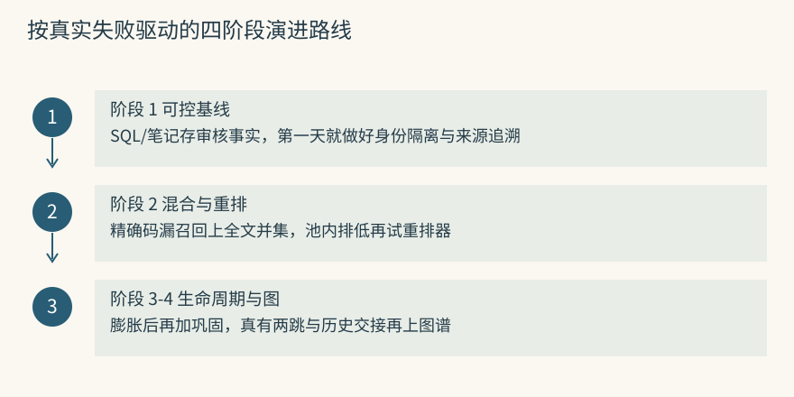
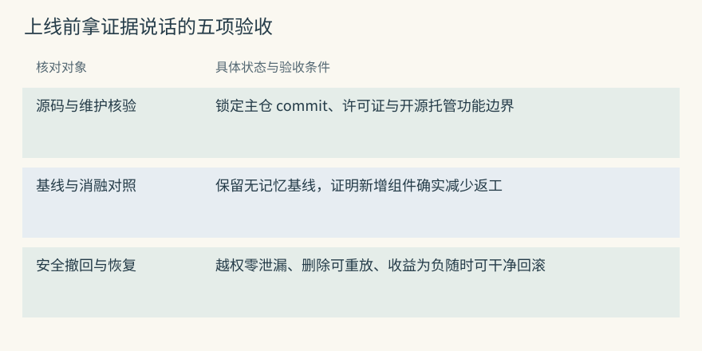

# 选型与演进路线

## 别按“谁火”选型，按你的“真实失败”选下一步

读完前面十六章，你可能发现自己手头攒了一桌子工具：SQLite、Mem0、Memobase、Graphiti、Cognee、HippoRAG、MemoryOS、Hippo、A-MEM、MemOS、Letta Code、Basic Memory、MCP、Agent Beacon、TencentDB、Hermes Jev……

**最容易把项目做死的方式，就是在第一天就把五个框架全装进架构图里。**

架构选型只有一条第一性原理：**拿你现在真实发生的失败，决定下一步只加哪一个最小组件。** 看看研发助手最常见的四种失败，它们需要的解法完全不一样：
1. **每次生成 PR 都忘了林远要求“中文 + 先给 diff”** → 这是**跨主题稳定偏好漏召回**，加一张按用户直读的配置表或稳定画像就解决了，根本不需要上图谱！
2. **搜 `PAY-409` 报错码搜不到，但库里明明存着** → 这是**精确标识符掉在向量初选池外**，把检索升级成“全文 + 向量独立并集”，别急着换更贵的重排模型。
3. **停用的老发版流程一直被推荐，或者问 11 月 2 日谁值班答错了** → 这是**版本替代与双时间缺失**，给规程加显式版本号/生效区间，真有高频历史交接再引入双时间图。
4. **核心支付组和大客户组两个 `billing-api` 串台了** → 这是**身份与租户隔离缺失**，立刻修鉴权和硬过滤，加再牛的重排器只会更精准地泄漏别人家机密。

## 动手买单前，先看看你现有的 Agent 运行时是不是已经给了一半

如果你已经在用像 **LangGraph** 这样的 Agent 编排框架，先别急着另起炉灶，把运行时自带的两种状态分清：
- **Checkpointer（线程快照）**：存单个对话线程（Thread）的执行状态，负责断点续跑、人工审批暂停恢复和单会话回溯；
- **Store（跨线程存储）**：存跨会话的键值对象（还支持可选语义索引），少量结构化的用户偏好和项目配置直接放 Store 里往往就够用。

先盘点清楚现有底座盖住了什么，只为**真的盖不住的缺口**（比如自动结构化抽取、双时间图、跨宿主 Trace 采集或团队多资产 ACL）引入外部记忆组件。

## 按真实验收驱动的四阶段演进路线

这套路线不是强制购物清单——如果你从第一天起核心业务就是多团队共享或强历史审计，完全可以直接补齐对应设计；它真正定义的是**风险与验收的递进顺序**。

### 阶段 1：跑通完全可解释的最小可控基线
- **做法**：少量人工审核过的团队规程 + 个人偏好表（SQL / 本地 SQLite / Basic Markdown / Mem0 `infer=False` 均可），第一天就把**服务端鉴权隔离、原始来源 ID、显式版本替代、Token 预算组装器和合规删除**立住。
- **验收**：攒出第 14 章那 10 道核心真题并跑绿，留作后续所有升级的永久对照组。

### 阶段 2：补齐混合并集检索与精排反馈
- **触发信号**：精确报错码（`PAY-409`）漏召回，或噪声候选把关键规程挤出 Top-5。
- **做法**：上“全文 + 向量独立并集”（如 SQLite FTS5 + 向量、MCP Memory Service）；确认必要证据都进了候选池只是排太靠后时，再在 `shadow` 模式下试点本地 Cross-Encoder 或 Hermes Jev（有注入风险或需充分性补查时优先考虑 Jev）。
- **验收**：固定相同 Token 预算和回答模型，验证全齐率提升，且拆开 `selected / packed / used / outcome` 埋点。

### 阶段 3：应对规模膨胀，引入分层与受控生命周期
- **触发信号**：库里积累了几百条过时记录，同义重复开始淹没新规程，或需要跨会话沉淀编码经验。
- **做法**：按痛点对症选型——编码 Agent 想人类可读、Git 审计自演化，重点看 **Letta Code（MemFS）** 或 **Hippo Memory**；托管开箱即用可评估 **Mem0（User Profiles + Dream）**；跨 20+ IDE 采集动作轨迹补 **Agent Beacon**。
- **验收**：所有自动巩固和遗忘先跑 `dry-run`，必须通过“低频高危灾难回滚规程不丢失”和“单次例外不污染长期规则”两项反例测试。

### 阶段 4：跨文档多跳、双时间历史与多团队资产治理
- **触发信号**：大量两跳审批链、频繁人员交接与晚到通知，或多团队多 Agent 共享知识库。
- **做法**：双时间与关系演化优先试用 **Graphiti**；异构文档/代码/会话统一数据工程平台评估 **Cognee**；纯多跳段落联想参考 **HippoRAG**；企业级多团队 ACL × Loadout 与代理注入评估 **TencentDB Agent Memory**。
- **验收**：同名服务零串台、晚到通知双时间轴全过、撤权扫清所有缓存与直读旁路、故障断网可安全重放。

## 比“什么时候升级”更重要的，是“什么时候果断撤回”

上线任何复杂记忆组件之前，先把**撤回条件**白纸黑字写下来：
- 上了图谱后多答对两道两跳题，却出现一次跨组同名误合并越权 → **立刻暂停自动建图**，收窄 Schema 或退回显式关系表；
- 开了自动衰减省了 20% Token，却把半年用一次的核心回滚规程藏没了 → **立刻关掉无保护衰减**；
- 接入某平台后发现跨库部分失败无法恢复，或者出现供应链安全告警 → **果断切回可控基线**。

撤回升级时记住一件事：**不仅要关开关，还要清理实验产生的派生摘要、强化计数和缓存污染**，保证你的基线干干净净。

## 场景速配表：不同需求从哪起步最省心

| 你的真实场景 | 推荐的最简起点 | 值得继续往上加组件的信号 |
|---|---|---|
| 只有十几条团队规程 + 个人偏好 | SQL 偏好表 + Markdown / 现有运行时 Store | 规则膨胀到人工维护不过来、频繁漏召回 |
| 想给现有业务快速接短事实记忆 | Mem0（先从 `infer=False` 基线对比自动抽取） | 核清 OSS 池边界与费用；需画像/巩固再评托管或外层补齐 |
| 编码 Agent 个人/小团队跨工具共享经验 | Letta Code（MemFS）或 Hippo Memory / Basic Memory | 需要跨 20+ 宿主动作 Trace 时补 Agent Beacon |
| 高频人员交接、晚到通知、双时间审计 | Graphiti（先拿极小 Episode 集验消歧与区间） | 显式关系表维护成本已明显高于图库运维成本 |
| 异构文档 + 代码 + 会话的企业知识管线 | Cognee（务必启用 v1.6.8+ 安全路径拦截） | 团队具备图+向量+关系三库运维与恢复能力 |
| 多客户端共享记忆与统一接入协议 | MCP Memory Service（v13.0+ 每 store 隔离） | 确实有多个异构客户端需要复用同一套后端 |
| 多团队多 Agent 共享资产、ACL 与 Skill 版本 | TencentDB Agent Memory | 存在跨部门权限隔离、Loadout 编排与统一撤权需求 |
| 检索后防提示注入、压缩噪音、判断证据够不够 | 本地 Cross-Encoder 或 Hermes Jev Skills（先 shadow） | 确认上游候选池已覆盖，只是精排/安全/补查卡脖子 |

上线前拿证据说话的五项最终检查表（选读）

不要交一份空泛的“勾选框”，上线评审时把下面五份可复查的真材料拍在桌上：
1. **锁定版本与安全账单**：精确仓库 URL、commit hash、洁净包版本与哈希、开源许可证（重点留意 AGPL-3.0 等分发条款）以及 OSS vs 托管功能边界；
2. **交付契约与架构边界图**：写明谁留原始日志、谁管唯一写入主权、谁做服务端鉴权、谁是唯一的最终 Prompt 组装器；
3. **10 题真失败回归 + 无记忆对照报告**：逐题给出写入、检索、打包、回答和 Token/延迟数据，证明净收益大于成本；
4. **两条负面安全演练日志**：跨租户同名服务零越权日志（覆盖全出口）+ 含哨兵串的隐私删除与备份恢复重放验收记录；
5. **故障演练与撤回预案**：断模型、断权限服务、跨存储部分失败的真实演练记录，以及收益为负时的干净回滚步骤。

## 动手检查

挑一条你当前正在做（或准备做）的 AI 应用里最真实的一个“忘事/答错”缺陷，写出三行诊断卡：
1. 答对这件事缺一不可的**原始来源**是什么？
2. 第一次偏离预期发生在**写入、检索初选、重排打包、还是模型使用**哪一层？
3. 你打算**只改哪一个最小机制**来验证假设，并保留什么对照组防止改出新退化？

答案提示：如果连候选列表和最终 Prompt 里到底装了什么都说不清，**第一步根本不该选任何新框架，而是先补齐最小观测日志**！明确首次偏离层之后，再按“写入错改提取与留底、池外漏改全文并集、池内排低试重排、打包丢改原子化与预算、用错改提示与工具硬约束”精准下手，每次只动一处并拿回归集和无记忆基线对照验收。

<figure class="concept-diagram" tabindex="0"><figcaption>图：好的记忆架构不是堆出来的，而是靠真实失败一步步验出来的——每一步都进可攻、退可守。</figcaption></figure>

横向查阅表（选读）

## 本章对照结论

| 候选方案 | 引入它的最硬理由 | 必须保留的极简对照 | 试用结项必须交出的硬材料 |
|---|---|---|---|
| Mem0 | 快速接入短事实 SDK（托管补 Profile/Dream） | 审核文本 + SQL / FTS5 | 抽取保真、池外 `PAY-409`、删除历史与费用 |
| Memobase | 学习 buffer/flush 与画像热读取思想 | 显式用户配置表 | `flush` 延迟、例外防污、并发锁与自维护方案 |
| Graphiti | 跨文档关系、双时间历史与 `SagaNode` | 带有效期的关系表 | 同名消歧、晚到交接、删源重建与图库运维账本 |
| Cognee | 异构文档/代码/会话统一 Schema 管线 | 固定分块 + 混合检索 | 路由对比、SSRF 防护、跨三库中断恢复 |
| HippoRAG | 跨文档无字面重合的多跳段落联想 | BM25 / Dense / Hybrid | 同预算第二跳净收益与建图开销 |
| Letta Code | Agent 自管理 MemFS + Git 透明审计 | 固定核心 + 历史搜索工具 | `commit` 编译生效、worktree 隔离与主动调用率 |
| Hippo / MemoryOS / A-MEM | 衰减反馈 / 分层页搬运 / 邻居演化 | 静态评分 + 显式版本替代 | 独立时间回放消融、低频高危保护与误强化测试 |
| MemOS | 统一容器与异步调度（探索 KV/LoRA） | 单文本库 + 标准消息队列 | 洁净版本安全核验、队列延迟与资源兼容性 |
| Basic / MCP / TencentDB | Markdown 真相源 / 多端协议 / 团队 ACL | 普通文档库 + 轻量鉴权 | 同步冲突、每 store 隔离、撤权全旁路拒绝 |
| Beacon / Hermes | 跨宿主动作 Trace / 检索后防注入与充分性闸门 | 原生日志 / 本地 Cross-Encoder | `fidelity` 覆盖、外发脱敏、`shadow` 对比与降级 |

