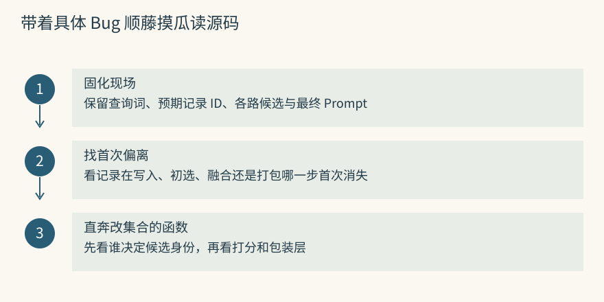
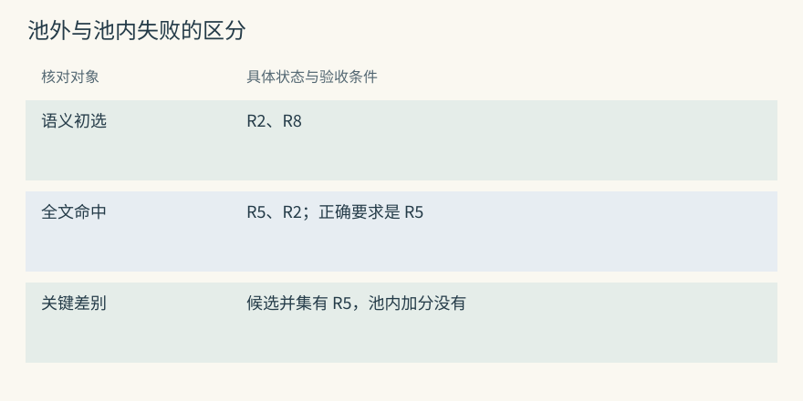
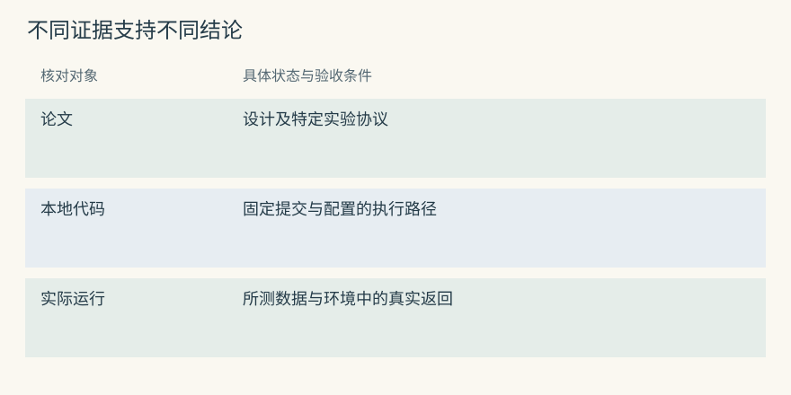
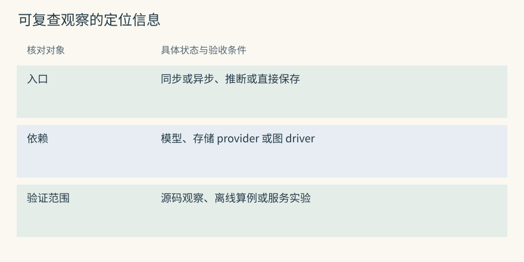
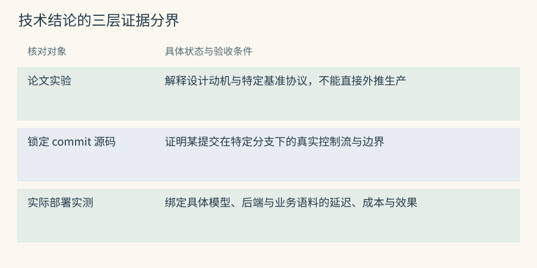

# 源码与论文索引

## 从一个问题开始读源码

借展清单遗漏了“内托尺寸含两侧缓冲层”，但搜索结果里明明出现过这条要求。阅读代码时先带上这次失败的输入、记录 ID 与最终消息：它是在初选外、被排序压下，还是取回后没有装入输入？三个位置需要追不同函数。

可以先定位 Mem0 的候选构造与评分入口：

```bash
rg -n 'def (_search_vector_store|_compute_entity_boosts)' \
  sources/repos/mem0/mem0/memory/main.py
```

找到定义后，记录参数来自谁、返回值交给谁，再沿真正改变集合的调用往下读。异常包装和配置继承可以暂缓，除非它们改变了本次分支。对于 Graphiti，则从问题对应的边开始，核对端点、来源和日期条件，而非先遍历全部节点。

<details class="source-example">
<summary>代码入口与结论边界（选读）</summary>



### Mem0：从实际函数与提示双向核对

在 [主流程](../../sources/repos/mem0/mem0/memory/main.py) 中，先确认实际使用的是推断写入、直接保存还是过程摘要分支。提示词描述提取意图，函数的写操作决定哪些记录真的新增或变化。不要仅依据 docstring 中的 CRUD 名称判断整个路径会自动执行更新与删除。

之后到 [历史存储](../../sources/repos/mem0/mem0/memory/storage.py) 查消息、变更和正文分别留下什么。业务记录消失与所有历史副本清除不是同一事件，应独立检查。

### Graphiti：从 orchestration 追 maintenance

[写入编排](../../sources/repos/graphiti/graphiti_core/graphiti.py) 将 episode 交给抽取、解析和保存流程。以一份“东馆外借需经文保部复核”的通知为输入，标出材料 ID、规范部门 ID 和许可边 ID；三者不可混用。

需要解释旧关系何时关闭时，进入 [边维护](../../sources/repos/graphiti/graphiti_core/utils/maintenance/edge_operations.py)，核对 resolved、invalidated、new 集合的成员和写回时机。函数返回某个集合，并不自动证明所有后端操作都已完成。

</details>

## 用纸笔记录三个集合

设向量路初选为 `{R2,R8}`，全文路为 `{R5,R2}`，正确的尺寸要求是 R5。若后续只遍历向量初选加分，R5 根本没有参加排序；若合并两路身份，才会出现 `{R2,R5,R8}`。先写身份，再看分数，可避免把漏召回误诊为重排失败。

用同样方法追 MCP 的混合存储、A-MEM 的邻居返回与 Letta 的文件版本：发生过处理的对象，不一定成为最终读取对象。中间集合和最终消费集合都要保留，才能解释一段优化是否产生实际影响。

<details class="source-example">
<summary>集合变化与返回对象（选读）</summary>



### Mem0：semantic 集合决定 candidate 身份

对当前快照，分别记录语义搜索、关键词命中和实体关联分数，再核对 candidates 的构造来源。若身份由 semantic results 提供，其他信号只能改变已有成员的得分。explain 说明参加评分的对象，不包含从未入池的漏项。

换一个 vector store 或升级版本后，应重新跑同一池外样例，不能把本次控制流观察当成所有部署的永久保证。

### Graphiti：UUID 并集与各路名次同时保留

在 [搜索实现](../../sources/repos/graphiti/graphiti_core/search/search.py) 中追 `edge_search()` 的多路结果与 UUID 映射，再查看本次排序方法。RRF 消费名次，cross-encoder 消费截断后的问题与事实文本，它们对候选范围有不同前提。

[搜索配方](../../sources/repos/graphiti/graphiti_core/search/search_config_recipes.py) 说明启用哪些路。基础边搜索、邻域扩展和更复杂的查询组织要区分，不能因为存了图就声称任意问题都会自动走完多跳。

</details>

## 用论文学习机制，再核对当前代码

把论文读成可复算的实验：作者怎样定义问题、以什么单位索引、选哪些种子、怎样检索、把结果交给哪个 reader。随后用馆藏对象、外借部门与复核人构造小例，检查该机制需要哪些证据。

再回当前源码寻找实际路径。HippoRAG 的不同版本可能改变事实与段落种子组织；时间图的字段和过滤也可能超出早期论文图。论文用于理解设计依据，不能替代当前分支和后端的行为核对。

<details class="source-example">
<summary>研究设定与实现版本（选读）</summary>



### Mem0：论文路线与当前 batch 实现分开记

论文实验可能使用特定抽取、更新和评测流程，当前普通批量路径则需检查 additive prompt、embedding 和实体链接等实际操作。记下实验数据、reader、记忆粒度与交付物是 OSS 还是托管服务，再判断哪些结论可迁移。

如果新通知只生成追加事实，不能用论文中的更新箭头解释旧事实已经结束。运行结果应另存输入、配置与输出，不与阅读笔记混在一起。

### Graphiti：时间思想要核对字段和过滤

[边字段](../../sources/repos/graphiti/graphiti_core/edges.py) 允许表达关系的有效时间和系统记录时间，[过滤实现](../../sources/repos/graphiti/graphiti_core/search/search_filters.py) 决定查询如何使用这些信息。

用“11 月 1 日交接、11 月 4 日才收到通知”分别问现实历史与当时已知状态。即使字段齐全，若查询没有施加对应条件，答案仍可能错误。保存日期和正确使用日期是两项验收。

</details>

## 给自己的结论留一个可复查的小注释

一条技术结论至少附代码提交、入口、实际配置和证据类型。比如“当前同步推断路径中，只观察到某集合参与评分；尚未运行其他后端”。这种范围声明便于后来判断升级使哪条结论失效。

若真的做了实验，再附材料版本、请求、结果与失败例。不要把“官方宣称”“读到代码”“离线模拟”和“实际服务返回”都写成一个没有条件的“支持”。

<details class="source-example">
<summary>可重查的观察记录（选读）</summary>



### Mem0：记录分支、provider 与已验证范围

说明本次采用 `infer=True` 还是直接写入、同步还是异步入口，以及模型和存储 provider。对于关键词池外漏项、history 中保留旧正文等观察，标出对应函数及测试范围，不扩展成所有托管部署都一样。

复查时优先重跑最小反例。若配置或候选构造变化，再更新结论，而非只检查同名 API 仍能导入。

### Graphiti：记录配置、driver 与对象粒度

注明搜索对象是边、节点还是材料，采用哪种 recipe、driver 与时间过滤。移除 episode 的实验还应检查共享来源、事实边和摘要，不能仅确认材料 ID 不再返回。

把查询结果和模型最终输入分开保存。图中能找到一条关系，不证明它已被本次回答使用，也不证明支持它的原文仍可授权回查。

</details>

## 动手检查

将“这套系统能持续学习”改成一个可失败的问题，并列出至少一个中间对象和一个最终验收结果。

答案提示：可以问“借展规程经修订并提交后，下一次调用是否读取新版本；旧来源删除时，摘要和缓存是否仍含原内容？”先固定版本和输入，再观察真实读取。仅有 improve 或 delete 方法名无法回答这两个问题。

<details class="implementation-notes">
<summary>定位资料与引用范围（选读）</summary>

## 本地源码

以下路径相对于 `sources/repos/`，仅提供阅读起点。许可需连同目标模块和当前交付版本核对。

| 项目 | 优先查看的对象 | 定位位置 | 归档许可说明 |
|---|---|---|---|
| Mem0 | 事实写读与历史 | `mem0/memory/main.py` | Apache-2.0 |
| Letta Code | 文件规则与编译入口 | `letta-code/src/agent/prompts/letta_root_memfs.md` | Apache-2.0 |
| Graphiti | episode 与关系 | `graphiti/graphiti_core/graphiti.py` | Apache-2.0 |
| Cognee | remember / recall / improve | `cognee/cognee/api/v1/` | Apache-2.0，按模块复查 |
| MemOS | 记忆容器与资源模块 | `memos/src/memos/` | Apache-2.0 |
| MemoryOS | 页面、主题与长期结果 | `memoryos/memoryos-pypi/` | Apache-2.0 |
| A-MEM | 描述与邻接演化 | `a-mem/agentic_memory/memory_system.py` | MIT |
| HippoRAG | 图种子与段落读取 | `hipporag/src/hipporag/HippoRAG.py` | 以归档仓库为准 |
| Memobase | 输入缓冲与画像 | `memobase/src/server/` | Apache-2.0 |
| Hippo Memory | 寿命、反馈与巩固 | `hippo-memory/src/` | MIT |
| Basic Memory | 文件解析与上下文 | `basic-memory/src/basic_memory/` | AGPL-3.0 |
| MCP Memory Service | 多客户端存储接口 | `mcp-memory-service/src/mcp_memory_service/` | Apache-2.0 |
| Agent Beacon | 动作采集与转发 | `agent-beacon/endpoint/`、`docs/` | MIT |
| TencentDB Agent Memory | 资产与层级注入 | `tencent-agent-memory/MemoryCore/`、`MemoryProxy/` | MIT |
| Hermes Jev Skills | 候选判别与继续搜索 | `hermes-jev-skills/jevkit/` | MIT |

另有历史 `letta-ai/letta` 副本用于核对仓库迁移。资料合计 16 仓，并不意味着旧仓仍是当前产品的推荐入口。

## 本次扩写的机制证据

机制核对沿三类变化组织。写入侧查看 Mem0 的批量提取、Memobase 的 buffer/flush、Graphiti 的 resolution 与 Cognee 的管线路由；它们保存和改变的对象并不相同。

读取侧比较 HippoRAG 的 fact/passage seeds 与 PPR、MCP 混合存储的身份合并、Hermes 的判别和不充分时继续搜索。先确定候选从哪来，再看评分，最后看宿主实际装入的内容。

长期演化则追 MemoryOS 的 page/session 提升、Hippo 的 outcome 与 sleep、A-MEM 的邻居属性及索引刷新、Letta Code 的文件提交与后续编译。MemOS 的资源与 scheduler、TencentDB 的资产版本、Basic 的文件同步和 Beacon 的采集保真各有独立责任。

这些说明依赖既有 2026-09-21 资料快照，未重新采集上游维护数据。每章保留更具体的入口和适用条件，不宣称已运行全部模型、后端或长期 benchmark。

## 论文原文

原始 PDF 及其搜索文本分别归档于 `sources/papers/pdf/` 和 `sources/papers/text/`。检索标识保持原值，以便回到完整实验设定。

| 标识 | 文献与核对重点 |
|---|---|
| arXiv:2310.08560 | Packer 等，MemGPT，有限窗口中的主动上下文管理 |
| arXiv:2402.17753 | Maharana 等，LoCoMo，长对话材料与评测协议 |
| arXiv:2405.14831 | Gutiérrez 等，HippoRAG，关联图与段落检索 |
| arXiv:2410.10813 | Wu 等，LongMemEval，长期交互中的能力切分 |
| arXiv:2501.13956 | Rasmussen 等，Zep，时间知识图的组织 |
| arXiv:2502.12110 | Xu 等，A-MEM，笔记演化与连接 |
| arXiv:2502.14802 | Gutiérrez 等，From RAG to Memory，非参数持续学习 |
| arXiv:2504.19413 | Chhikara 等，Mem0，事实记忆及相应实验 |
| arXiv:2505.24478 | Markovic 等，知识图与 LLM 接口优化 |
| arXiv:2506.06326 | Kang 等，Memory OS of AI Agent，层级管理 |
| arXiv:2507.03724 | Li 等，MemOS，记忆资源的统一组织 |

## 证据使用约定

论文数值只属于相应数据、模型和评分协议；README 自报结果需明确标作项目报告。未经独立重跑，不将它们写成此次复现。不同 reader、候选池和数据切分的分数不能拼成统一排名。

维护数据同样有日期。上线前另查当前主仓、发布、安全公告和许可，不能用旧快照替代现在的风险评估。

## 进一步阅读顺序

先用 MemGPT 建立窗口与存储的区别，再看短事实写读；跨资料关联需求出现后进入时间图和 HippoRAG。生命周期部分将层级组织、反馈价值与演化笔记分开比较，避免把一切状态变化统称学习。

随后用 LoCoMo 与 LongMemEval 理解实验单位，最后回到 SDK、服务或运行时的接入合同。研究路线不要求安装所有项目，阅读的目标是解释同一失败在不同机制中会怎样处理。

## 按技术问题复核，而不是只读 README

候选问题追到过滤、身份合并和最终截断；演化问题追到真实写操作及之后的读取；接入问题画出原文、索引、摘要、转发和缓存副本。宣传中的功能名不能代替这些对象关系。

例如一次共享资料撤回，应分别核对授权集合、旧 ID 回查、派生摘要和客户端缓存。算法论文不能证明删除完整，许可证也不能证明权限实现正确。按证据类别拆开问题，才知道还缺哪种验证。

</details>

<figure class="concept-diagram" tabindex="0"><figcaption>图：从技术主张回到能支持它的证据；尚未验证的条件单独保留。</figcaption></figure>

<details class="comparison-reference">
<summary>跨项目复核入口（选读）</summary>

## 本章对照结论

| 待回答的问题 | 要看到的状态 | 可选核对对象 | 不能据此扩大宣称 |
|---|---|---|---|
| 原话变成什么 | 候选、正文与来源 | Mem0、Memobase、Graphiti | 未测后端的质量 |
| 为什么没被找到 | 各路身份与最终池 | MCP、HippoRAG、Hermes 等 | 统一性能胜负 |
| 旧结论何时退出 | 有效区间、替代与版本 | Graphiti、MemoryOS、Letta 等 | 长期收益必然成立 |
| 删除是否彻底 | 原文及所有派生副本 | Basic、MemOS、TencentDB 等 | 仅凭 API 的隐私保证 |
| 新任务是否真的改善 | 最终输入、动作与结果 | 运行时和业务工具共同检查 | 教学算例等于生产认证 |

</details>
